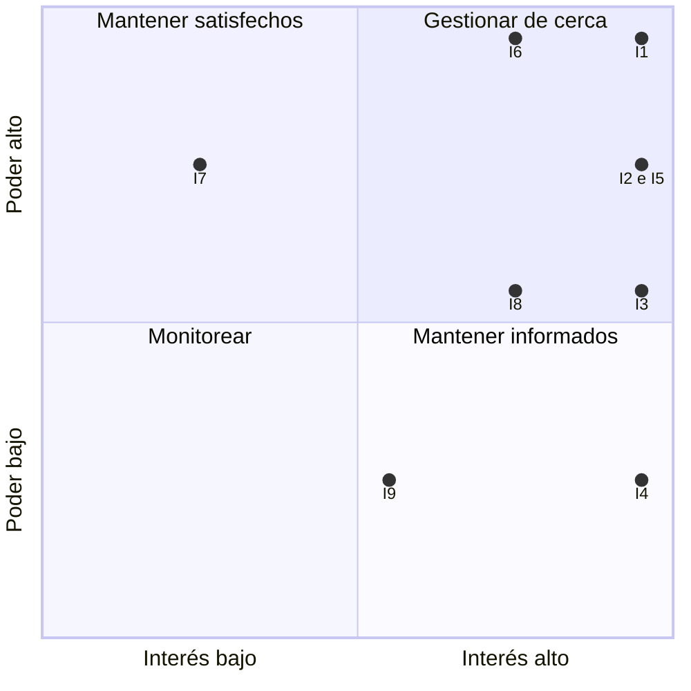
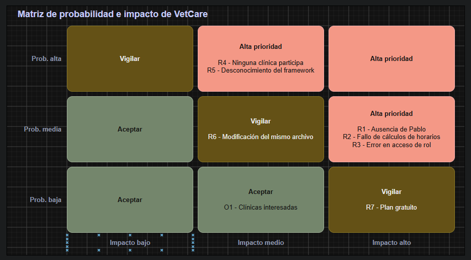

# VetCare

## Sección 00: Portada e identificación del equipo

**Nombre del proyecto:** VetCare — Sistema de gestión de atención veterinaria.

**Universidad:** Universidad Técnica Nacional (UTN), Sede San Carlos.

**Curso:** Administración de Proyectos Informáticos.

**Periodo académico:** III cuatrimestre de 2026, grupo SC-02.

**Docente:** Yesenia Calvo Araya.

**Integrantes del curso:**
- Jose Pablo Soto Quesada.
- Maikel Chaves Salas.
- Edgar Eliam Araya Alvarado.

**Equipo de desarrollo de VetCare:**

| Integrante | Rol |
| --- | --- |
| Jose Pablo Soto Quesada | Product Owner y Developer |
| Maikel Chaves Salas | Scrum Master y Developer |
| Edgar Eliam Araya Alvarado | Developer |
| Daniel Rojas | Developer Backend |
| Valeria Méndez | Developer Frontend y QA |

**Fecha de inicio del proyecto:** Septiembre de 2026.

**Última actualización del expediente:** 23 de noviembre de 2026.

**Metodología de gestión:** Enfoque híbrido basado en los procesos de dirección de proyectos del PMI y el marco de trabajo Scrum.

**Repositorio del proyecto:** https://github.com/jpablosq/Proyecto-Admin

---

## Sección 01: Problema, oportunidad y Product Goal

### Problema

Las clínicas veterinarias necesitan administrar información de diferentes clientes y sus mascotas, pero en algunos casos estos datos pueden encontrarse registrados en documentos físicos, hojas de cálculo o diferentes medios de comunicación. Esto puede dificultar el acceso y control de la información. Además, un mismo cliente puede tener varias mascotas, por lo que es necesario mantener organizada la información de cada una de ellas de manera independiente. También puede ser complicado para los médicos veterinarios consultar rápidamente el historial de una mascota, sus consultas anteriores, vacunas, tratamientos y próximas citas. La falta de un sistema centralizado puede generar pérdida de información, dificultades para organizar las citas y mayor tiempo para consultar los datos de los pacientes.

Este planteamiento se basa en lo que el equipo conoce del trabajo en clínicas veterinarias. No proviene de un estudio ni de una clínica en particular.

### Proyecto propuesto

Desarrollar un sistema web para la gestión de una clínica veterinaria, dirigido tanto a los clientes como a los médicos veterinarios. El sistema permitirá a los clientes registrarse y administrar su información, así como registrar una o varias mascotas asociadas a su cuenta. También podrán consultar la información de sus mascotas y gestionar sus citas. Por otra parte, los médicos veterinarios podrán consultar sus citas y acceder al expediente de cada mascota para registrar y consultar información relacionada con las consultas, diagnósticos, tratamientos, vacunas y observaciones. El sistema permitirá centralizar la información y mantener una relación organizada entre los clientes y sus mascotas, de manera que cada mascota tenga su propio historial de atención veterinaria.

### Valor esperado

Con el sistema, la información de clientes y mascotas queda en un solo lugar. Cada cliente puede registrar y administrar varias mascotas, y cada mascota tiene su propio expediente con consultas, tratamientos y vacunas. Los médicos veterinarios consultan el historial de sus pacientes desde el sistema y las citas se registran y consultan en línea. Los clientes pueden ver la información y el historial de atención de sus mascotas. Se busca reducir la dependencia de documentos físicos y registros dispersos, y llevar un mejor control de la atención de cada paciente.

### Objetivo general

Desarrollar un sistema web para la gestión de una clínica veterinaria que permita administrar la información de clientes, mascotas, médicos veterinarios, citas e historiales médicos, y dar seguimiento a la atención de cada mascota.

### Objetivos específicos

1. Analizar los procesos relacionados con la administración de clientes, mascotas, citas e información médica dentro de una clínica veterinaria.
2. Diseñar una base de datos que permita relacionar a los clientes con una o varias mascotas y almacenar de manera organizada la información de cada paciente.
3. Desarrollar un módulo para el registro y administración de clientes, permitiendo mantener actualizada su información personal y de contacto.
4. Implementar un módulo que permita a los clientes registrar y administrar varias mascotas asociadas a su cuenta.
5. Desarrollar un módulo de gestión de citas que permita registrar, consultar y administrar las citas de las mascotas.
6. Implementar un expediente médico digital para cada mascota, permitiendo registrar consultas, diagnósticos, tratamientos, vacunas y observaciones.
7. Desarrollar funcionalidades para que los médicos veterinarios puedan consultar el historial médico de sus pacientes y registrar nueva información durante las consultas.
8. Permitir que los clientes puedan consultar la información y el historial de atención de sus mascotas.
9. Implementar diferentes niveles de acceso para clientes y médicos veterinarios, de acuerdo con las funciones que corresponden a cada tipo de usuario.
10. Realizar pruebas del sistema para verificar el correcto funcionamiento de sus principales módulos y que la información se gestione de manera adecuada.

### Product Goal

Definir una primera versión de VetCare como sistema web de gestión veterinaria, orientada a centralizar la información de propietarios, mascotas, médicos veterinarios, citas y expedientes clínicos.

El producto propuesto deberá contemplar diferentes niveles de acceso según el tipo de usuario, permitir la administración de múltiples mascotas por propietario y mantener un historial clínico independiente para cada paciente.

Durante el proyecto académico, este objetivo servirá para orientar la definición del alcance, la priorización del Product Backlog, la planificación de los Sprints y la evaluación de los resultados documentados.

### Acta de constitución del proyecto (Project Charter)

**Nombre del proyecto:** VetCare — Sistema de gestión de atención veterinaria.

**Fecha de inicio:** 16 de septiembre de 2026.

**Fecha de actualización del acta:** 23 de noviembre de 2026.

**Tipo de proyecto:** Desarrollo de software para la gestión de procesos veterinarios.

**Justificación:**

La información de propietarios, mascotas y atenciones veterinarias puede encontrarse distribuida entre registros físicos y herramientas independientes, lo que dificulta su consulta, actualización y seguimiento.

VetCare propone desarrollar una plataforma web centralizada que permita administrar propietarios, mascotas, citas y expedientes clínicos, mejorando la organización de la información y facilitando el acceso según las responsabilidades de cada usuario.

**Objetivo del proyecto:**

Desarrollar y gestionar una solución web para clínicas veterinarias mediante un enfoque híbrido de dirección de proyectos y Scrum, utilizando una planificación iterativa que permita controlar el alcance, las estimaciones, los recursos, los riesgos, la calidad y el cronograma.

**Alcance del proyecto:**

La solución contempla las siguientes funcionalidades:

- Registro e inicio de sesión de usuarios.
- Administración de propietarios y mascotas.
- Gestión de médicos veterinarios.
- Control de acceso según roles.
- Programación, consulta y cancelación de citas.
- Registro de consultas, diagnósticos y tratamientos.
- Control y seguimiento de vacunas.
- Consulta de expedientes clínicos e historiales médicos.

**Exclusiones:**

No se incluyen los módulos de facturación, inventario, hospitalización, administración de múltiples sucursales, aplicaciones móviles nativas ni integraciones con plataformas externas.

**Conformación del equipo:**

El proyecto inició con tres integrantes responsables de la planificación, organización y desarrollo de las primeras funcionalidades.

Posteriormente, se aprobó la contratación de dos profesionales adicionales para fortalecer las áreas de desarrollo y aseguramiento de calidad.

| Integrante | Rol | Responsabilidad principal |
| --- | --- | --- |
| Jose Pablo Soto Quesada | Product Owner y Developer | Gestión del Product Backlog, prioridades, alcance y decisiones del producto. |
| Maikel Chaves Salas | Scrum Master y Developer | Coordinación del proceso Scrum, seguimiento y gestión de impedimentos. |
| Edgar Eliam Araya Alvarado | Developer | Desarrollo, pruebas funcionales y documentación. |
| Daniel Rojas | Developer Backend | Servicios, lógica de negocio y base de datos. |
| Valeria Méndez | Developer Frontend y QA | Interfaces, experiencia de usuario y pruebas funcionales. |

**Capacidad de trabajo:**

La capacidad inicial del equipo era de 47 horas por Sprint, distribuidas entre tres integrantes.

Con la incorporación de los dos profesionales contratados, la capacidad planificada aumenta a 79 horas por Sprint completo.

La capacidad efectiva de cada iteración se ajustará según la disponibilidad de los integrantes y la fecha de incorporación de los nuevos recursos.

**Presupuesto:**

| Concepto | Costo estimado por Sprint completo |
| --- | ---: |
| Contratación de Daniel Rojas | ₡96.000 |
| Contratación de Valeria Méndez | ₡80.000 |
| Subtotal | ₡176.000 |
| Reserva de contingencia (10 %) | ₡17.600 |
| **Presupuesto total estimado** | **₡193.600** |

Los integrantes iniciales se consideran recursos internos. Los costos de contratación corresponden a las horas presupuestadas de los profesionales incorporados.

La utilización de recursos adicionales deberá revisarse y autorizarse conforme al procedimiento de control de cambios.

**Enfoque de gestión:**

Se utilizará un enfoque híbrido que combine los procesos de dirección de proyectos del PMI con el marco Scrum.

El trabajo se organizará en Sprints de dos semanas, utilizando el Product Backlog, Sprint Backlog, eventos Scrum y mecanismos de seguimiento para controlar el progreso.

**Restricciones principales:**

- Cumplir con el calendario oficial de entrega del proyecto.
- Administrar la capacidad disponible de los cinco integrantes.
- Mantener los costos de contratación dentro del presupuesto autorizado.
- Priorizar las historias de usuario según su valor y sus dependencias.
- Cumplir los criterios de aceptación y la Definition of Done.
- Utilizar datos de prueba para proteger la información de los usuarios.
- Considerar que todavía no existe una clínica confirmada para realizar validaciones operativas.

**Supuestos del proyecto:**

- Los requerimientos iniciales podrán ajustarse mediante el refinamiento del Product Backlog.
- Los profesionales contratados dispondrán de los accesos y recursos necesarios para desarrollar las tareas asignadas.
- Los servicios tecnológicos podrán utilizarse inicialmente mediante planes gratuitos.
- Las estimaciones de esfuerzo y velocidad se actualizarán según los resultados de los Sprints.
- Las funcionalidades se priorizarán para cumplir con los límites de tiempo y presupuesto.

**Entregables previstos:**

1. Product Backlog priorizado y actualizado.
2. Planificación y seguimiento de los Sprints.
3. Funcionalidades del sistema verificadas según los criterios de aceptación.
4. Registro de pruebas y cumplimiento de la Definition of Done.
5. Matrices de riesgos, responsabilidades y presupuesto.
6. Registro de decisiones, cambios y resultados del proyecto.
7. Expediente completo y demostración del incremento alcanzado.

**Responsable de la gestión del producto:** Jose Pablo Soto Quesada.

**Responsable de la coordinación Scrum:** Maikel Chaves Salas.

**Control de cambios:**

Toda modificación que afecte el alcance, el cronograma, el presupuesto o los recursos deberá registrarse y evaluarse. El Product Owner será responsable de aprobar los cambios de prioridad y alcance, mientras que los Developers revisarán sus implicaciones técnicas y de esfuerzo.

### Definición del Scrum Team

El equipo Scrum de VetCare está conformado por cinco integrantes, organizados según las responsabilidades establecidas en la Guía Scrum (Schwaber y Sutherland, 2020).

Inicialmente, el proyecto contaba con tres integrantes: Jose Pablo Soto Quesada, Maikel Chaves Salas y Edgar Eliam Araya Alvarado. Conforme avanzó la planificación, se identificó la necesidad de aumentar la capacidad de trabajo para atender las historias de usuario, fortalecer las actividades técnicas y cumplir con el cronograma establecido.

Por esta razón, se aprobó la contratación de dos profesionales adicionales: Daniel Rojas, especializado en desarrollo backend, y Valeria Méndez, especializada en desarrollo frontend y aseguramiento de calidad.

Con estas incorporaciones, el equipo quedó conformado de la siguiente manera:

| Integrante | Rol Scrum | Responsabilidades |
| --- | --- | --- |
| Jose Pablo Soto Quesada | Product Owner + Developer | Administrar y priorizar el Product Backlog, definir los criterios de aceptación, coordinar las necesidades de los interesados y apoyar las actividades de desarrollo. |
| Maikel Chaves Salas | Scrum Master + Developer | Facilitar los eventos Scrum, gestionar impedimentos, mantener actualizado el tablero de seguimiento y participar en las actividades técnicas. |
| Edgar Eliam Araya Alvarado | Developer | Desarrollar funcionalidades, realizar pruebas funcionales y de permisos y mantener actualizada la documentación del proyecto. |
| Daniel Rojas | Developer Backend | Diseñar e implementar la lógica del servidor, apoyar la administración de la base de datos y desarrollar los servicios relacionados con usuarios, citas y expedientes clínicos. |
| Valeria Méndez | Developer Frontend | Diseñar e implementar las interfaces de usuario, mejorar la experiencia de navegación y colaborar en las pruebas funcionales del sistema. |

#### Ampliación y distribución del equipo

La contratación de Daniel Rojas y Valeria Méndez responde a la necesidad de distribuir mejor la carga de trabajo, reducir la dependencia de integrantes específicos y fortalecer las áreas de desarrollo y calidad.

La ampliación permite organizar las responsabilidades de acuerdo con las competencias de cada integrante y aumentar la capacidad disponible para los siguientes Sprints.

El Sprint 1 conserva su planificación y resultados originales, correspondientes al equipo inicial de tres personas. La nueva conformación se considera en la planificación de las siguientes iteraciones.

Como parte de esta actualización, se revisarán las estimaciones de esfuerzo, los responsables de las tareas, los costos de personal y el cronograma del proyecto.

#### Roles adicionales para el futuro

| Rol | Cuándo se necesita | Asignación propuesta |
| --- | --- | --- |
| Responsable de base de datos (DBA) | Diseño del modelo de datos y respaldos | Jose Pablo |
| Responsable de pruebas (QA) | Planificación y ejecución de pruebas funcionales y de permisos | Valeria Méndez, con apoyo de Edgar Eliam Araya |
| Responsable de interfaz (UX/UI) | Prototipos y pruebas de usabilidad | Jose Pablo |
| Responsable de despliegue (DevOps) | Alojamiento y puesta en línea | Maikel |
| Responsable de documentación | Manual de usuario y actualización de este documento | Eliam, con apoyo de los demás |

### Visión a futuro: modelo de negocio

A largo plazo, la plataforma podría ofrecerse como un servicio en la nube por suscripción (SaaS) para clínicas veterinarias, con estos planes:

| Plan | Precio mensual | Enfoque |
| --- | --- | --- |
| Essential | ₡29.900 | Consultorios y clínicas pequeñas con un veterinario. |
| Professional | ₡59.900 | Clínicas en crecimiento, hasta 3 veterinarios. |
| Clinic | ₡99.900 | Clínicas con varias sucursales, hasta 8 veterinarios. |
| Enterprise | Personalizado | Organizaciones con varias compañías y regiones. |

Los precios son una estimación del equipo y no se basan en un estudio de mercado. Esta visión queda solo como referencia. El proyecto del curso es una versión inicial con fines académicos, limitada a las funcionalidades descritas en los requerimientos.

## Sección 02: Contexto organizacional y restricciones

### Factores ambientales de la empresa (EEF)

La Guía del PMBOK (PMI, 2017) llama factores ambientales de la empresa a las condiciones que el equipo no controla y que afectan al proyecto. Para VetCare se identifican los siguientes.

| Factor | Efecto en VetCare |
| --- | --- |
| Infraestructura tecnológica (hosting, base de datos, herramientas) | Define dónde se despliega el sistema y sus límites de uso |
| Cultura organizacional de la clínica | Afecta la adopción del sistema frente a los registros físicos |
| Normativa legal y de privacidad de datos | Obliga a controlar accesos y proteger la información |
| Distribución del equipo (presencial o remoto) | Condiciona la coordinación entre los cinco integrantes y la comunicación durante los Sprints. |
| Disponibilidad de usuarios para pruebas | Afecta la calidad de la validación |
| Calendario académico | Limita el tiempo y el alcance posible |

### Activos de los procesos de la organización (OPA)

Los activos de los procesos de la organización son documentos, procedimientos, herramientas y conocimientos que pueden reutilizarse para gestionar el proyecto. A diferencia de los factores ambientales, estos recursos pueden actualizarse conforme el equipo adquiere experiencia.

En VetCare se consideran los siguientes activos disponibles o en elaboración dentro del equipo académico:

| Activo | Estado | Aplicación en VetCare |
| --- | --- | --- |
| Repositorio de GitHub | Disponible | Centraliza el expediente y conserva el historial de cambios. |
| Plantillas de historias de usuario | Disponibles | Permiten documentar necesidades, criterios de aceptación, prioridades y estimaciones. |
| Product Backlog | Disponible | Organiza y prioriza el trabajo propuesto para el proyecto. |
| Tablero de Jira | Documentado | Permite organizar tareas, responsables y seguimiento de los Sprints. |
| Matriz de riesgos | Disponible | Registra riesgos, prioridades, responsables y respuestas previstas. |
| Registro de impedimentos y retrospectivas | Documentado | Recoge dificultades, decisiones y oportunidades de mejora. |

Estos activos se revisan durante la planificación y al cierre de cada Sprint para mantener la consistencia de la documentación y aprovechar las lecciones aprendidas.

### Estructura organizacional

La Guía del PMBOK (PMI, 2017) distingue estructuras funcionales, matriciales y orientadas a proyectos según la autoridad que tiene el director de proyecto. Como todavía no hay una clínica confirmada, la estructura de la clínica es una suposición del equipo. Una clínica pequeña suele tener una estructura funcional. La dirección (I1) decide sobre los recursos y la puesta en uso, y el personal tiene tareas fijas de atención. En ese contexto el equipo tiene poca autoridad dentro de la clínica y depende de que la dirección apruebe los cambios y dé acceso a los usuarios.

VetCare se organiza mediante una estructura orientada a proyectos, conformada por cinco integrantes. La responsabilidad de definir y priorizar el producto corresponde al Product Owner, mientras que el Scrum Master facilita la aplicación de Scrum y la resolución de impedimentos. Los Developers se organizan de manera colaborativa para estimar, distribuir y ejecutar las actividades del Sprint.

La profesora Yesenia Calvo Araya participa como interesada del proyecto y supervisa el cumplimiento de los requisitos y entregables del curso, sin asumir la dirección operativa del equipo.

### Gobernanza del proyecto

La gobernanza establece cómo se toman, supervisan y comunican las decisiones relevantes del proyecto. En VetCare se propone una estructura de gobernanza ligera, adaptada al tamaño del equipo y al carácter académico del trabajo.

| Decisión | Responsable | Mecanismo |
| --- | --- | --- |
| Definición del Product Goal y prioridades | Product Owner | Revisión del Product Backlog y necesidades identificadas. |
| Estimación y planificación del Sprint | Developers | Sprint Planning y estimación colaborativa. |
| Seguimiento e impedimentos | Scrum Master | Tablero de Jira y reuniones de seguimiento. |
| Calidad y criterios de aceptación | Developers y Product Owner | Verificación de criterios y Definition of Done. |
| Modificaciones al alcance | Product Owner, en coordinación con el equipo | Evaluación del impacto y registro de solicitudes de cambio. |
| Cumplimiento académico | Equipo del proyecto y docente | Revisión de las instrucciones, entregables y criterios de evaluación. |

Las decisiones se documentarán cuando afecten el alcance, el cronograma, los recursos o los riesgos del proyecto.

El Product Owner mantiene la responsabilidad sobre las prioridades del producto, mientras que los Developers organizan y estiman el trabajo. El Scrum Master facilita el proceso y da seguimiento a los impedimentos.

La profesora Yesenia Calvo Araya participa como interesada académica, encargada de orientar y evaluar el cumplimiento del curso, sin asumir la dirección operativa del equipo.

### Restricciones conocidas

| Tipo | Restricción |
| --- | --- |
| Tiempo | El proyecto termina con el ciclo III-2026. Se trabaja en Sprints de dos semanas y la fecha final del curso no cambia. |
| Presupuesto | El proyecto contempla recursos internos y la contratación de dos desarrolladores adicionales. El presupuesto estimado para el equipo ampliado es de ₡193.600 por Sprint, incluida una reserva de contingencia del 10 %. Los servicios de alojamiento, base de datos y gestión del proyecto se mantienen en planes gratuitos. |
| Tecnología | El sistema es una aplicación web responsive (RNF-01) con el código en GitHub (RNF-06). Durante el desarrollo solo se usan datos ficticios (RNF-07). El framework y el proveedor de alojamiento están por definir. |
| Personas | El equipo inició con tres integrantes y posteriormente se amplió a cinco mediante la contratación de dos desarrolladores adicionales. La disponibilidad, asignación de responsabilidades y costos del personal deben considerarse en la planificación de los siguientes Sprints. No se cuenta todavía con una clínica confirmada para la validación de los requisitos. |

### Lean Canvas

La tabla usa la plantilla Lean Canvas de Ash Maurya (2012).

| Bloque | Contenido |
| --- | --- |
| Problema | Información dispersa en papel y hojas de cálculo; dificultad para consultar historiales, organizar citas y seguir vacunas y tratamientos. |
| Segmentos de clientes | Clínicas veterinarias; usuarios: médicos, recepción y propietarios de mascotas. |
| Propuesta de valor | Un sistema web donde cada mascota tiene su expediente y cada cliente administra varias mascotas y sus citas. |
| Solución | Módulos de clientes, mascotas, citas y expediente médico con acceso por tipo de usuario. |
| Canales | Aplicación web desde navegador. |
| Fuentes de ingreso | No aplica en el curso; se definiría con la clínica si se implementa. |
| Estructura de costos | Servicios tecnológicos en planes gratuitos, tiempo del equipo interno y contratación de dos profesionales de desarrollo. El presupuesto estimado del equipo contratado es de ₡193.600 por Sprint completo, incluida la reserva de contingencia. |
| Métricas clave | Citas gestionadas, expedientes creados y tiempo para consultar un historial. |
| Ventaja diferenciadora | Relación de un cliente con varias mascotas y expediente individual validado con personal veterinario. |

## Sección 03: Gestión de interesados

El análisis se hace para VetCare, el sistema presentado en la Lección 1, y usa el registro de interesados y la matriz poder-interés de la Guía del PMBOK, 6.ª edición (PMI, 2017). Se incluyen los actores que pueden influir en el proyecto o verse afectados por sus resultados. Los roles operativos son propuestos y deben confirmarse al seleccionar la clínica. Las actitudes son estimaciones iniciales y no salen de entrevistas.

| ID / Interesado | Necesidad principal | Poder | Interés | Actitud estimada |
| --- | --- | --- | --- | --- |
| I1. Propietario o dirección de la clínica | Centralizar información, mejorar el servicio y autorizar recursos y puesta en uso. | 5 | 5 | Favorable |
| I2. Médicos veterinarios | Consultar y registrar expedientes, diagnósticos, vacunas y tratamientos con rapidez. | 4 | 5 | Favorable |
| I3. Recepción / administración | Organizar citas y datos de clientes y mascotas; evitar duplicaciones. | 3 | 5 | Neutral |
| I4. Clientes / propietarios de mascotas | Registrar varias mascotas, gestionar citas y consultar información autorizada. | 2 | 5 | Favorable |
| I5. Equipo de desarrollo de VetCare | Contar con requisitos claros, responsabilidades definidas, recursos suficientes y una distribución equilibrada de las tareas. El equipo está conformado por cinco integrantes, incluidos los dos profesionales contratados para fortalecer el desarrollo y las pruebas. | 4 | 5 | Favorable |
| I6. Profesor: Yesenia Calvo Araya | Evaluar la coherencia del proyecto, las evidencias y el cumplimiento académico. | 5 | 4 | Favorable |
| I7. Proveedor de alojamiento y base de datos | Contar con requisitos técnicos definidos y condiciones de uso y pago claras. | 4 | 2 | Neutral |
| I8. Responsable de soporte tecnológico de la clínica | Mantener disponibilidad, accesos, respaldos y resolver incidentes. | 3 | 4 | Neutral |
| I9. Personal auxiliar veterinario | Consultar los datos necesarios para apoyar la atención según su autorización. | 2 | 3 | Neutral |

Poder es la capacidad de influir en decisiones, recursos, aceptación o continuidad. Interés es el grado de atención y afectación por el resultado. La escala va de 1 a 5: 1 = muy bajo, 2 = bajo, 3 = medio, 4 = alto y 5 = muy alto.

---

### Registro: estrategias de involucramiento

| ID | Estrategia y acción propuesta | Responsable del seguimiento |
| --- | --- | --- |
| I1 | Gestionar de cerca. Reunión quincenal para priorizar necesidades, aprobar alcance y revisar riesgos; solicitar aceptación de cada entrega. | Jose Pablo Soto |
| I2 | Gestionar de cerca. Entrevistas iniciales y demostraciones cada dos semanas; validar campos del expediente y flujos clínicos con datos ficticios. | Jose Pablo Soto |
| I3 | Gestionar de cerca. Observar el proceso de citas, probar prototipos y capacitar antes del piloto; recoger dificultades de uso. | Eliam Araya |
| I4 | Mantener informados. Invitar a un grupo representativo a probar registro, varias mascotas y citas en cada entrega relevante; ofrecer instrucciones sencillas. | Eliam Araya |
| I5 | Gestionar de cerca. Planificación semanal, tablero de tareas y revisión quincenal de avances, obstáculos y calidad. | Maikel Chaves |
| I6 | Gestionar de cerca. Presentar avances en las revisiones del curso, registrar retroalimentación y comprobar la rúbrica antes de las entregas. | Jose Pablo Soto |
| I7 | Mantener satisfecho. Confirmar límites, costos, disponibilidad y recuperación antes del despliegue; contactar ante cambios técnicos o incidentes. | Maikel Chaves |
| I8 | Gestionar de cerca. Acordar accesos, respaldos y recuperación; revisar preparación del entorno antes del piloto y entregar guía de soporte. | Maikel Chaves |
| I9 | Mantener informados. Consultar en hitos sobre necesidades de apoyo y explicar cambios de flujo; aumentar su participación si se confirma un rol directo en el sistema. | Eliam Araya |

Los responsables del seguimiento se asignan de acuerdo con las funciones propuestas para el equipo Scrum. Jose Pablo, como Product Owner, coordina la relación con los interesados vinculados a las prioridades del producto y al cumplimiento académico. Maikel, como Scrum Master, da seguimiento a la coordinación del equipo y a los aspectos tecnológicos. Eliam apoya el involucramiento de los usuarios operativos y la documentación de sus necesidades.

Estas asignaciones deberán ser validadas por los cinco integrantes del equipo y podrán ajustarse durante la planificación o las retrospectivas de los Sprints.

### Justificación de valoraciones discutibles

I2, poder 4. Los médicos no necesariamente autorizan el presupuesto, pero su validación del expediente y su adopción pueden condicionar la aceptación del sistema. No se asigna 5 porque la aprobación global corresponde a la dirección.

I3, poder 3. Recepción influye en los procesos diarios y en la calidad de los datos, aunque no decide la inversión. Su interés es 5 por el uso frecuente de las citas. Si este rol no existe, sus responsabilidades se asignarán al actor que las ejecute.

I6, poder 5 e interés 4. El profesor determina la evaluación y la aceptación académica, y su poder se limita a ese contexto. Su interés es alto, aunque no usará el sistema en la operación de la clínica.

I7, poder 4 e interés 2. Una interrupción o una limitación técnica del proveedor puede impedir el despliegue. Para el proveedor, en cambio, el proyecto es un servicio más. Esta dependencia se revisará según el alojamiento que se elija.

### Mapa poder-interés

El poder va en el eje vertical y el interés en el horizontal. Para decidir la estrategia, las puntuaciones 1 y 2 se toman como bajas y las puntuaciones 3, 4 y 5 como medias o altas. El valor 3 se incluye en la gestión activa por su influencia operativa, aunque eso no lo iguala al poder de la dirección.

### Coordenadas del mapa

Cada fila es una posición exacta del mapa. El eje horizontal corresponde al interés y el vertical al poder.

| Interesado | Interés (X) | Poder (Y) |
| --- | --- | --- |
| I1 | 5 | 5 |
| I2 | 5 | 4 |
| I3 | 5 | 3 |
| I4 | 5 | 2 |
| I5 | 5 | 4 |
| I6 | 4 | 5 |
| I7 | 2 | 4 |
| I8 | 4 | 3 |
| I9 | 3 | 2 |

El diagrama ubica las puntuaciones 3 a 5 en la mitad alta y 1 a 2 en la mitad baja. La tabla anterior conserva los valores exactos de 1 a 5.

| Cuadrante | Interesados |
| --- | --- |
| Gestionar de cerca | I1, I2, I3, I5, I6 e I8 |
| Mantener satisfechos | I7 |
| Mantener informados | I4 e I9 |
| Monitorear | Sin interesados con poder e interés bajos en esta valoración inicial. |

I2 e I5 comparten la coordenada (interés 5, poder 4). I9 se mantendrá informado en los hitos relevantes porque su participación todavía es indirecta. Si llega a necesitar acceso directo al sistema, se revisarán su interés y su estrategia.

### Tres interesados críticos

Se seleccionan la dirección, los médicos veterinarios y el equipo desarrollador porque intervienen de forma directa en la autorización, la utilidad clínica y la ejecución de VetCare. El profesor también se gestiona de cerca por su papel en la aceptación académica.

### 1. Dirección de la clínica (I1)

Autoriza recursos, define prioridades y decide la puesta en uso. Con ella se hace una reunión inicial para acordar el alcance y los criterios de éxito, y una revisión quincenal con aprobación al cierre de cada entrega. El responsable es el equipo desarrollador, con Jose Pablo Soto como enlace. Como evidencia quedan la minuta de decisiones, la lista priorizada y la aceptación documentada. Se espera llegar a un alcance viable y a decisiones a tiempo sobre cambios y sobre el piloto.

### 2. Médicos veterinarios (I2)

Determinan si el expediente refleja la atención real y si el sistema les sirve durante las consultas. Se propone una entrevista y una observación inicial, y después revisiones de prototipos y pruebas cada dos semanas con casos ficticios de consultas, vacunas y tratamientos. Participan el equipo desarrollador y un médico representante elegido por la clínica. La evidencia son los comentarios registrados, las incidencias y la lista de criterios clínicos aprobados. El objetivo es validar que puedan consultar el historial y registrar una atención completa con los permisos correctos.

### 3. Equipo desarrollador (I5)

El equipo de desarrollo es responsable de transformar los requerimientos en funcionalidades, gestionar las restricciones técnicas y asegurar el cumplimiento de los criterios de calidad.

Está conformado por Jose Pablo Soto Quesada, Maikel Chaves Salas, Edgar Eliam Araya Alvarado, Daniel Rojas y Valeria Méndez.

El trabajo se organiza mediante la planificación de los Sprints, la distribución colaborativa de tareas, las revisiones de código, las pruebas funcionales y el seguimiento del tablero de Jira.

Jose Pablo coordina las prioridades del producto, Maikel facilita el proceso Scrum, Eliam participa en desarrollo y pruebas, Daniel se enfoca en backend y Valeria en frontend y aseguramiento de calidad.

Como evidencia del trabajo se consideran las tareas registradas, la documentación técnica, las pruebas realizadas y las decisiones tomadas durante las revisiones del Sprint.

## Sección 04: Ciclo de vida del proyecto y planificación del primer Sprint

### Enfoque de gestión del proyecto

Se elige un enfoque híbrido. Los objetivos y módulos de VetCare están definidos desde la Lección 1, pero las necesidades de uso deben validarse con clientes y personal veterinario. Por eso se planifican los compromisos generales y el producto se desarrolla en iteraciones.

### Elementos predictivos

Al inicio se definen el alcance base, los objetivos, los entregables, las responsabilidades y un cronograma ajustado a las fechas del curso. También se acuerdan el modelo inicial de datos, los niveles de acceso, los criterios de aceptación y los riesgos. Con estos elementos, el equipo de cinco integrantes puede organizar las responsabilidades, controlar el trabajo y evaluar el cumplimiento de los objetivos establecidos.

### Elementos adaptativos

Los flujos de citas, la consulta del historial, la presentación de vacunas y el registro de varias mascotas pueden cambiar después de las pruebas con usuarios. Se trabaja con una lista priorizada de requisitos e iteraciones de dos semanas. Cada ciclo incluye diseño, implementación, pruebas y demostración, para incorporar la retroalimentación antes de continuar.

### Aplicación en VetCare

Primero se validan los requisitos y las relaciones entre clientes, mascotas, médicos y citas. Después se implementan, en este orden: (1) cuentas, permisos y registro de clientes y mascotas; (2) gestión de citas; (3) expediente, consultas, diagnósticos, tratamientos y vacunas; y (4) consulta autorizada para clientes y pruebas integrales. El orden y la cantidad de iteraciones se ajustan al calendario real.

### Control de cambios y calidad

Los ajustes de interfaz o de flujo que no alteran los compromisos se priorizan para la siguiente iteración. Si un cambio afecta el alcance, el tiempo o los recursos, el equipo documenta su impacto y lo revisa con la dirección y, cuando corresponda, con el profesor. Cada entrega debe pasar pruebas funcionales y de permisos antes de considerarse terminada.

### Justificación frente a otros enfoques

Un enfoque solo predictivo haría difícil incorporar los cambios que aparezcan al probar el sistema con usuarios. Uno solo adaptativo daría menos estructura para los compromisos académicos y el alcance ya definido. El híbrido mantiene una planificación verificable y deja espacio para ajustar el producto durante el desarrollo.

La planificación inicial no contemplaba contrataciones ni un presupuesto monetario. Posteriormente, el proyecto incorporó dos profesionales adicionales y estableció un presupuesto de ₡193.600 por Sprint completo con el equipo ampliado. La selección de una clínica para validar los requerimientos y la confirmación del cronograma de entrega continúan pendientes.

### Ciclo de vida del proyecto

El problema sale de lo que el equipo conoce sobre el manejo de la información en clínicas veterinarias, como se explica en la sección Problema. Desde ahí el proyecto pasa por cuatro fases, ordenadas según los grupos de procesos de la Norma para la Dirección de Proyectos (PMI, 2017).

| Fase | Fechas | Qué se hace | Resultado |
| --- | --- | --- | --- |
| Inicio | 16/09/2026 al 29/09/2026 (semanas 1 y 2) | Se definen el problema, el proyecto, los objetivos y los interesados. | Problema, objetivos, registro y mapa de interesados |
| Planificación | 30/09/2026 al 21/10/2026 (semanas 3 a 6) | Se elige el enfoque, se arma y estima el Product Backlog y se planifica el Sprint 1. | Enfoque híbrido, Product Backlog, plan de Sprints y Sprint Backlog del Sprint 1 |
| Ejecución por Sprints | 22/10/2026 al 02/12/2026 | Tres Sprints de dos semanas: usuarios y mascotas, citas y expediente. Si la velocidad no alcanza, se usa el Sprint 4, hasta el 16/12/2026. | Un Incremento terminado al final de cada Sprint |
| Cierre | Al terminar el último Sprint | Última Sprint Review, entrega del sistema y del expediente al profesor y actualización del historial. | Sistema funcionando con datos ficticios y expediente completo |

El proyecto del curso termina en la fase de cierre. Si una clínica quiere usar el sistema después (oportunidad O1), haría falta una transición a operación con capacitación, alojamiento propio y soporte. Esa transición queda fuera del alcance del curso.

Cada Sprint repite en pequeño los cinco grupos de procesos, según la relación que se presentó en la Semana 3 del curso.

| Grupo de procesos | Evento en VetCare |
| --- | --- |
| Inicio | Refinamiento del Product Backlog y elección del enfoque del Sprint |
| Planificación | Sprint Planning: Sprint Goal, historias y tareas con horas |
| Ejecución | Trabajo diario y Daily Scrum |
| Monitoreo y control | Tablero en Jira, burndown y Sprint Review |
| Cierre | Sprint Retrospective, con acciones de mejora para el siguiente Sprint |

El Monitoreo y Control se desarrolla de forma transversal durante todo el ciclo de vida. En VetCare se contempla mediante el seguimiento del tablero de Jira, la revisión del avance frente a las estimaciones, el registro de impedimentos y la evaluación de riesgos y cambios.

Por lo tanto, aunque el ciclo de vida se represente mediante cuatro fases principales, se consideran los cinco grupos de procesos de la dirección de proyectos.

### Planificación del primer Sprint

El primer Sprint de VetCare se planificó para el periodo del 22 de octubre al 4 de noviembre de 2026, con una duración de dos semanas.

**Sprint Goal:** Que un propietario pueda crear su cuenta, iniciar sesión y registrar y administrar sus mascotas, con acceso diferenciado entre propietarios, médicos veterinarios y administrador.

**Historias seleccionadas:**

| Historia | Descripción | Puntos |
| --- | --- | ---: |
| HU-01 | Registro de propietarios | 3 |
| HU-02 | Inicio y cierre de sesión con acceso por rol | 3 |
| HU-03 | Registro de mascotas del propietario | 5 |
| HU-04 | Consulta y edición de mascotas | 3 |
| HU-05 | Registro de médicos veterinarios | 2 |
| **Total planificado** | | **16** |

**Justificación de la selección:**

Las historias seleccionadas conforman la base funcional propuesta para VetCare. La gestión de usuarios, roles y mascotas es necesaria antes de abordar la programación de citas y los expedientes clínicos.

Se priorizaron estas historias por sus dependencias y su valor para el Product Goal. El alcance inicial se estimó en 16 puntos de historia.

El desglose de tareas, responsables, horas estimadas y mecanismos de seguimiento se encuentra en la Sección 05 del expediente.

Los resultados del Sprint 1 y sus adaptaciones posteriores se documentan en el Acta de Sprint Review y Retrospective.

---

---

## Sección 05: Backlog inicial y Sprint Backlog

### Product Backlog inicial

El Product Backlog reúne las historias de usuario de VetCare. Cada historia sale de uno o más requerimientos funcionales (columna RF). Lo gestiona y prioriza el Product Owner, Jose Pablo Soto, y se ajusta después de cada Sprint Review según la retroalimentación recibida.

La prioridad tiene dos niveles. P1 es alta y se usa para lo indispensable en el funcionamiento básico. P2 es media y se usa para lo importante que puede esperar a versiones posteriores. La estimación se hace en puntos de historia (1, 2, 3, 5 y 8), que miden el esfuerzo relativo, y se vota con planning poker, la técnica que describió James Grenning en 2002.

| ID | Módulo | Historia de usuario | RF | Prioridad | Puntos |
| --- | --- | --- | :---: | :---: | :---: |
| HU-01 | Usuarios | Como propietario, quiero registrarme con mis datos personales y de contacto, para acceder al sistema. | RF-01 | P1 | 3 |
| HU-02 | Usuarios | Como usuario, quiero iniciar y cerrar sesión, para acceder únicamente a las funciones de mi rol (propietario, médico veterinario o administrador). | RF-02, RF-03 | P1 | 3 |
| HU-03 | Mascotas | Como propietario, quiero registrar una o varias mascotas con su nombre, especie, raza, sexo, fecha de nacimiento y peso, para que cada una tenga su propia información. | RF-05 | P1 | 5 |
| HU-04 | Mascotas | Como propietario, quiero ver la lista de mis mascotas y editar su información, para mantener sus datos actualizados. | RF-06 | P1 | 3 |
| HU-05 | Usuarios | Como administrador, quiero registrar a los médicos veterinarios, para que puedan ingresar al sistema y atender citas. | RF-04 | P1 | 2 |
| HU-06 | Citas | Como propietario, quiero agendar una cita para una de mis mascotas eligiendo un veterinario y una fecha y hora disponibles, para recibir atención sin tener que llamar. | RF-07 | P1 | 8 |
| HU-07 | Citas | Como propietario, quiero cancelar una cita programada, para liberarla si no puedo asistir. | RF-08 | P2 | 2 |
| HU-08 | Citas | Como médico veterinario, quiero consultar mis citas programadas, para organizar mi jornada. | RF-09 | P1 | 3 |
| HU-09 | Citas | Como médico veterinario, quiero marcar una cita como atendida, para llevar el control de las citas realizadas. | RF-10 | P2 | 2 |
| HU-10 | Expediente | Como médico veterinario, quiero registrar una consulta con su motivo, diagnóstico, tratamiento y observaciones en el expediente de la mascota, para documentar la atención. | RF-11 | P1 | 5 |
| HU-11 | Expediente | Como médico veterinario, quiero registrar las vacunas aplicadas y la fecha de la próxima dosis, para dar seguimiento al plan de vacunación. | RF-12 | P2 | 3 |
| HU-12 | Expediente | Como médico veterinario, quiero consultar el historial completo de una mascota, para conocer sus atenciones anteriores antes de atenderla. | RF-13 | P1 | 3 |
| HU-13 | Expediente | Como propietario, quiero consultar el historial de atención y las vacunas de mis mascotas, para conocer su estado de salud. | RF-14 | P2 | 3 |
| | | | | Total | 45 |

### Plan de Sprints inicial

La planificación inicial de VetCare contemplaba 13 historias de usuario, equivalentes a 45 puntos, distribuidas en tres Sprints de dos semanas.

Esta distribución representa la línea base del proyecto antes de las adaptaciones derivadas de las Sprint Reviews y de la incorporación de dos profesionales adicionales.

Se conserva como referencia histórica para comparar las estimaciones iniciales con la planificación revisada.

| Sprint | Fechas | Enfoque | Historias | Puntos |
| --- | --- | --- | --- | :---: |
| Sprint 1 | 22/10/2026 al 04/11/2026 | Usuarios, roles y mascotas | HU-01, HU-02, HU-03, HU-04, HU-05 | 16 |
| Sprint 2 | 05/11/2026 al 18/11/2026 | Citas | HU-06, HU-07, HU-08, HU-09 | 15 |
| Sprint 3 | 19/11/2026 al 02/12/2026 | Expediente clínico | HU-10, HU-11, HU-12, HU-13 | 14 |

Para la planificación inicial se estableció una velocidad estimada de 15 puntos por Sprint, con un rango de referencia de 12 a 18 puntos. Esta estimación se realizó antes de contar con resultados de iteraciones.

También se contempló un Sprint 4, del 03/12/2026 al 16/12/2026, como medida de contingencia en caso de que la velocidad fuera inferior a la prevista.

La capacidad inicial correspondía a 47 horas por Sprint, distribuidas entre los tres integrantes originales. En esa etapa todavía no se habían definido tarifas de contratación.

Posteriormente, los resultados documentados de las revisiones y la ampliación del equipo motivaron la replanificación del proyecto. El Product Backlog actualizado se encuentra en la Sección 06.

### Sprint Backlog del Sprint 1

| Elemento | Detalle |
| --- | --- |
| Duración | 2 semanas (22/10/2026 al 04/11/2026) |
| Sprint Goal | Que un propietario pueda crear su cuenta, iniciar sesión y registrar y administrar sus mascotas, con acceso diferenciado entre propietarios, médicos veterinarios y administrador. |
| Historias seleccionadas | HU-01, HU-02, HU-03, HU-04 y HU-05 |
| Total de puntos | 16 |

Estas historias van primero porque son la base del sistema. Sin usuarios, roles, propietarios y mascotas registrados no se pueden agendar citas ni llevar un expediente. También permiten validar desde el inicio la relación de un propietario con varias mascotas, que es la parte central del modelo de datos.

#### Tareas del Sprint 1

| ID | Historia | Tarea | Responsable | Horas estimadas |
| --- | --- | --- | --- | :---: |
| T-01 | General | Diseñar el modelo de datos inicial (usuarios, roles, propietarios y mascotas). | Jose Pablo Soto | 4 |
| T-02 | General | Configurar el repositorio, la estructura del proyecto y la base de datos. | Maikel Chaves | 3 |
| T-03 | HU-01 | Diseñar e implementar la interfaz de registro de propietarios. | Jose Pablo Soto | 3 |
| T-04 | HU-01 | Implementar el registro de propietarios con validación de datos obligatorios. | Maikel Chaves | 4 |
| T-05 | HU-01 | Probar el registro de propietarios. | Eliam Araya | 2 |
| T-06 | HU-02 | Implementar el inicio y cierre de sesión. | Maikel Chaves | 4 |
| T-07 | HU-02 | Implementar el control de acceso según el rol del usuario. | Eliam Araya | 3 |
| T-08 | HU-02 | Probar el inicio de sesión y los permisos por rol. | Jose Pablo Soto | 2 |
| T-09 | HU-03 | Diseñar e implementar el formulario de registro de mascotas. | Jose Pablo Soto | 3 |
| T-10 | HU-03 | Implementar el registro de mascotas asociadas al propietario. | Eliam Araya | 4 |
| T-11 | HU-03 | Probar el registro de una y de varias mascotas por propietario. | Maikel Chaves | 2 |
| T-12 | HU-04 | Implementar la lista de mascotas del propietario y la edición de sus datos. | Eliam Araya | 4 |
| T-13 | HU-04 | Probar la lista y la edición de mascotas. | Jose Pablo Soto | 2 |
| T-14 | HU-05 | Implementar el registro de médicos veterinarios por parte del administrador. | Maikel Chaves | 3 |
| T-15 | HU-05 | Probar el registro de médicos y su acceso al sistema. | Eliam Araya | 2 |
| T-16 | General | Actualizar la documentación del proyecto con los resultados del Sprint. | Eliam Araya | 2 |

La carga queda así: Jose Pablo Soto, 14 horas; Maikel Chaves, 16 horas; Eliam Araya, 17 horas. En total son 47 horas. Ninguna funcionalidad la prueba solo quien la desarrolló.

### Mecanismo de seguimiento

El seguimiento del Sprint corresponde al grupo de procesos de monitoreo y control de la Guía del PMBOK (PMI, 2017). Sirve para comparar el avance real con lo planificado y tomar decisiones a tiempo.

#### 1. Tablero de tareas

El tablero está en Jira Software (plan gratuito), en el espacio Scrum VetCare, con clave VET.

Enlace: https://josepablonet.atlassian.net/jira/software/c/projects/VET/boards/2

| Columna | Límite WIP | Significado | Justificación del límite |
| --- | :---: | --- | --- |
| Por hacer | Sin límite | Tareas del Sprint que aún no se han iniciado. | Ahí está todo el Sprint Backlog al empezar. |
| En progreso | 3 | Tareas en las que un integrante está trabajando. Cada integrante tiene una tarea activa a la vez. | Se limita a tres tareas simultáneas para evitar la acumulación de trabajo en progreso, favorecer la colaboración y facilitar las revisiones. |
| En pruebas | 2 | Código integrado en la rama principal, pendiente de verificación por otro integrante. | Si hay dos tareas esperando, alguien termina lo suyo y prueba antes de empezar otra cosa. |
| Terminado | Sin límite | Tareas que cumplen la Definición de Terminado. Solo las mueve quien prueba, no quien desarrolló. | Es el final del flujo. |

Los límites se configuraron en Jira con la restricción por número de incidencias, que también cuenta las subtareas.

Cada tarjeta tiene una sola tarea y un solo responsable, con el formato "HU-01 · T-03 Interfaz de registro". Cada integrante mueve sus tareas apenas cambia su estado, para que el equipo vea el avance real.

En Jira, las historias HU-01 a HU-05 se cargaron como elementos de tipo Historia, con sus puntos, su prioridad y su descripción con la misma estructura de cinco partes del detalle de historias de usuario (título, estructura, criterios de aceptación, estimación y prioridad, y notas adicionales o anexos). Las tareas T-03 a T-15 son subtareas de su historia, y T-01, T-02 y T-16 son tareas generales. Cada tarea tiene a su responsable en el campo Persona asignada y sus horas en el campo Estimación original. El Sprint 1 va del 22/10/2026 al 04/11/2026 y tiene como objetivo el Sprint Goal de este documento.

Regla para mover una tarjeta a Terminado: la verificación debe realizarla una persona distinta de quien desarrolló la funcionalidad. Antes de actualizar el estado, se revisarán los criterios de aceptación y la Definition of Done vigente, documentada en la Sección 09. Este procedimiento constituye un acuerdo del equipo y no necesariamente una restricción automática de Jira.

#### 2. Daily Scrum

Se hace los lunes, miércoles y viernes, en persona o por mensaje en el grupo del equipo, con un máximo de 15 minutos. Cada integrante responde:

- ¿Qué avancé desde la última Daily?
- ¿Qué voy a hacer hasta la próxima?
- ¿Tengo algún impedimento?

#### 3. Gráfico de avance (burndown)

El Scrum Master registra las horas de trabajo pendientes al final de cada Daily y las compara con el avance ideal. Si el avance real queda por encima del ideal en dos registros seguidos, el equipo revisa qué está frenando el trabajo y, si hace falta, conversa con el Product Owner para ajustar el alcance del Sprint.

| Registro | Día del Sprint | Horas pendientes ideales | Horas pendientes reales |
| --- | :---: | :---: | :---: |
| Inicio | 0 | 47 | 47 |
| Daily 1 | 2 | 38 | |
| Daily 2 | 4 | 28 | |
| Daily 3 | 6 | 19 | |
| Daily 4 | 8 | 9 | |
| Cierre | 10 | 0 | |

#### 4. Registro de impedimentos

El Scrum Master registra los impedimentos detectados y les da seguimiento hasta resolverlos.

| Fecha | Impedimento | Responsable | Acción | Estado |
| --- | --- | --- | --- | --- |
| | | | | |

#### 5. Verificación de la Definition of Done

Antes de mover una historia a "Terminado", el equipo debe comprobar que cumple los criterios de aceptación y la Definition of Done vigente.

La definición completa, las pruebas requeridas y las evidencias de calidad se encuentran en la Sección 09: Calidad y Definition of Done.

Las historias que no cumplan todos los criterios aplicables permanecerán pendientes y no podrán contabilizarse como puntos completados.

#### 6. Cierre del Sprint

En la Sprint Review se presenta el incremento al profesor y a los representantes de la clínica (I1, I2 e I3), y la retroalimentación se usa para ajustar el Product Backlog. Después, en la Sprint Retrospective, el equipo revisa qué funcionó, qué no y qué cambiar para el siguiente Sprint. Al cierre se registran los puntos de historia completados, que dan la velocidad del equipo, y el porcentaje de tareas terminadas.

## Sección 06: Alcance, Product Backlog priorizado y criterios de aceptación

### Declaración del alcance

VetCare comprende el diseño, desarrollo y verificación de un sistema web para administrar la información de propietarios, mascotas, médicos veterinarios, citas y expedientes clínicos.

El alcance del producto incluye las funcionalidades necesarias para registrar usuarios y mascotas, gestionar citas, mantener expedientes clínicos y consultar historiales médicos, respetando los niveles de acceso establecidos.

El alcance del proyecto contempla el análisis de requerimientos, diseño de la solución, planificación y ejecución de los Sprints, desarrollo de funcionalidades, pruebas, seguimiento de riesgos, control de costos y documentación de los resultados.

Para mantener el alcance controlado, se establecen las siguientes funcionalidades incluidas y excluidas:

| Incluye | No incluye |
| --- | --- |
| Registro e inicio de sesión de usuarios | Facturación, cobros y suscripciones |
| Acceso según rol: propietario, veterinario y administrador | Inventario de medicamentos y productos |
| Registro de varias mascotas por propietario | Laboratorio, imágenes clínicas y hospitalización |
| Agendar, cancelar y consultar citas | Recordatorios automáticos y notificaciones |
| Expediente clínico con consultas y vacunas | Reportes y dashboards administrativos |
| Consulta del historial por parte del propietario | Varias clínicas o sucursales |
| | Aplicación móvil nativa e integraciones externas |

### Requerimientos del proyecto

Los requerimientos corresponden a la versión inicial de VetCare y establecen las funcionalidades y condiciones de calidad consideradas dentro del alcance del proyecto. Se relacionan con las historias de usuario del Product Backlog y podrán actualizarse mediante el procedimiento de control de cambios.

### Requerimientos funcionales

#### Usuarios y acceso

| ID | Requerimiento |
| --- | --- |
| RF-01 | El sistema debe permitir que los propietarios de mascotas se registren con sus datos personales y de contacto. |
| RF-02 | El sistema debe permitir iniciar y cerrar sesión. |
| RF-03 | El sistema debe mostrar a cada usuario solo las funciones de su rol: propietario, médico veterinario o administrador. |
| RF-04 | El administrador debe poder registrar a los médicos veterinarios. |

#### Mascotas

| ID | Requerimiento |
| --- | --- |
| RF-05 | El propietario debe poder registrar una o varias mascotas con su nombre, especie, raza, sexo, fecha de nacimiento y peso. |
| RF-06 | El propietario debe poder consultar y editar la información de sus mascotas. |

#### Citas

| ID | Requerimiento |
| --- | --- |
| RF-07 | El propietario debe poder agendar una cita para una de sus mascotas, eligiendo un veterinario y una fecha y hora disponibles. |
| RF-08 | El propietario debe poder cancelar una cita programada. |
| RF-09 | El médico veterinario debe poder consultar sus citas programadas. |
| RF-10 | El médico veterinario debe poder cambiar el estado de una cita a atendida. |

#### Expediente clínico

| ID | Requerimiento |
| --- | --- |
| RF-11 | El médico veterinario debe poder registrar una consulta en el expediente de la mascota, con motivo, diagnóstico, tratamiento y observaciones. |
| RF-12 | El médico veterinario debe poder registrar las vacunas aplicadas y la fecha de la próxima dosis. |
| RF-13 | El médico veterinario debe poder consultar el historial completo de una mascota. |
| RF-14 | El propietario debe poder consultar el historial de atención y las vacunas de sus mascotas. |

### Requerimientos no funcionales

| ID | Categoría | Requerimiento |
| --- | --- | --- |
| RNF-01 | Usabilidad | El sistema debe ser una aplicación web responsive, utilizable desde computadoras y teléfonos. |
| RNF-02 | Usabilidad | La interfaz debe estar en español y ser sencilla de usar. |
| RNF-03 | Seguridad | Las contraseñas deben almacenarse cifradas. |
| RNF-04 | Seguridad | Cada usuario solo debe acceder a la información permitida por su rol; un propietario solo puede ver sus propias mascotas. |
| RNF-05 | Integridad | El sistema debe validar los datos obligatorios antes de guardarlos. |
| RNF-06 | Mantenibilidad | El código debe gestionarse en un repositorio de GitHub con control de versiones. |
| RNF-07 | Privacidad | Durante el desarrollo y las pruebas se utilizarán únicamente datos ficticios. |

### Product Backlog priorizado y actualizado

**Fecha de actualización:** 23/11/2026.

El Product Backlog inicial de VetCare contemplaba 13 historias de usuario, con un total de 45 puntos.

Durante la Sprint Review del Sprint 1 se incorporó la HU-14, relacionada con la visualización de la edad de las mascotas. Con esta incorporación, el Product Backlog actualizado contiene 14 historias y 46 puntos.

Las historias se clasifican según su prioridad:

- **P1 — Alta:** funcionalidades esenciales para el funcionamiento del sistema.
- **P2 — Media:** funcionalidades importantes que pueden planificarse según la capacidad disponible y las dependencias.

La siguiente tabla presenta las historias priorizadas, el Sprint asignado en la planificación revisada y su estado documentado.

| ID | Módulo | Historia de usuario | RF | Prioridad | Puntos | Sprint | Estado |
| --- | --- | --- | --- | --- | ---: | --- | --- |
| HU-01 | Usuarios | Registro de propietarios | RF-01 | P1 | 3 | Sprint 1 | Terminada según acta |
| HU-02 | Usuarios | Inicio y cierre de sesión con acceso por rol | RF-02, RF-03 | P1 | 3 | Sprint 1 | Terminada según acta |
| HU-03 | Mascotas | Registro de mascotas del propietario | RF-05 | P1 | 5 | Sprint 1 | Terminada según acta |
| HU-04 | Mascotas | Consulta y edición de mascotas | RF-06 | P1 | 3 | Sprint 3 | Pendiente de corrección |
| HU-05 | Usuarios | Registro de médicos veterinarios | RF-04 | P1 | 2 | Sprint 1 | Terminada según acta |
| HU-06 | Citas | Agendar citas veterinarias | RF-07 | P1 | 8 | Sprint 2 | Terminada en el escenario |
| HU-08 | Citas | Consulta de citas del veterinario | RF-09 | P1 | 3 | Sprint 2 | Terminada en el escenario |
| HU-10 | Expediente | Registro de consultas clínicas | RF-11 | P1 | 5 | Sprint 3 | Planificada |
| HU-12 | Expediente | Consulta del historial por el veterinario | RF-13 | P1 | 3 | Sprint 3 | Planificada |
| HU-07 | Citas | Cancelación de citas | RF-08 | P2 | 2 | Sprint 3 | Planificada |
| HU-09 | Citas | Marcar citas como atendidas | RF-10 | P2 | 2 | Sprint 4 | Pendiente |
| HU-11 | Expediente | Registro de vacunas | RF-12 | P2 | 3 | Sprint 3 | Planificada |
| HU-13 | Expediente | Consulta del historial por el propietario | RF-14 | P2 | 3 | Sprint 3 | Planificada |
| HU-14 | Mascotas | Visualización de la edad de las mascotas | RF-06 | P2 | 1 | Sprint 3 | Planificada |
| **Total** | | **14 historias de usuario** | | | **46** | | |

#### Distribución del Product Backlog por prioridad

| Prioridad | Historias | Puntos |
| --- | ---: | ---: |
| P1 — Alta | 9 | 35 |
| P2 — Media | 5 | 11 |
| **Total** | **14** | **46** |

#### Distribución según la planificación revisada

| Sprint | Puntos terminados o planificados | Observación |
| --- | ---: | --- |
| Sprint 1 | 13 | Resultado documentado en el acta del Sprint 1. |
| Sprint 2 | 11 | Resultado considerado en el escenario de planificación. |
| Sprint 3 | 20 | Puntos planificados con el equipo ampliado. |
| Sprint 4 | 2 | HU-09 pendiente, más posibles contingencias. |
| **Total** | **46** | |

El Product Backlog inicial de la Sección 05 se conserva como línea base histórica.

Las modificaciones posteriores se registran en esta versión actualizada, manteniendo la trazabilidad de las decisiones tomadas durante las revisiones y la replanificación del proyecto.

Los estados del Sprint 2 corresponden al escenario definido para la planificación y no constituyen evidencia de pruebas ejecutadas.

Ninguna historia del Sprint 3 se considerará terminada hasta verificar sus criterios de aceptación y la Definition of Done.

### Detalle de historias de usuario

La plantilla sigue la regla de las tres C (card, conversation, confirmation) que Ron Jeffries describió en 2001. Los criterios de aceptación usan el formato Dado que, cuando, entonces, propuesto por Dan North en 2006 dentro del desarrollo guiado por comportamiento (BDD). La revisión de calidad aplica el criterio INVEST de Bill Wake (2003). Las reglas de negocio de cada historia son propuestas del equipo y no provienen de una clínica real; el Product Owner puede ajustarlas antes de cada Sprint Planning.

Cada historia sigue la misma estructura de cinco partes: 1) título; 2) estructura, con el formato Como, quiero, para; 3) criterios de aceptación; 4) estimación y prioridad (metadata de gestión), y 5) notas adicionales o anexos, donde se indican los requerimientos funcionales (RF) y no funcionales (RNF) relacionados, las dependencias, las notas técnicas y los anexos pendientes. La prioridad P1 corresponde a Alta y la P2 a Media.

La dificultad de cada criterio de aceptación la asignó cada integrante en escala 1, 2, 3 y 5, donde JP es Jose Pablo Soto, MC es Maikel Chaves y EA es Eliam Araya. Jose Pablo tiene más experiencia en desarrollo web y bases de datos, por eso sus valores suelen ser más bajos. La dificultad por criterio es distinta de los puntos de historia: la primera muestra qué parte le cuesta más a cada integrante y los puntos miden el tamaño de toda la historia.

Los votos de planning poker que acompañan cada estimación son los de la primera ronda. Cuando no coincidieron, el equipo conversó las diferencias y acordó el valor de la estimación. Jose Pablo suele votar más bajo por su experiencia; Maikel y Eliam votan igual o más alto.

#### HU-01: Registro de propietarios

1. **Título** "Registro de propietarios"

2. **Estructura**

   Como propietario de mascotas, quiero registrarme con mi nombre, teléfono, correo electrónico y una contraseña, para acceder al sistema y administrar la información de mis mascotas.

3. **Criterios de Aceptación**

   - Dado que el visitante completa todos los datos obligatorios, cuando presiona "Registrarse", entonces el sistema crea la cuenta con el rol de propietario y muestra un mensaje de confirmación. (JP 1, MC 2, EA 2)
   - Dado que el visitante deja vacío algún dato obligatorio, cuando intenta registrarse, entonces el sistema no crea la cuenta y señala los campos faltantes. (JP 1, MC 1, EA 2)
   - Dado que el correo ya está registrado, cuando el visitante intenta registrarse, entonces el sistema indica que el correo está en uso. (JP 1, MC 2, EA 2)
   - Dado que la contraseña tiene menos de 8 caracteres, cuando el visitante intenta registrarse, entonces el sistema muestra un mensaje de error. (JP 1, MC 1, EA 1)
   - Dado que la cuenta fue creada, cuando se guarda en la base de datos, entonces la contraseña queda almacenada cifrada. (JP 3, MC 5, EA 5)

4. **Estimación y Prioridad (Metadata de Gestión)**

   - **Prioridad:** Alta (P1)
   - **Estimación propuesta:** 3 puntos de historia, acordados por planning poker (votos de la primera ronda: JP 3, MC 3, EA 3).
   - **Dificultad por criterio:** El quinto criterio fue el de mayor dificultad para los tres.
   - **Sprint:** Sprint 1, del 22/10/2026 al 04/11/2026.

5. **Notas Adicionales o Anexos**

   - **Requerimientos relacionados:** RF-01, RNF-03 y RNF-05.
   - **Dependencias:** No depende de otras historias.
   - **Notas Técnicas:** El rol de propietario se asigna de forma automática y ningún visitante puede registrarse como veterinario o administrador. El mínimo de 8 caracteres para la contraseña es una decisión del equipo.
   - **Anexos:** El wireframe del formulario está pendiente.

#### HU-02: Inicio y cierre de sesión con acceso por rol

1. **Título** "Inicio y cierre de sesión con acceso por rol"

2. **Estructura**

   Como usuario del sistema, quiero iniciar y cerrar sesión, para acceder solo a las funciones de mi rol (propietario, médico veterinario o administrador).

3. **Criterios de Aceptación**

   - Dado que el usuario está registrado, cuando ingresa su correo y contraseña correctos, entonces el sistema inicia la sesión y lo lleva a la pantalla principal de su rol. (JP 1, MC 2, EA 2)
   - Dado que el usuario ingresa un correo o una contraseña incorrectos, cuando intenta iniciar sesión, entonces el sistema muestra un mensaje genérico de credenciales inválidas, sin indicar cuál dato falló. (JP 1, MC 1, EA 1)
   - Dado que el usuario tiene la sesión iniciada, cuando presiona "Cerrar sesión", entonces el sistema finaliza la sesión y lo devuelve a la pantalla de inicio de sesión. (JP 1, MC 1, EA 1)
   - Dado que un propietario tiene la sesión iniciada, cuando intenta entrar a una función de veterinario o de administrador, entonces el sistema le niega el acceso. (JP 2, MC 3, EA 3)

4. **Estimación y Prioridad (Metadata de Gestión)**

   - **Prioridad:** Alta (P1)
   - **Estimación propuesta:** 3 puntos de historia, acordados por planning poker (votos de la primera ronda: JP 3, MC 3, EA 3).
   - **Dificultad por criterio:** El cuarto criterio fue el de mayor dificultad, porque el control de acceso se valida en el servidor.
   - **Sprint:** Sprint 1, del 22/10/2026 al 04/11/2026.

5. **Notas Adicionales o Anexos**

   - **Requerimientos relacionados:** RF-02, RF-03 y RNF-04.
   - **Dependencias:** Depende de la HU-01.
   - **Notas Técnicas:** El control de acceso se valida en el servidor, además de ocultar las opciones en la interfaz.
   - **Anexos:** El wireframe de la pantalla de inicio de sesión está pendiente.

#### HU-03: Registro de mascotas del propietario

1. **Título** "Registro de mascotas del propietario"

2. **Estructura**

   Como propietario de mascotas, quiero registrar una o varias mascotas asociadas a mi cuenta con su nombre, especie, raza, sexo, fecha de nacimiento y peso, para que cada una tenga su propia información.

3. **Criterios de Aceptación**

   - Dado que el propietario inició sesión, cuando completa los datos obligatorios y presiona "Guardar", entonces el sistema registra la mascota, la asocia a su cuenta y muestra un mensaje de confirmación. (JP 2, MC 3, EA 3)
   - Dado que el propietario deja vacío el nombre, la especie o el sexo, cuando intenta guardar, entonces el sistema no registra la mascota y señala los campos faltantes. (JP 1, MC 1, EA 1)
   - Dado que el propietario ingresa una fecha de nacimiento posterior a la fecha actual o un peso menor o igual a cero, cuando intenta guardar, entonces el sistema muestra un mensaje de error. (JP 1, MC 2, EA 2)
   - Dado que el propietario ya tiene una mascota registrada, cuando registra otra, entonces ambas aparecen en su lista con información independiente. (JP 1, MC 2, EA 2)
   - Dado que un usuario no inició sesión, cuando intenta entrar al registro de mascotas, entonces el sistema lo envía a la página de inicio de sesión. (JP 1, MC 1, EA 2)

4. **Estimación y Prioridad (Metadata de Gestión)**

   - **Prioridad:** Alta (P1)
   - **Estimación propuesta:** 5 puntos de historia, acordados por planning poker (votos de la primera ronda: JP 3, MC 5, EA 5).
   - **Dificultad por criterio:** El primer criterio fue el de mayor dificultad, porque requiere la relación entre propietario y mascota en la base de datos.
   - **Sprint:** Sprint 1, del 22/10/2026 al 04/11/2026.

5. **Notas Adicionales o Anexos**

   - **Requerimientos relacionados:** RF-05 y RNF-05.
   - **Dependencias:** Depende de la HU-02, porque la mascota se asocia al propietario autenticado.
   - **Notas Técnicas:** Un propietario puede tener muchas mascotas y cada mascota pertenece a un solo propietario. La raza y la fecha de nacimiento son opcionales.
   - **Anexos:** El wireframe del formulario está pendiente.

#### HU-04: Consulta y edición de mascotas

1. **Título** "Consulta y edición de mascotas"

2. **Estructura**

   Como propietario de mascotas, quiero ver la lista de mis mascotas y editar su información, para mantener sus datos actualizados.

3. **Criterios de Aceptación**

   - Dado que el propietario tiene mascotas registradas, cuando entra a "Mis mascotas", entonces el sistema muestra el nombre, la especie y la raza de cada una. (JP 1, MC 1, EA 1)
   - Dado que el propietario no tiene mascotas, cuando entra a "Mis mascotas", entonces el sistema muestra un mensaje y la opción de registrar una. (JP 1, MC 1, EA 1)
   - Dado que el propietario edita los datos de una mascota con información válida, cuando presiona "Guardar", entonces el sistema actualiza los datos y muestra un mensaje de confirmación. (JP 1, MC 2, EA 2)
   - Dado que el propietario deja un campo obligatorio vacío o ingresa un dato inválido, cuando intenta guardar, entonces el sistema aplica las mismas validaciones de la HU-03. (JP 1, MC 1, EA 1)
   - Dado que un propietario intenta ver o editar una mascota ajena, cuando accede a ella, entonces el sistema le niega el acceso. (JP 2, MC 3, EA 3)

4. **Estimación y Prioridad (Metadata de Gestión)**

   - **Prioridad:** Alta (P1)
   - **Estimación propuesta:** 3 puntos de historia, acordados por planning poker (votos de la primera ronda: JP 2, MC 3, EA 3).
   - **Dificultad por criterio:** El quinto criterio fue el de mayor dificultad, porque cada consulta debe verificar que la mascota pertenezca al propietario.
   - **Sprint:** Sprint 1, del 22/10/2026 al 04/11/2026.

5. **Notas Adicionales o Anexos**

   - **Requerimientos relacionados:** RF-06, RNF-04 y RNF-05.
   - **Dependencias:** Depende de la HU-03.
   - **Notas Técnicas:** El formulario de edición puede reutilizar el de registro.
   - **Anexos:** El wireframe de la lista está pendiente.

#### HU-05: Registro de médicos veterinarios

1. **Título** "Registro de médicos veterinarios"

2. **Estructura**

   Como administrador de la clínica, quiero registrar a los médicos veterinarios con su nombre, correo electrónico y una contraseña inicial, para que puedan ingresar al sistema y atender citas.

3. **Criterios de Aceptación**

   - Dado que el administrador inició sesión, cuando completa los datos del veterinario y presiona "Guardar", entonces el sistema crea la cuenta con el rol de médico veterinario. (JP 1, MC 2, EA 2)
   - Dado que el correo ya está registrado, cuando el administrador intenta guardar, entonces el sistema indica que el correo está en uso. (JP 1, MC 1, EA 1)
   - Dado que el veterinario fue registrado, cuando inicia sesión, entonces el sistema le muestra las funciones de su rol. (JP 1, MC 2, EA 2)
   - Dado que un usuario que no es administrador intenta entrar al registro de veterinarios, cuando accede a esa opción, entonces el sistema le niega el acceso. (JP 1, MC 2, EA 2)

4. **Estimación y Prioridad (Metadata de Gestión)**

   - **Prioridad:** Alta (P1)
   - **Estimación propuesta:** 2 puntos de historia, acordados por planning poker (votos de la primera ronda: JP 1, MC 2, EA 2).
   - **Dificultad por criterio:** Los criterios tienen una dificultad parecida, porque reutilizan el registro de la HU-01 y el control de acceso de la HU-02.
   - **Sprint:** Sprint 1, del 22/10/2026 al 04/11/2026.

5. **Notas Adicionales o Anexos**

   - **Requerimientos relacionados:** RF-03, RF-04 y RNF-03.
   - **Dependencias:** Depende de la HU-02.
   - **Notas Técnicas:** La cuenta del administrador se crea con datos iniciales al instalar el sistema y no existe un registro público de administradores.
   - **Anexos:** El wireframe del panel está pendiente.

#### HU-06: Agendar una cita para una mascota

1. **Título** "Agendar una cita para una mascota"

2. **Estructura**

   Como propietario de mascotas, quiero agendar una cita para una de mis mascotas eligiendo un veterinario y una fecha y hora disponibles, para recibir atención sin llamar a la clínica.

3. **Criterios de Aceptación**

   - Dado que el propietario tiene al menos una mascota registrada, cuando selecciona la mascota, el veterinario, la fecha y una hora disponible y confirma, entonces el sistema registra la cita con estado "Programada" y muestra un resumen. (JP 2, MC 3, EA 3)
   - Dado que el propietario eligió un veterinario y una fecha, cuando el sistema muestra los horarios, entonces solo aparecen las horas libres de ese veterinario. (JP 3, MC 5, EA 5)
   - Dado que dos propietarios intentan reservar el mismo veterinario a la misma hora, cuando el segundo confirma, entonces el sistema le indica que el horario ya no está disponible. (JP 3, MC 5, EA 5)
   - Dado que el propietario selecciona una fecha anterior a la actual, cuando intenta continuar, entonces el sistema no lo permite. (JP 1, MC 1, EA 1)
   - Dado que el propietario no tiene mascotas registradas, cuando entra a agendar una cita, entonces el sistema le indica que primero debe registrar una. (JP 1, MC 1, EA 1)

4. **Estimación y Prioridad (Metadata de Gestión)**

   - **Prioridad:** Alta (P1)
   - **Estimación propuesta:** 8 puntos de historia, acordados por planning poker (votos de la primera ronda: JP 5, MC 8, EA 8).
   - **Dificultad por criterio:** El segundo y el tercer criterio fueron los de mayor dificultad, porque requieren calcular los horarios libres y evitar que dos citas ocupen el mismo espacio.
   - **Sprint:** Sprint 2, del 05/11/2026 al 18/11/2026.

5. **Notas Adicionales o Anexos**

   - **Requerimientos relacionados:** RF-07 y RNF-05.
   - **Dependencias:** Depende de la HU-03 y de la HU-05.
   - **Notas Técnicas:** Antes del Sprint 2 el Product Owner debe definir el horario de atención y la duración de cada cita; el equipo propone 30 minutos como valor inicial, sin una fuente que lo respalde.
   - **Anexos:** El wireframe de la pantalla de agendamiento está pendiente.

#### HU-07: Cancelar una cita

1. **Título** "Cancelar una cita"

2. **Estructura**

   Como propietario de mascotas, quiero cancelar una cita programada, para liberar el espacio si no puedo asistir.

3. **Criterios de Aceptación**

   - Dado que el propietario tiene una cita "Programada" en una fecha futura, cuando presiona "Cancelar" y confirma, entonces el sistema cambia el estado a "Cancelada" y el horario queda libre. (JP 1, MC 2, EA 2)
   - Dado que el sistema pide confirmar la cancelación, cuando el propietario desiste, entonces la cita no cambia. (JP 1, MC 1, EA 1)
   - Dado que la cita está "Atendida" o "Cancelada", cuando el propietario la consulta, entonces la opción de cancelar no aparece. (JP 1, MC 1, EA 2)
   - Dado que un propietario intenta cancelar una cita ajena, cuando realiza la acción, entonces el sistema le niega el acceso. (JP 1, MC 2, EA 2)

4. **Estimación y Prioridad (Metadata de Gestión)**

   - **Prioridad:** Media (P2)
   - **Estimación propuesta:** 2 puntos de historia, acordados por planning poker (votos de la primera ronda: JP 1, MC 2, EA 2).
   - **Dificultad por criterio:** Los criterios tienen una dificultad baja, porque reutilizan el control de acceso y los estados de la HU-06.
   - **Sprint:** Sprint 2, del 05/11/2026 al 18/11/2026.

5. **Notas Adicionales o Anexos**

   - **Requerimientos relacionados:** RF-08 y RNF-04.
   - **Dependencias:** Depende de la HU-06.
   - **Notas Técnicas:** La cita cancelada se conserva con su estado para mantener el historial.
   - **Anexos:** El wireframe está pendiente.

#### HU-08: Consulta de citas del veterinario

1. **Título** "Consulta de citas del veterinario"

2. **Estructura**

   Como médico veterinario, quiero consultar mis citas programadas, para organizar mi jornada.

3. **Criterios de Aceptación**

   - Dado que el veterinario inició sesión, cuando entra a "Mis citas", entonces el sistema muestra sus citas ordenadas por fecha y hora, con el nombre y la especie de la mascota y el nombre del propietario. (JP 2, MC 2, EA 3)
   - Dado que el veterinario selecciona una fecha, cuando filtra la agenda, entonces el sistema muestra solo las citas de ese día. (JP 1, MC 2, EA 2)
   - Dado que el veterinario no tiene citas en la fecha elegida, cuando consulta la agenda, entonces el sistema muestra un mensaje. (JP 1, MC 1, EA 1)
   - Dado que existen citas de otros veterinarios, cuando el veterinario consulta su agenda, entonces solo ve las suyas. (JP 1, MC 2, EA 2)

4. **Estimación y Prioridad (Metadata de Gestión)**

   - **Prioridad:** Alta (P1)
   - **Estimación propuesta:** 3 puntos de historia, acordados por planning poker (votos de la primera ronda: JP 2, MC 3, EA 5).
   - **Dificultad por criterio:** El primer criterio fue el de mayor dificultad, porque la consulta une datos de citas, mascotas y propietarios.
   - **Sprint:** Sprint 2, del 05/11/2026 al 18/11/2026.

5. **Notas Adicionales o Anexos**

   - **Requerimientos relacionados:** RF-09 y RNF-04.
   - **Dependencias:** Depende de la HU-06.
   - **Notas Técnicas:** Por defecto se muestran las citas del día actual.
   - **Anexos:** El wireframe de la agenda está pendiente.

#### HU-09: Marcar una cita como atendida

1. **Título** "Marcar una cita como atendida"

2. **Estructura**

   Como médico veterinario, quiero marcar una cita como atendida, para llevar el control de las citas realizadas.

3. **Criterios de Aceptación**

   - Dado que el veterinario tiene una cita "Programada" para el día actual, cuando presiona "Marcar como atendida", entonces el estado cambia a "Atendida". (JP 1, MC 2, EA 2)
   - Dado que la cita está "Cancelada", cuando el veterinario la consulta, entonces la opción no aparece. (JP 1, MC 1, EA 1)
   - Dado que la cita es de una fecha futura, cuando el veterinario intenta marcarla, entonces el sistema no lo permite. (JP 1, MC 1, EA 2)
   - Dado que la cita pertenece a otro veterinario, cuando intenta modificarla, entonces el sistema le niega el acceso. (JP 1, MC 2, EA 2)

4. **Estimación y Prioridad (Metadata de Gestión)**

   - **Prioridad:** Media (P2)
   - **Estimación propuesta:** 2 puntos de historia, acordados por planning poker (votos de la primera ronda: JP 1, MC 2, EA 3).
   - **Dificultad por criterio:** Los criterios tienen una dificultad baja, porque se trata de un cambio de estado con validaciones simples.
   - **Sprint:** Sprint 2, del 05/11/2026 al 18/11/2026.

5. **Notas Adicionales o Anexos**

   - **Requerimientos relacionados:** RF-10 y RNF-04.
   - **Dependencias:** Depende de la HU-08.
   - **Notas Técnicas:** Al marcar la cita, el sistema puede ofrecer un acceso directo al registro de la consulta de la HU-10.
   - **Anexos:** El wireframe está pendiente.

#### HU-10: Registro de consultas en el expediente

1. **Título** "Registro de consultas en el expediente"

2. **Estructura**

   Como médico veterinario, quiero registrar una consulta con su motivo, diagnóstico, tratamiento y observaciones en el expediente de la mascota, para documentar la atención.

3. **Criterios de Aceptación**

   - Dado que el veterinario seleccionó una mascota, cuando completa el motivo, el diagnóstico y el tratamiento y presiona "Guardar", entonces el sistema registra la consulta con la fecha actual y su nombre. (JP 2, MC 3, EA 3)
   - Dado que el veterinario deja vacío el motivo, el diagnóstico o el tratamiento, cuando intenta guardar, entonces el sistema señala los campos faltantes. (JP 1, MC 1, EA 1)
   - Dado que la consulta fue registrada, cuando se abre el expediente de la mascota, entonces la consulta aparece en el historial. (JP 1, MC 2, EA 2)
   - Dado que un propietario intenta registrar una consulta, cuando accede a esa función, entonces el sistema le niega el acceso. (JP 1, MC 2, EA 2)

4. **Estimación y Prioridad (Metadata de Gestión)**

   - **Prioridad:** Alta (P1)
   - **Estimación propuesta:** 5 puntos de historia, acordados por planning poker (votos de la primera ronda: JP 3, MC 5, EA 5).
   - **Dificultad por criterio:** El primer criterio fue el de mayor dificultad, porque crea la estructura del expediente que usan la HU-12 y la HU-13.
   - **Sprint:** Sprint 3, del 19/11/2026 al 02/12/2026.

5. **Notas Adicionales o Anexos**

   - **Requerimientos relacionados:** RF-11, RNF-04 y RNF-05.
   - **Dependencias:** Depende de la HU-03 y de la HU-05.
   - **Notas Técnicas:** Las observaciones son opcionales. Una consulta registrada no se elimina.
   - **Anexos:** El wireframe del formulario está pendiente.

#### HU-11: Registro de vacunas

1. **Título** "Registro de vacunas"

2. **Estructura**

   Como médico veterinario, quiero registrar las vacunas aplicadas a una mascota y la fecha de la próxima dosis, para dar seguimiento a su vacunación.

3. **Criterios de Aceptación**

   - Dado que el veterinario seleccionó una mascota, cuando ingresa el nombre de la vacuna y la fecha de aplicación y presiona "Guardar", entonces el sistema registra la vacuna en el expediente. (JP 1, MC 2, EA 2)
   - Dado que la fecha de próxima dosis es anterior o igual a la de aplicación, cuando el veterinario intenta guardar, entonces el sistema muestra un mensaje de error. (JP 1, MC 2, EA 2)
   - Dado que la vacuna no requiere otra dosis, cuando el veterinario deja vacío ese campo, entonces el sistema guarda el registro sin próxima dosis. (JP 1, MC 1, EA 1)
   - Dado que la vacuna fue registrada, cuando se abre el expediente, entonces aparece con su fecha de aplicación y su próxima dosis. (JP 1, MC 1, EA 2)

4. **Estimación y Prioridad (Metadata de Gestión)**

   - **Prioridad:** Media (P2)
   - **Estimación propuesta:** 3 puntos de historia, acordados por planning poker (votos de la primera ronda: JP 2, MC 3, EA 3).
   - **Dificultad por criterio:** El primer y el segundo criterio fueron los de mayor dificultad para Maikel y Eliam, por el manejo de fechas.
   - **Sprint:** Sprint 3, del 19/11/2026 al 02/12/2026.

5. **Notas Adicionales o Anexos**

   - **Requerimientos relacionados:** RF-12 y RNF-05.
   - **Dependencias:** Depende de la HU-03 y de la HU-05.
   - **Notas Técnicas:** El nombre de la vacuna se escribe como texto libre; un catálogo de vacunas queda fuera del alcance del curso.
   - **Anexos:** El wireframe está pendiente.

#### HU-12: Consulta del historial clínico por el veterinario

1. **Título** "Consulta del historial clínico por el veterinario"

2. **Estructura**

   Como médico veterinario, quiero consultar el historial completo de una mascota, para conocer sus atenciones anteriores antes de atenderla.

3. **Criterios de Aceptación**

   - Dado que el veterinario busca una mascota, cuando abre su expediente, entonces el sistema muestra los datos de la mascota y del propietario, las consultas y las vacunas. (JP 2, MC 3, EA 3)
   - Dado que la mascota tiene varias consultas, cuando el veterinario abre el historial, entonces aparecen de la más reciente a la más antigua. (JP 1, MC 1, EA 1)
   - Dado que la mascota no tiene consultas, cuando el veterinario abre el expediente, entonces el sistema muestra un mensaje. (JP 1, MC 1, EA 1)
   - Dado que el veterinario está atendiendo una cita, cuando la selecciona en su agenda, entonces puede abrir el expediente de la mascota. (JP 1, MC 2, EA 2)

4. **Estimación y Prioridad (Metadata de Gestión)**

   - **Prioridad:** Alta (P1)
   - **Estimación propuesta:** 3 puntos de historia, acordados por planning poker (votos de la primera ronda: JP 2, MC 3, EA 3).
   - **Dificultad por criterio:** El primer criterio fue el de mayor dificultad, porque reúne datos de cuatro tablas en una sola vista.
   - **Sprint:** Sprint 3, del 19/11/2026 al 02/12/2026.

5. **Notas Adicionales o Anexos**

   - **Requerimientos relacionados:** RF-13 y RNF-04.
   - **Dependencias:** Depende de la HU-10 y de la HU-11.
   - **Notas Técnicas:** Como el sistema atiende una sola clínica, cualquier veterinario puede consultar el expediente de cualquier mascota.
   - **Anexos:** El wireframe del expediente está pendiente.

#### HU-13: Consulta del historial por el propietario

1. **Título** "Consulta del historial por el propietario"

2. **Estructura**

   Como propietario de mascotas, quiero consultar el historial de atención y las vacunas de mis mascotas, para conocer su estado de salud.

3. **Criterios de Aceptación**

   - Dado que el propietario inició sesión, cuando abre el historial de una de sus mascotas, entonces el sistema muestra las consultas y vacunas de la más reciente a la más antigua. (JP 1, MC 2, EA 2)
   - Dado que una vacuna tiene próxima dosis, cuando el propietario consulta el historial, entonces ve esa fecha. (JP 1, MC 1, EA 1)
   - Dado que el propietario consulta el historial, cuando visualiza la información, entonces solo puede leerla. (JP 1, MC 2, EA 2)
   - Dado que el propietario intenta consultar una mascota ajena, cuando accede a ella, entonces el sistema le niega el acceso. (JP 1, MC 2, EA 2)

4. **Estimación y Prioridad (Metadata de Gestión)**

   - **Prioridad:** Media (P2)
   - **Estimación propuesta:** 3 puntos de historia, acordados por planning poker (votos de la primera ronda: JP 2, MC 3, EA 3).
   - **Dificultad por criterio:** Los criterios tienen una dificultad baja, porque reutilizan la vista de la HU-12 y el control de acceso de la HU-04.
   - **Sprint:** Sprint 3, del 19/11/2026 al 02/12/2026.

5. **Notas Adicionales o Anexos**

   - **Requerimientos relacionados:** RF-14 y RNF-04.
   - **Dependencias:** Depende de la HU-10 y de la HU-11.
   - **Notas Técnicas:** Puede reutilizar la vista de la HU-12 sin las opciones de edición.
   - **Anexos:** El wireframe está pendiente.

#### HU-14: Visualización de la edad de las mascotas

1. **Título**

   "Visualización de la edad de las mascotas"

2. **Estructura**

   Como propietario de mascotas, quiero ver la edad de cada mascota en mi lista, para conocer su edad sin tener que calcularla manualmente.

3. **Criterios de Aceptación**

   - Dado que el propietario inició sesión y tiene mascotas con fecha de nacimiento registrada, cuando accede a "Mis mascotas", entonces el sistema muestra la edad en años cumplidos junto a la información de cada mascota.
   - Dado que una mascota todavía no ha cumplido un año, cuando el propietario consulta su lista, entonces el sistema muestra "Menos de 1 año".
   - Dado que una mascota no tiene fecha de nacimiento registrada, cuando el propietario consulta su lista, entonces el sistema muestra "Edad no disponible", sin presentar un dato incorrecto.
   - Dado que la fecha de nacimiento de una mascota se modifica, cuando el propietario guarda los cambios y vuelve a consultar la lista, entonces la edad mostrada se actualiza utilizando la nueva fecha.
   - Dado que un propietario intenta consultar la información de una mascota que pertenece a otra cuenta, cuando accede a su lista o solicita sus datos, entonces el sistema no muestra información de esa mascota.

4. **Estimación y Prioridad (Metadata de Gestión)**

   - **Prioridad:** Media (P2).
   - **Estimación propuesta:** 1 punto de historia, sujeto a confirmación durante el Sprint Planning.
   - **Justificación de la estimación:** La funcionalidad reutiliza la fecha de nacimiento registrada en la HU-03 y el listado de mascotas contemplado en la HU-04. No requiere almacenar la edad como un dato independiente.
   - **Mayor dificultad prevista:** Verificar el cálculo correcto de años cumplidos y el comportamiento cuando no existe una fecha de nacimiento.
   - **Sprint:** Sprint 3, del 19/11/2026 al 02/12/2026.
   - **Estado:** Planificada.

5. **Notas Adicionales o Anexos**

   - **Requerimientos relacionados:** RF-06, RNF-04 y RNF-05.
   - **Dependencias:** Depende de la HU-03 y de la disponibilidad del listado de mascotas de la HU-04.
   - **Notas Técnicas:** La edad se calculará a partir de la fecha de nacimiento y la fecha actual. Se mostrarán únicamente años cumplidos. Si no existe una fecha de nacimiento, se informará que la edad no está disponible. El cálculo deberá contemplar correctamente los cumpleaños y las fechas de años bisiestos.
   - **Origen:** Solicitud incorporada durante la Sprint Review del Sprint 1 para mejorar la información visible en la lista de mascotas.
   - **Responsable propuesto:** Valeria Méndez, con verificación funcional de Eliam Araya.
   - **Anexos:** El diseño actualizado del listado de mascotas está pendiente.

#### Verificación INVEST

La tabla registra las dependencias y el tamaño de cada historia, que son los dos criterios de INVEST (Wake, 2003) más fáciles de incumplir. Todas las historias tienen criterios de aceptación comprobables con datos ficticios y sus reglas pueden negociarse con el Product Owner.

| Historia | Depende de | Puntos | Sprint |
| --- | --- | :---: | :---: |
| HU-01 | Ninguna | 3 | 1 |
| HU-02 | HU-01 | 3 | 1 |
| HU-03 | HU-02 | 5 | 1 |
| HU-04 | HU-03 | 3 | 1 |
| HU-05 | HU-02 | 2 | 1 |
| HU-06 | HU-03, HU-05 | 8 | 2 |
| HU-07 | HU-06 | 2 | 2 |
| HU-08 | HU-06 | 3 | 2 |
| HU-09 | HU-08 | 2 | 2 |
| HU-10 | HU-03, HU-05 | 5 | 3 |
| HU-11 | HU-03, HU-05 | 3 | 3 |
| HU-12 | HU-10, HU-11 | 3 | 3 |
| HU-13 | HU-10, HU-11 | 3 | 3 |
| HU-14 | HU-03, HU-04 | 1 | 3 |

Ninguna historia depende de trabajo asignado a un Sprint posterior. La HU-06 es la más grande, con 8 puntos.

---

## Sección 07: Planificación temporal, estimaciones y costos

La planificación de VetCare contempla la duración de los Sprints, las estimaciones de esfuerzo, la capacidad disponible del equipo y el presupuesto necesario para desarrollar las funcionalidades priorizadas.

Se conserva la planificación original como línea base y se documentan los ajustes derivados de la ampliación del equipo.

### Capacidad de trabajo y presupuesto del equipo ampliado

La planificación inicial de VetCare contemplaba un equipo de tres integrantes y un esfuerzo estimado de 47 horas por Sprint.

Con la incorporación de Daniel Rojas y Valeria Méndez, se revisó la capacidad de trabajo para las siguientes iteraciones. La nueva distribución contempla 79 horas por Sprint.

| Integrante | Horas disponibles por Sprint |
| --- | ---: |
| Jose Pablo Soto Quesada | 14 |
| Maikel Chaves Salas | 16 |
| Edgar Eliam Araya Alvarado | 17 |
| Daniel Rojas | 16 |
| Valeria Méndez | 16 |
| **Total** | **79** |

Las horas corresponden a la capacidad planificada del equipo. Las estimaciones se revisarán durante el Sprint Planning y el seguimiento de cada Sprint.

### Presupuesto de personal

Para estimar los costos de los recursos incorporados se establecen las siguientes tarifas de planificación:

| Recurso | Tarifa por hora | Horas por Sprint | Costo estimado |
| --- | ---: | ---: | ---: |
| Daniel Rojas | ₡6.000 | 16 | ₡96.000 |
| Valeria Méndez | ₡5.000 | 16 | ₡80.000 |
| **Total** | | **32** | **₡176.000** |

Los tres integrantes iniciales aportan 47 horas de trabajo por Sprint, sin desembolso salarial contemplado en este presupuesto. Su esfuerzo se registra como recurso interno del proyecto.

Se establece una reserva de contingencia equivalente al 10 % del costo de contratación, destinada a cubrir posibles desviaciones de esfuerzo.

| Concepto | Costo por Sprint |
| --- | ---: |
| Contratación de personal | ₡176.000 |
| Reserva de contingencia (10 %) | ₡17.600 |
| **Presupuesto estimado** | **₡193.600** |

La ampliación del equipo se considera para la planificación revisada a partir del Sprint 3. Los resultados y estimaciones históricas del Sprint 1 permanecen sin modificaciones.

La velocidad de referencia continúa siendo de 13 puntos, según el cierre del Sprint 1. No se incrementará automáticamente por la incorporación de personal; se revisará con los resultados de las siguientes iteraciones.

### Consideraciones sobre la capacidad y los costos

Las 79 horas representan la capacidad planificada para un Sprint completo de dos semanas con los cinco integrantes disponibles desde su inicio.

Como la ampliación del equipo se registró el 23/11/2026 y el Sprint 3 comenzó el 19/11/2026, la capacidad efectiva de esta iteración deberá ajustarse considerando las fechas de incorporación, las tareas ya realizadas y el tiempo restante.

El presupuesto de ₡193.600 corresponde a una estimación para un Sprint completo con los dos profesionales contratados, incluida la reserva de contingencia del 10 %. No representa necesariamente el gasto ejecutado en el Sprint 3.

### Presupuesto acumulado y control de costos

**Fecha de actualización:** 23/11/2026.

El presupuesto de VetCare contempla los costos de contratación de Daniel Rojas y Valeria Méndez, incorporados durante la replanificación del proyecto.

Los tres integrantes originales se consideran recursos internos, por lo que sus horas de trabajo se registran como esfuerzo del equipo, sin desembolso salarial dentro del presupuesto de contratación.

#### Estimación del presupuesto del Release

El costo estimado de un Sprint completo con los profesionales contratados es de ₡176.000, más una reserva de contingencia del 10 %, equivalente a ₡17.600.

Para establecer una referencia presupuestaria, se consideran el Sprint 3 y el Sprint 4 con la capacidad completa del equipo ampliado.

| Iteración | Costo de contratación | Contingencia (10 %) | Presupuesto estimado |
| --- | ---: | ---: | ---: |
| Sprint 1 | No contemplada | No aplica | No contemplado |
| Sprint 2 | No contemplada | No aplica | No contemplado |
| Sprint 3 | ₡176.000 | ₡17.600 | ₡193.600 |
| Sprint 4 | ₡176.000 | ₡17.600 | ₡193.600 |
| **Total de referencia** | **₡352.000** | **₡35.200** | **₡387.200** |

El presupuesto de ₡387.200 representa una proyección para dos Sprints completos con los profesionales contratados. No equivale al gasto real ni implica que ambos Sprints se ejecutarán necesariamente con esa misma capacidad.

La incorporación del equipo ampliado se documentó el 23/11/2026, cuando el Sprint 3 ya había comenzado. Por lo tanto, el costo efectivo de esa iteración debe calcularse a partir de las horas realmente asignadas y ejecutadas desde la incorporación.

El Sprint 4 se mantiene como una iteración de contingencia, sujeta al trabajo pendiente, la fecha de entrega académica y las decisiones de planificación.

#### Método de cálculo de costos

Los costos de contratación se calcularán utilizando las siguientes tarifas:

- Daniel Rojas: ₡6.000 por hora.
- Valeria Méndez: ₡5.000 por hora.

**Costo directo de contratación = (Horas de Daniel × ₡6.000) + (Horas de Valeria × ₡5.000).**

**Reserva de contingencia estimada = Costo directo de contratación × 10 %.**

**Presupuesto estimado total = Costo directo de contratación + Reserva de contingencia.**

La reserva de contingencia constituye una previsión presupuestaria y no se registrará como gasto ejecutado mientras no se utilice.

#### Seguimiento del presupuesto

El seguimiento financiero se realizará al cierre de cada Sprint, comparando las horas estimadas con las horas efectivamente trabajadas y los gastos registrados.

| Indicador | Descripción |
| --- | --- |
| Costo planificado | Monto previsto según las horas asignadas y las tarifas de contratación. |
| Costo real | Monto correspondiente a las horas efectivamente trabajadas y los pagos registrados. |
| Desviación de costos | Diferencia entre el costo real y el costo planificado. |
| Reserva disponible | Parte de la contingencia que permanece sin utilizar. |
| Costo proyectado al cierre | Estimación actualizada considerando el trabajo pendiente. |

La desviación de costos se calculará mediante la fórmula:

**Desviación = Costo real - Costo planificado.**

Un resultado positivo indicará un costo superior al presupuesto previsto. Un resultado negativo indicará un costo inferior.

Los costos reales y las desviaciones permanecerán pendientes de registro hasta contar con las horas ejecutadas y los datos de gasto correspondientes.

#### Responsables del control financiero

- **Jose Pablo Soto Quesada (Product Owner):** revisa las prioridades y autoriza los cambios de alcance que afecten el presupuesto.
- **Maikel Chaves Salas (Scrum Master):** da seguimiento a las horas reportadas, las desviaciones y los impedimentos que puedan generar costos adicionales.
- **Developers:** registran el esfuerzo realizado e informan oportunamente sobre posibles desviaciones de las estimaciones.

Cualquier incremento del presupuesto previsto deberá evaluarse mediante el procedimiento de control de cambios antes de comprometer nuevos recursos.

### Cronograma de entregas (Release Plan)

**Fecha de revisión:** 23/11/2026.

El Release Plan establece la distribución temporal de las historias de usuario y los entregables previstos para cada Sprint.

La planificación original contemplaba tres Sprints. Después de la revisión del Sprint 1, la incorporación de la HU-14 y la ampliación del equipo, se estableció una distribución revisada de cuatro Sprints.

El Product Backlog actualizado contiene 14 historias de usuario, equivalentes a 46 puntos.

#### Distribución temporal revisada

| Sprint | Periodo | Historias consideradas | Puntos | Resultado o entrega prevista |
| --- | --- | --- | ---: | --- |
| Sprint 1 | 22/10/2026 al 04/11/2026 | HU-01, HU-02, HU-03, HU-05 | 13 | Base de usuarios, autenticación, roles y registro de mascotas. Resultado registrado en el acta del Sprint 1. |
| Sprint 2 | 05/11/2026 al 18/11/2026 | HU-06, HU-08 | 11 | Gestión y consulta de citas. Resultado considerado en el escenario de planificación del Sprint 2. |
| Sprint 3 | 19/11/2026 al 02/12/2026 | HU-04, HU-07, HU-10, HU-11, HU-12, HU-13, HU-14 | 20 | Corrección de permisos, cancelación de citas, expediente clínico, vacunas, historiales y visualización de edad. |
| Sprint 4 | 03/12/2026 al 16/12/2026 | HU-09 | 2 | Cambio de estado de citas y atención de posibles pendientes del Sprint 3. |
| **Total** | | **14 historias** | **46** | |

Los 13 puntos del Sprint 1 corresponden al resultado documentado en su acta. Los 11 puntos del Sprint 2 corresponden a un escenario de planificación y requieren evidencia técnica para confirmarse como trabajo terminado.

Los 20 puntos del Sprint 3 constituyen una meta de planificación, no una velocidad demostrada. Su viabilidad deberá revisarse considerando la incorporación del equipo ampliado durante una iteración ya iniciada.

#### Estimaciones y proyección de avance

La planificación inicial utilizó una velocidad estimada de 15 puntos por Sprint.

El acta del Sprint 1 registra 13 puntos y el escenario de planificación del Sprint 2 considera 11 puntos. Estos valores se utilizan como referencia para revisar el trabajo pendiente, sin asumir que el aumento de integrantes produce automáticamente una velocidad mayor.

La estimación de cada historia se expresa en puntos, que representan esfuerzo relativo, complejidad e incertidumbre. Las horas se utilizan por separado para planificar la capacidad y calcular los costos del equipo.

Para controlar el avance, se compararán las historias previstas con aquellas que cumplan sus criterios de aceptación y la Definition of Done al finalizar cada Sprint.

#### Dependencias principales

1. El registro de usuarios y mascotas sirve como base para los módulos de citas y expedientes.
2. La HU-04 debe corregir los permisos de acceso identificados durante el Sprint 1.
3. La HU-07 requiere disponer de la funcionalidad de agendamiento de citas de la HU-06.
4. Las HU-10 y HU-11 permiten registrar la información clínica necesaria para las HU-12 y HU-13.
5. La HU-14 utiliza la fecha de nacimiento registrada y el listado de mascotas.
6. La HU-09 requiere el módulo de citas y permanece prevista para el Sprint 4.

#### Control de fechas y entregables

El cronograma de Sprints corresponde a la planificación del producto. La fecha de entrega académica es un compromiso independiente que deberá ajustarse al calendario oficial del curso.

Dado que la planificación revisada contempla actividades hasta el 16/12/2026, será necesario verificar si estas fechas son compatibles con la entrega oficial de la Semana 11.

Si el cierre académico ocurre antes de completar los Sprints previstos, el Product Owner deberá priorizar las funcionalidades demostrables, registrar el trabajo pendiente y actualizar el alcance comprometido, sin considerar terminadas historias que no hayan cumplido la Definition of Done.

Los cambios de fechas, capacidad o alcance se documentarán mediante el procedimiento de control de cambios.

## Sección 08: Riesgos y adquisiciones

Los riesgos se identificaron en una lluvia de ideas del equipo. Se califican con la matriz de probabilidad e impacto de la Guía del PMBOK (PMI, 2017), con una escala de 1 a 3 para cada eje. La prioridad es el producto de ambos valores: de 6 a 9 es alta, 3 y 4 se vigilan, y 1 y 2 se aceptan. Las calificaciones son una estimación del equipo. Los riesgos se revisan en cada Sprint Planning y en cada Retrospective.

### Matriz de riesgos

| ID | Nombre | Descripción | Categoría | Tipo | Probabilidad | Impacto | Prioridad | Dueño |
| --- | --- | --- | --- | --- | :---: | :---: | :---: | --- |
| R1 | Ausencia de Pablo | Si Jose Pablo, que es el que más sabe y es el Product Owner, se ausenta, Maikel y Eliam avanzan más lento en las partes difíciles. | Equipo | Amenaza | 2 | 3 | 6 | Maikel |
| R2 | Fallo de cálculos de horarios | Si el cálculo de horarios libres o el bloqueo de reservas duplicadas de la HU-06 falla, dos citas pueden ocupar el mismo espacio. | Técnico | Amenaza | 2 | 3 | 6 | Jose Pablo |
| R3 | Error en acceso de rol | Si el control de acceso por rol tiene un error, un propietario puede ver mascotas o citas ajenas. | Técnico | Amenaza | 2 | 3 | 6 | Eliam |
| R4 | Ninguna clínica participa | Si ninguna clínica acepta participar, o una acepta y se retira antes de terminar el curso, los flujos de citas y expediente no se validan con usuarios reales y pueden no ajustarse al trabajo de una clínica. | Tercero | Amenaza | 3 | 2 | 6 | Jose Pablo |
| R5 | Desconocimiento del framework | Si los integrantes no conocen lo suficiente el framework elegido, las tareas toman más horas que las estimadas y quedan historias sin terminar al cierre del Sprint. | Equipo | Amenaza | 3 | 2 | 6 | Maikel |
| R6 | Modificación del mismo archivo | Si dos integrantes modifican los mismos archivos y los integran sin revisar, se generan conflictos en Git o se pierde código de la rama principal. | Técnico | Amenaza | 2 | 2 | 4 | Eliam |
| R7 | Plan gratuito | Si el plan gratuito de alojamiento o de base de datos cambia sus condiciones o suspende el servicio, el sistema queda fuera de línea en la Sprint Review. | Tercero | Amenaza | 1 | 3 | 3 | Maikel |
| R8 | Adaptación de los nuevos integrantes | Si Daniel Rojas y Valeria Méndez necesitan más tiempo del previsto para familiarizarse con el proyecto, las tareas del Sprint 3 podrían retrasarse. | Equipo | Amenaza | 2 | 3 | 6 | Maikel Chaves |
| R9 | Sobrecarga del Sprint 3 | Si los 20 puntos planificados superan la capacidad efectiva del equipo, algunas historias podrían quedar incompletas. | Cronograma | Amenaza | 3 | 3 | 9 | Maikel Chaves |
| R10 | Incremento de costos | Si se requiere ejecutar un Sprint 4 completo con el equipo ampliado, el costo de contratación podría superar el presupuesto inicialmente previsto. | Financiero | Amenaza | 2 | 2 | 4 | Jose Pablo Soto |
| O1 | Clínicas interesadas | Si una clínica que revisa el sistema se interesa en usarlo después del curso, el proyecto puede seguir como piloto. | Negocio | Oportunidad | 1 | 2 | 2 | Jose Pablo |

### Mapa de calor

Con la actualización del 23/11/2026, siete riesgos se clasifican con prioridad alta: R1, R2, R3, R4, R5, R8 y R9. Los riesgos R6, R7 y R10 requieren seguimiento. O1 se mantiene como oportunidad aceptada.

El mapa de calor presenta la evaluación consolidada de los riesgos de VetCare, actualizada al 23/11/2026. Incluye los diez riesgos identificados (R1-R10) y la oportunidad O1, ubicados según su probabilidad e impacto.

La representación visual y la matriz de riesgos utilizan la misma escala de valoración. Los riesgos R1, R2, R3, R4, R5, R8 y R9 requieren atención prioritaria, mientras que R6, R7 y R10 permanecen bajo seguimiento.

### Plan de mitigación

La estrategia de respuesta sigue las opciones de la Guía del PMBOK (PMI, 2017): evitar, transferir, mitigar o aceptar para las amenazas, y explotar, compartir, mejorar o aceptar para las oportunidades.

| ID | Estrategia | Acciones concretas | Ítem en el backlog |
| --- | --- | --- | --- |
| R1 | Mitigar | Jose Pablo documenta en el repositorio el modelo de datos y la estructura del proyecto. En la HU-06 trabaja en pareja con Maikel o Eliam. | M-01 |
| R2 | Mitigar | La base de datos impide dos citas del mismo veterinario en la misma fecha y hora. Se prueban reservas simultáneas con datos ficticios. | M-02, M-03 |
| R3 | Mitigar | Se arma una lista de pruebas de permisos por rol, que incluye cambiar el identificador de una mascota en la dirección para intentar ver una ajena. Se aplica a cada historia antes de pasarla a Terminado. | M-04 |
| R4 | Mitigar | Jose Pablo contacta una clínica o un veterinario para que revise el sistema al cierre del Sprint 2 y del Sprint 3. | M-05 |
| R5 | Mitigar | Jose Pablo da una sesión sobre el framework a Maikel y Eliam antes de empezar la HU-06. | M-06 |
| R6 | Mitigar | Los cambios entran a la rama principal por pull request, revisado por otro integrante. | M-07 |
| R7 | Mitigar | Se guarda en el repositorio el script que crea la base de datos y se hace un respaldo semanal de los datos ficticios. | M-08 |
| R8 | Mitigar | Maikel coordina una inducción técnica para Daniel y Valeria, verifica sus accesos a las herramientas y organiza sesiones de trabajo conjunto para facilitar su incorporación. | M-09 |
| R9 | Mitigar | Jose Pablo y Maikel revisan el avance del Sprint 3, priorizan las historias esenciales y trasladan al Sprint 4 las historias que no puedan finalizarse cumpliendo la Definition of Done. | M-10 |
| R10 | Mitigar | Jose Pablo controla las horas contratadas y compara el gasto proyectado con el presupuesto aprobado. Cualquier ampliación de horas o presupuesto requiere autorización previa. | M-11 |
| O1 | Aceptar | Si una clínica muestra interés, se conversa con ella al cierre del curso. No requiere acciones en el backlog. | Ninguno |

| ID | Disparador | Plan de contingencia | Fecha de revisión | Riesgo residual |
| --- | --- | --- | --- | --- |
| R1 | Jose Pablo avisa una ausencia de más de dos días o falta a dos Daily seguidas. | Maikel reparte tareas de menor dificultad y las decisiones de alcance se consultan a Jose Pablo por mensaje. | 19/11/2026 | P 1, I 2, prioridad 2 |
| R2 | Una prueba muestra dos citas con el mismo veterinario y la misma hora, o una hora ocupada aparece como libre. | La HU-06 no se da por terminada y se corrige al inicio del Sprint 3. | 18/11/2026 | P 1, I 3, prioridad 3 |
| R3 | Una prueba logra abrir una mascota o una cita de otro propietario. | La historia vuelve a En progreso y no se presenta en la Sprint Review. | Cierre de cada Sprint | P 1, I 3, prioridad 3 |
| R4 | Al 18/11/2026 no hay una clínica confirmada, o la clínica deja de responder durante una semana. | Jose Pablo valida los flujos como representante de la clínica y se deja constancia en este documento. | 18/11/2026 | P 2, I 2, prioridad 4 |
| R5 | El burndown queda por encima del ideal en dos registros seguidos. | Se conversa con el Product Owner para pasar una historia P2 (HU-07 o HU-09) al Sprint siguiente. | 18/11/2026 | P 2, I 1, prioridad 2 |
| R6 | Un conflicto de integración borra código o alguien sube cambios directo a la rama principal. | Se recupera la versión anterior desde el historial de Git. | 18/11/2026 | P 1, I 2, prioridad 2 |
| R7 | El proveedor anuncia cambios en el plan gratuito, o el sistema no responde 24 horas antes de una Sprint Review. | La Sprint Review se hace con el sistema corriendo en la computadora de un integrante. | Antes de cada Sprint Review | P 1, I 1, prioridad 1 |
| R8 | Daniel o Valeria no pueden iniciar las tareas asignadas por falta de accesos, documentación o conocimiento del proyecto. | Maikel organiza sesiones de apoyo con los integrantes originales y redistribuye las tareas mientras se completa la incorporación. | Durante el seguimiento del Sprint 3 | Pendiente de reevaluación |
| R9 | El avance del Sprint 3 resulta insuficiente para completar las historias comprometidas dentro de la capacidad disponible. | Jose Pablo revisa las prioridades con los Developers y traslada al Sprint 4 las historias que no puedan cumplir la Definition of Done. | Durante el seguimiento del Sprint 3 | Pendiente de reevaluación |
| R10 | La proyección de costos supera el presupuesto autorizado para las horas de contratación o requiere financiar horas adicionales. | Se revisan el trabajo pendiente y las horas disponibles; el Product Owner evalúa y autoriza cualquier incremento antes de comprometer nuevos recursos. | En cada revisión presupuestaria | Pendiente de reevaluación |
| O1 | Una clínica pregunta si puede seguir usando el sistema. | No aplica. | 02/12/2026 | No aplica |

Los umbrales de los disparadores (dos días, dos Daily, una semana, 24 horas) son acuerdos del equipo y no vienen de una fuente externa.

### Adquisiciones críticas

El proyecto VetCare contempla la contratación de servicios profesionales para fortalecer el desarrollo de las funcionalidades y cumplir con el cronograma establecido.

Las adquisiciones incluyen los servicios tecnológicos necesarios para el proyecto y la incorporación de dos profesionales al equipo Scrum.

| Adquisición | Proveedor | Tipo de contrato | Costo estimado | Plan de salida |
| --- | --- | --- | --- | --- |
| Alojamiento y base de datos | Proveedor por definir, en plan gratuito | Términos de uso del servicio | ₡0 | Utilizar los respaldos y scripts de la base de datos para trasladar el sistema a otro proveedor. |
| Repositorio de código | GitHub | Plan gratuito | ₡0 | Mantener copias locales del repositorio y trasladarlo a otra plataforma si fuera necesario. |
| Tablero de trabajo | Jira Software de Atlassian | Plan gratuito | ₡0 | Exportar las historias y tareas a CSV para trasladarlas a otra herramienta de gestión. |
| Desarrollo backend | Daniel Rojas | Servicios profesionales por tiempo y materiales | ₡96.000 por Sprint completo | Entregar el código, la documentación técnica y las tareas pendientes al equipo. |
| Desarrollo frontend y QA | Valeria Méndez | Servicios profesionales por tiempo y materiales | ₡80.000 por Sprint completo | Entregar los componentes desarrollados, los casos de prueba y la documentación correspondiente. |

#### Contratación de personal

**Fecha de revisión de las contrataciones:** 23/11/2026.

Como parte de la revisión de la capacidad del proyecto, se incorporaron dos profesionales adicionales:

- **Daniel Rojas:** contratado para apoyar el desarrollo backend, los servicios del sistema y la integración de la base de datos.
- **Valeria Méndez:** contratada para apoyar el desarrollo frontend, las interfaces y el aseguramiento de calidad.

La contratación se organiza bajo una modalidad de tiempo y materiales, con tarifas por hora y un límite de horas aprobadas para cada Sprint.

| Profesional | Tarifa por hora | Límite de horas por Sprint | Costo máximo por Sprint |
| --- | ---: | ---: | ---: |
| Daniel Rojas | ₡6.000 | 16 | ₡96.000 |
| Valeria Méndez | ₡5.000 | 16 | ₡80.000 |
| **Total** | | **32** | **₡176.000** |

#### Control de las contrataciones

El Product Owner, Jose Pablo Soto Quesada, es responsable del seguimiento presupuestario y de autorizar los cambios de alcance que afecten los costos.

El Scrum Master, Maikel Chaves Salas, coordina la incorporación de los profesionales al equipo, facilita su acceso a la información del proyecto y da seguimiento a los impedimentos.

Se establecen las siguientes condiciones de control:

1. Las horas se registran por tarea y por integrante.
2. El límite autorizado es de 16 horas por profesional para un Sprint completo.
3. Las horas efectivamente disponibles del Sprint 3 se verifican considerando la fecha de incorporación del personal.
4. Cualquier ampliación de horas requiere revisión y aprobación del Product Owner.
5. Los entregables deben cumplir los criterios de aceptación y la Definition of Done.
6. Al terminar la contratación, cada profesional entrega la documentación y los avances correspondientes.

#### Presupuesto y contingencia

| Concepto | Costo estimado por Sprint completo |
| --- | ---: |
| Contratación de Daniel Rojas | ₡96.000 |
| Contratación de Valeria Méndez | ₡80.000 |
| Subtotal de contratación | ₡176.000 |
| Reserva de contingencia (10 %) | ₡17.600 |
| **Presupuesto total** | **₡193.600** |

La contratación se considera en la replanificación del Sprint 3 y, de ser necesario, en el Sprint 4.

El presupuesto corresponde a un Sprint completo con las horas máximas autorizadas. El costo definitivo dependerá de las horas efectivamente utilizadas.

La reserva de contingencia se destina a atender desviaciones justificadas de esfuerzo o necesidades adicionales previamente autorizadas.

### Tareas de mitigación para el Sprint 2

Estas tareas se agregan al Sprint Backlog del Sprint 2, del 05/11/2026 al 18/11/2026.

| ID | Riesgo | Tarea | Responsable | Horas estimadas |
| --- | --- | --- | --- | :---: |
| M-01 | R1 | Documentar el modelo de datos y la estructura del proyecto en el repositorio. | Jose Pablo Soto | 2 |
| M-02 | R2 | Agregar en la base de datos la restricción que impide dos citas del mismo veterinario a la misma hora. | Jose Pablo Soto | 1 |
| M-03 | R2 | Probar reservas simultáneas con datos ficticios. | Eliam Araya | 2 |
| M-04 | R3 | Preparar la lista de pruebas de permisos por rol. | Eliam Araya | 2 |
| M-05 | R4 | Contactar una clínica o un veterinario para revisar el sistema. | Jose Pablo Soto | 1 |
| M-06 | R5 | Dar una sesión sobre el framework a Maikel y Eliam. | Jose Pablo Soto | 2 |
| M-07 | R6 | Configurar la rama principal para que solo reciba cambios por pull request revisado. | Maikel Chaves | 1 |
| M-08 | R7 | Guardar el script de la base de datos y programar un respaldo semanal. | Maikel Chaves | 2 |

En total son 13 horas: 6 de Jose Pablo, 4 de Eliam y 3 de Maikel.

### Tareas de mitigación propuestas para el Sprint 3

**Fecha de identificación:** 23/11/2026.

Como resultado de la incorporación de dos profesionales y la replanificación del Sprint 3, se identifican tres nuevas actividades preventivas.

| ID | Riesgo | Tarea | Responsable | Esfuerzo | Estado |
| --- | --- | --- | --- | --- | --- |
| M-09 | R8 | Realizar una inducción técnica a Daniel y Valeria, verificar sus accesos y revisar las herramientas y la documentación del proyecto. | Maikel Chaves | Por estimar | Pendiente de registrar en Jira |
| M-10 | R9 | Revisar el avance del Sprint 3 frente a la capacidad efectiva y documentar las decisiones de priorización o traslado de historias. | Maikel Chaves y Jose Pablo Soto | Por estimar | Pendiente de registrar en Jira |
| M-11 | R10 | Registrar las horas contratadas, calcular los costos proyectados y verificar las autorizaciones de posibles ampliaciones presupuestarias. | Jose Pablo Soto | Por estimar | Pendiente de registrar en Jira |

#### Criterios de seguimiento

- **M-09:** Se verificará mediante el registro de inducción, la confirmación de accesos y la identificación de posibles impedimentos.
- **M-10:** Se verificará mediante el tablero de Jira, la revisión del avance y el registro de decisiones que afecten el Sprint Backlog.
- **M-11:** Se verificará mediante el registro de horas, la comparación de costos y las autorizaciones correspondientes.

Las tareas M-09, M-10 y M-11 constituyen acciones propuestas de mitigación. No se considerarán ejecutadas hasta contar con evidencias.

Su esfuerzo está pendiente de estimación. Antes de incorporarlas al Sprint Backlog, el equipo deberá determinar si forman parte de las actividades generales ya planificadas o si requieren horas adicionales.

No se sumarán automáticamente a las 79 horas de asignación objetivo del Sprint 3, para evitar contabilizar dos veces el mismo trabajo.

Una vez registradas en Jira, se actualizarán sus responsables, estimaciones y estados.

#### Trazabilidad de las tareas de mitigación en Jira

Las tareas de mitigación identificadas durante la replanificación del 23/11/2026 se registran y supervisan mediante el tablero de Jira del proyecto VetCare.

| Tarea | Riesgo relacionado | Incidencia en Jira |
| --- | --- | --- |
| M-09 | R8 — Adaptación de los nuevos integrantes | [VET-25](https://josepablonet.atlassian.net/browse/VET-25) |
| M-10 | R9 — Sobrecarga del Sprint 3 | [VET-26](https://josepablonet.atlassian.net/browse/VET-26) |
| M-11 | R10 — Incremento de costos | [VET-27](https://josepablonet.atlassian.net/browse/VET-27) |

Las referencias deberán sustituirse por los identificadores reales asignados por Jira.

El estado, el responsable y el esfuerzo de cada incidencia se consultarán en el tablero del proyecto. Las tareas de mitigación no se considerarán ejecutadas sin las evidencias correspondientes.

Las estimaciones de estas actividades deberán conciliarse con las tareas existentes del Sprint 3 antes de modificar la asignación objetivo de 79 horas.

## Sección 09: Calidad y Definition of Done

### Plan de gestión de la calidad

El propósito de la gestión de calidad de VetCare es asegurar que las funcionalidades desarrolladas cumplan los requerimientos establecidos, los criterios de aceptación de las historias de usuario y las condiciones necesarias para integrarse al producto.

Se aplicarán actividades de aseguramiento y control de calidad durante cada Sprint, priorizando la seguridad de los datos, el control de permisos, la integridad de los registros y el funcionamiento de los módulos.

### Definition of Done (DoD)

**Versión propuesta:** 1.1.

**Fecha de revisión:** 23/11/2026.

**Ámbito de aplicación:** Historias de usuario desarrolladas o verificadas a partir de la aprobación de esta versión.

La Definition of Done establece las condiciones mínimas que una historia debe cumplir antes de considerarse terminada y formar parte del Incremento del producto.

#### Criterios verificables

Una historia se considera terminada únicamente cuando cumple los siguientes criterios:

1. **Criterios de aceptación:** Se verificaron todos los criterios específicos de la historia y se registró su resultado para revisión del Product Owner.

2. **Revisión de código:** Los cambios fueron revisados por al menos otro integrante del equipo, y se atendieron las observaciones necesarias.

3. **Pruebas unitarias:** Se ejecutaron satisfactoriamente las pruebas unitarias correspondientes a la lógica implementada. Si no aplican, se documenta la justificación técnica.

4. **Pruebas de integración y funcionales:** Se comprobó el funcionamiento de la historia junto con los módulos relacionados mediante pruebas de integración y pruebas manuales con datos ficticios. Se incluyen pruebas de permisos cuando corresponda.

5. **Integración del código:** Los cambios están integrados en la rama principal del repositorio, sin conflictos pendientes ni errores de compilación o ejecución.

6. **Verificación en ambiente de pruebas:** La funcionalidad fue desplegada o ejecutada en un ambiente de pruebas controlado y se verificó que funciona fuera del entorno individual de quien la desarrolló.

7. **Control de defectos:** No existen errores conocidos sin resolver que impidan cumplir los criterios de aceptación, comprometan la seguridad o afecten el funcionamiento esperado.

8. **Documentación y evidencia:** Se actualizaron los documentos necesarios y se registraron las evidencias de pruebas, revisión e integración asociadas a la historia.

Una historia que incumpla cualquiera de los criterios aplicables permanece pendiente, aunque su implementación se haya completado.

#### Estrategia de validación

| Tipo de verificación | Propósito | Responsable principal | Evidencia esperada |
| --- | --- | --- | --- |
| Pruebas unitarias | Verificar funciones, validaciones y reglas de negocio. | Developer responsable | Resultado de ejecución de pruebas. |
| Pruebas de integración | Comprobar la comunicación entre interfaz, servicios y base de datos. | Developers | Casos y resultados de pruebas. |
| Pruebas funcionales manuales | Validar los flujos descritos en los criterios de aceptación. | Valeria Méndez y Eliam Araya | Lista de verificación y resultados. |
| Pruebas de permisos | Comprobar que cada usuario accede únicamente a la información autorizada. | Valeria Méndez y Eliam Araya | Casos de acceso permitido y denegado. |
| Revisión de código | Detectar errores y verificar la integración de los cambios. | Developer distinto del autor | Revisión registrada en el repositorio. |
| Validación de aceptación | Comprobar que la historia satisface la necesidad descrita. | Jose Pablo Soto Quesada, Product Owner | Registro de aceptación o devolución. |

### Registro de evidencias de calidad

Para cada historia se deberá mantener un registro que permita comprobar su cumplimiento.

| Campo | Información requerida |
| --- | --- |
| Historia de usuario | Identificador HU correspondiente. |
| Responsable de implementación | Integrante que desarrolló la funcionalidad. |
| Responsable de verificación | Integrante que revisó y probó la funcionalidad. |
| Pruebas ejecutadas | Identificación de las pruebas unitarias, de integración y funcionales aplicables. |
| Resultado | Aprobado, rechazado o pendiente. |
| Evidencia | Referencia al commit, revisión de código, resultado de pruebas o registro de Jira. |
| Validación del Product Owner | Aceptada o pendiente de corrección. |

No se registrará una historia como terminada sin evidencia suficiente de su verificación.

### Control de calidad durante los Sprints

La calidad se revisará continuamente mediante las pruebas, el seguimiento del tablero de Jira y las revisiones de código.

En la Sprint Review se presentarán únicamente las historias que cumplan los criterios de aceptación y la Definition of Done. Las historias incompletas permanecerán en el Product Backlog para su posterior planificación.

En la Sprint Retrospective se analizarán los defectos encontrados, las dificultades de integración y las acciones necesarias para mejorar el proceso.

### Aprobación y control de versiones de la DoD

La definición inicial de VetCare contemplaba cinco criterios. Esta versión amplía las condiciones de calidad para incorporar explícitamente la revisión de código, las pruebas unitarias y de integración y la verificación en ambiente de pruebas.

La versión 1.1 queda propuesta para revisión y acuerdo del Scrum Team y del Product Owner. Su aprobación y fecha de entrada en vigor deberán registrarse en el historial de decisiones del proyecto.

Los resultados históricos de Sprints anteriores conservarán los criterios utilizados en su momento. No se considerarán verificados con la nueva versión sin revisar las evidencias correspondientes.

## Sección 10: Comunicación y responsabilidades del equipo

### Plan de comunicación

La comunicación sigue las categorías del mapa poder-interés. La dirección de la clínica (I1), los médicos (I2), recepción (I3), el equipo (I5), el profesor (I6) y soporte tecnológico (I8) se gestionan de cerca. Los propietarios de mascotas (I4) y el personal auxiliar (I9) se mantienen informados. El proveedor de alojamiento y base de datos (I7) se mantiene satisfecho.

| Canal | Participantes | Frecuencia | Uso |
| --- | --- | --- | --- |
| Sprint Review | I1, I2, I3 y el profesor | Cada dos semanas, al cierre del Sprint | Presentar el incremento y recoger retroalimentación |
| Daily Scrum | Equipo | Lunes, miércoles y viernes, máximo 15 minutos | Avance, trabajo siguiente e impedimentos |
| Chat del equipo | Equipo | Respuesta dentro de 24 horas en días hábiles | Avisos y coordinación |
| Mensaje directo | Equipo | Respuesta el mismo día | Bloqueos urgentes |

El alcance, las prioridades y las fechas se deciden con el Product Owner en la Sprint Planning o en las reuniones de seguimiento. Las asignaciones se acuerdan en la Daily Scrum. El chat sirve para avisar y no para decidir.

Un impedimento técnico se plantea en la Daily Scrum. Si no se resuelve en 24 horas, el Scrum Master lo lleva al Product Owner. Un conflicto entre integrantes lo conversan primero las dos personas involucradas. Si no se resuelve en 48 horas, el Scrum Master lo lleva a la Daily, y si continúa se informa al profesor. Los plazos de 24 y 48 horas son acuerdos del equipo.

### Matriz de responsabilidades RACI

La matriz RACI permite establecer las responsabilidades del equipo de VetCare para las actividades de gestión, planificación, desarrollo, calidad y seguimiento.

Se utilizan las siguientes categorías:

- **R (Responsable):** Ejecuta la actividad.
- **A (Aprobador):** Responde por el resultado y tiene autoridad para aprobarlo.
- **C (Consultado):** Aporta información antes de tomar una decisión.
- **I (Informado):** Recibe información sobre la decisión o el resultado.

| Actividad | Product Owner | Scrum Master | Developers | Interesados |
| --- | :---: | :---: | :---: | :---: |
| Definir el Product Goal y priorizar el Product Backlog | A/R | C | C | C |
| Estimar las historias de usuario | C | C | A/R | I |
| Planificar y ejecutar el Sprint Backlog | C | R | A/R | I |
| Facilitar los eventos Scrum | C | A/R | C | I |
| Desarrollar e integrar funcionalidades | C | C | A/R | I |
| Cumplir la Definition of Done | C | C | A/R | I |
| Validar los criterios de aceptación de las historias | A/R | C | R | C |
| Coordinar el seguimiento de riesgos e impedimentos | C | A/R | R | I |
| Aprobar cambios de prioridad, alcance y presupuesto | A/R | C | C | I |
| Comunicar avances y resultados del proyecto | A | R | C | I |

El rol de Product Owner corresponde a Jose Pablo Soto Quesada y el de Scrum Master a Maikel Chaves Salas.

Las responsabilidades de desarrollo son compartidas por los cinco integrantes, considerando que Jose Pablo y Maikel también participan como Developers:

- Jose Pablo Soto Quesada: desarrollo y gestión del producto.
- Maikel Chaves Salas: desarrollo, coordinación Scrum e integración.
- Edgar Eliam Araya Alvarado: desarrollo, pruebas y documentación.
- Daniel Rojas: desarrollo backend y servicios.
- Valeria Méndez: desarrollo frontend y aseguramiento de calidad.

La matriz establece un único aprobador por actividad. Esto no modifica la autogestión del equipo Scrum: los Developers acuerdan cómo organizar y ejecutar el trabajo técnico.

### Working Agreements del equipo

**Versión propuesta:** 1.0.

**Fecha de elaboración:** 23/11/2026.

Los Working Agreements son acuerdos que establecen cómo colaboran los cinco integrantes de VetCare.

Su propósito es facilitar la comunicación, evitar conflictos, mantener la calidad del producto y asegurar que las decisiones relevantes queden documentadas.

#### Acuerdos de trabajo

| ID | Acuerdo | Verificación |
| --- | --- | --- |
| WA-01 | Utilizamos el chat del equipo para la comunicación cotidiana y respondemos los mensajes en un máximo de 24 horas hábiles. | Revisión de los mensajes pendientes durante las reuniones de seguimiento. |
| WA-02 | Participamos en las reuniones Daily Scrum los lunes, miércoles y viernes, con una duración máxima de 15 minutos. | Registro de asistencia, avances e impedimentos. |
| WA-03 | Actualizamos el estado de las tareas en Jira el mismo día en que cambia su situación. | Correspondencia entre el trabajo realizado y el estado de las tarjetas. |
| WA-04 | Solicitamos la revisión de los pull requests por otra persona y procuramos atenderlos dentro de las siguientes 24 horas hábiles. | Revisiones y comentarios registrados en GitHub. |
| WA-05 | Verificamos los criterios de aceptación y la Definition of Done antes de considerar una historia terminada. | Evidencias de pruebas y validación asociadas a la historia. |
| WA-06 | Comunicamos los impedimentos técnicos tan pronto como se detectan y solicitamos apoyo del Scrum Master cuando no pueden resolverse oportunamente. | Registro de impedimentos y acciones de seguimiento. |
| WA-07 | Tomamos las decisiones técnicas mediante la colaboración de los Developers y respetamos la responsabilidad del Product Owner sobre las prioridades del producto. | Decisiones documentadas y Product Backlog actualizado. |
| WA-08 | Abordamos los desacuerdos mediante una conversación respetuosa, basada en hechos. Si no se resuelven en 48 horas, solicitamos la facilitación del Scrum Master. | Registro de acuerdos o acciones para resolver el desacuerdo. |
| WA-09 | Registramos y evaluamos las solicitudes de cambio antes de modificar el alcance, el presupuesto o el cronograma, protegiendo el Sprint Goal. | Solicitudes y decisiones registradas en el expediente. |
| WA-10 | Revisamos estos acuerdos durante las Sprint Retrospectives para identificar mejoras y actualizar las reglas cuando sea necesario. | Acciones de mejora y versiones actualizadas del documento. |

#### Aprobación de los acuerdos

Los acuerdos se presentan para revisión del equipo Scrum completo:

| Integrante | Rol | Estado de aprobación |
| --- | --- | --- |
| Jose Pablo Soto Quesada | Product Owner y Developer | Pendiente de confirmar |
| Maikel Chaves Salas | Scrum Master y Developer | Pendiente de confirmar |
| Edgar Eliam Araya Alvarado | Developer | Pendiente de confirmar |
| Daniel Rojas | Developer Backend | Pendiente de confirmar |
| Valeria Méndez | Developer Frontend y QA | Pendiente de confirmar |

La aprobación de los integrantes y cualquier modificación posterior se registrarán en el historial de decisiones o en la evidencia correspondiente del repositorio.

**Próxima revisión prevista:** Sprint Retrospective del Sprint 3.

## Sección 11: Decisiones, cambios y evidencias — integración final

### Registro de Solicitudes de Cambio (CR)

**Fecha de actualización:** 23/11/2026.

El Registro de Solicitudes de Cambio permite documentar las modificaciones que afectan el alcance, el cronograma, los recursos, los costos o los riesgos de VetCare.

Cada solicitud debe evaluarse antes de incorporarse a la planificación, considerando su impacto sobre el Product Goal, la capacidad del equipo y los compromisos establecidos.

#### Procedimiento de control de cambios

El proceso de gestión de cambios contempla cinco etapas:

1. **Solicitud:** Un integrante o interesado propone una modificación del producto o del proyecto.
2. **Evaluación:** El Product Owner consulta a los Developers para identificar el impacto sobre alcance, esfuerzo, cronograma, costos, calidad y riesgos.
3. **Decisión:** El Product Owner aprueba, rechaza o difiere el cambio, considerando las prioridades y las restricciones.
4. **Actualización:** Si se aprueba, se actualizan los artefactos afectados, como el Product Backlog, el Release Plan, el presupuesto o la matriz de riesgos.
5. **Comunicación y seguimiento:** La decisión se documenta y se comunica al equipo. Su ejecución se revisa durante el seguimiento del Sprint.

No se incorporarán cambios durante un Sprint cuando estos comprometan el Sprint Goal sin una revisión y negociación previa con los Developers.

#### Solicitudes de cambio registradas

| ID | Fecha | Solicitante | Solicitud | Impacto identificado | Decisión | Responsable |
| --- | --- | --- | --- | --- | --- | --- |
| CR-01 | 18/11/2026 | Product Owner, durante la Sprint Review del Sprint 1 | Incorporar la HU-14 para visualizar la edad de las mascotas en su listado. | Alcance: +1 punto, pasando de 45 a 46 puntos. Tiempo: incorporación prevista en Sprint 3. Costo: sin costo adicional individual aprobado. Riesgo: requiere validar el cálculo de edad y los permisos de acceso. | Aprobada e incorporada al Product Backlog actualizado. | Jose Pablo Soto Quesada |
| CR-02 | 23/11/2026 | Equipo de VetCare | Ampliar el equipo mediante la contratación de Daniel Rojas y Valeria Méndez y redistribuir las historias pendientes. | Alcance: se mantienen las 14 historias. Capacidad teórica: de 47 a 79 horas por Sprint completo. Cronograma: replanificación del Sprint 3 y mantenimiento del Sprint 4 como contingencia. Costo: ₡193.600 por Sprint completo con el equipo ampliado. Riesgos: R8, R9 y R10. | Incorporada en la replanificación documentada del 23/11/2026, sujeta a verificar la capacidad efectiva y los costos ejecutados. | Jose Pablo Soto Quesada y Maikel Chaves Salas |

#### Justificación de las decisiones

**CR-01 — Incorporación de la HU-14**

Durante la Sprint Review del Sprint 1 se identificó una oportunidad de mejora en la visualización de las mascotas.

La solicitud consiste en mostrar la edad calculada de cada mascota a partir de su fecha de nacimiento, evitando que el propietario deba realizar el cálculo manualmente.

El cambio se estimó en 1 punto de historia y recibió prioridad P2. Su incorporación aumentó el Product Backlog de 13 a 14 historias y de 45 a 46 puntos.

La funcionalidad quedó prevista para el Sprint 3 y se documentó con sus criterios de aceptación en la Sección 06.

La solicitud corresponde a la revisión documentada del proyecto; no representa una validación independiente de una clínica confirmada.

**CR-02 — Ampliación del equipo y replanificación**

Durante la revisión de la planificación se identificó la necesidad de fortalecer el desarrollo backend, frontend y las actividades de aseguramiento de calidad.

Se incorporaron Daniel Rojas y Valeria Méndez a la planificación del equipo, con una disponibilidad estimada de 16 horas por Sprint completo para cada profesional.

Esta decisión permite proyectar una capacidad de 79 horas por Sprint completo, frente a las 47 horas consideradas inicialmente.

La ampliación también introduce costos de contratación y nuevos riesgos relacionados con la incorporación de personal, la carga de trabajo y el presupuesto.

Por esta razón, se actualizaron la distribución de responsabilidades, el presupuesto, el Sprint Backlog del Sprint 3 y la matriz de riesgos.

La replanificación considera 20 puntos para el Sprint 3, pero esta cifra constituye una meta y no una velocidad demostrada.

#### Trazabilidad de los cambios

| Solicitud | Artefactos afectados | Seguimiento requerido |
| --- | --- | --- |
| CR-01 | Product Backlog, detalle de HU-14, verificación INVEST y Release Plan. | Verificar los criterios de aceptación de HU-14 y su cumplimiento de la Definition of Done. |
| CR-02 | Scrum Team, capacidad del equipo, Sprint Backlog 3, Release Plan, presupuesto, adquisiciones y matriz de riesgos. | Confirmar disponibilidad efectiva, horas ejecutadas, costos y viabilidad de las historias comprometidas. |

Las solicitudes permanecerán registradas en el expediente para asegurar la trazabilidad entre las decisiones y sus efectos sobre la planificación.

Las modificaciones posteriores deberán agregarse con un identificador consecutivo: CR-03, CR-04 y siguientes.

### Acta de Sprint Review y Sprint Retrospective del Sprint 1

#### Datos generales

| Elemento | Detalle |
| --- | --- |
| Sprint evaluado | Sprint 1, del 22/10/2026 al 04/11/2026 |
| Fecha de la sesión | 18/11/2026  |
| Sprint Goal | Que un propietario pueda crear su cuenta, iniciar sesión y registrar y administrar sus mascotas, con acceso diferenciado entre propietarios, médicos veterinarios y administrador. |
| Product Owner | Jose Pablo Soto Quesada |
| Scrum Master  | Maikel Chaves Salas |
| Developers | Jose Pablo Soto Quesada, Maikel Chaves Salas y Edgar Eliam Araya Alvarado |
| Interesados presentes | Representante de la clínica (I1, I2 e I3): Jose Pablo Soto Quesada. Profesor (I6): observador. |
| Redacción del acta | Edgar Eliam Araya Alvarado |

Todavía no hay una clínica confirmada (riesgo R4). Por eso, en esta sesión Jose Pablo representa a la clínica, según el plan de contingencia de R4. Como también es el Product Owner, la aceptación de cada historia se decide contra sus criterios de aceptación y la Definición de Terminado, que prueba un integrante distinto de quien la desarrolló. Toda la demostración se hizo con datos ficticios (RNF-07).

#### Parte 1. Sprint Review

##### Incremento presentado contra la Definición de Terminado

Criterios de la Definición de Terminado (DoD): (1) cumple sus criterios de aceptación; (2) está integrado en la rama principal; (3) lo probó un integrante distinto de quien lo desarrolló, con pruebas de permisos; (4) no tiene errores conocidos; (5) está documentado.

| Historia | Puntos | DoD 1 | DoD 2 | DoD 3 | DoD 4 | DoD 5 | Resultado |
| --- | :---: | :---: | :---: | :---: | :---: | :---: | --- |
| HU-01 Registro de propietarios | 3 | Sí | Sí | Sí | Sí | Sí | Terminada |
| HU-02 Inicio y cierre de sesión con acceso por rol | 3 | Sí | Sí | Sí | Sí | Sí | Terminada |
| HU-03 Registro de mascotas del propietario | 5 | Sí | Sí | Sí | Sí | Sí | Terminada |
| HU-04 Consulta y edición de mascotas | 3 | No | Sí | Sí | No | Sí | No terminada |
| HU-05 Registro de médicos veterinarios | 2 | Sí | Sí | Sí | Sí | Sí | Terminada |

**Qué pasó con la HU-04:** en la prueba de permisos se cambió el identificador de la mascota en la dirección y un propietario logró abrir el formulario de edición de una mascota ajena. Falla el quinto criterio de aceptación. Esto activa el disparador del riesgo R3: la historia vuelve a En progreso y no se presenta como terminada en la Review. Solo se informó el resultado de la prueba.

##### Qué se mostró, qué se aceptó y qué cambia

| Qué se mostró | Decisión del Product Owner | Qué cambia |
| --- | --- | --- |
| Registro de un propietario, validación de campos y correo repetido | Aceptado | Nada |
| Inicio de sesión con los tres roles y bloqueo de un propietario en funciones de veterinario | Aceptado | Nada |
| Registro de dos mascotas para el mismo propietario | Aceptado, con observación | Se pide que la lista muestre también la edad calculada (nueva historia HU-14, P2) |
| Registro de un veterinario por el administrador | Aceptado | Nada |
| Lista y edición de mascotas (HU-04): solo se informó el resultado de la prueba, no se presentó como terminada | No aceptado | La HU-04 pasa al Sprint 3 como primera historia, con prioridad P1 |

**Sprint Goal:** cumplido de forma parcial. El propietario puede crear su cuenta, iniciar sesión y registrar mascotas con acceso por rol, pero todavía no puede editarlas de forma segura.

##### Decisiones sobre prioridades, fechas y presupuesto

| Tema | Decisión |
| --- | --- |
| Prioridades | La HU-04 es la primera historia del Sprint 3 (P1). La HU-14 entra como P2. |
| Fechas | La HU-04 y la HU-14 van al Sprint 3 (19/11/2026 al 02/12/2026). La HU-07, la HU-12 y la HU-13 pasan al Sprint 4 (03/12/2026 al 16/12/2026).  |
| Presupuesto | Al momento de esta revisión, el 18/11/2026, el proyecto todavía contemplaba únicamente a los tres integrantes originales, con una capacidad de 47 horas por Sprint y sin costos de contratación definidos. La ampliación del equipo y su presupuesto se incorporaron posteriormente, el 23/11/2026, mediante la solicitud CR-02. Los costos actualizados se documentan en la Sección 07. |

**Nota de trazabilidad:** Las decisiones anteriores corresponden a la planificación documentada el 18/11/2026. La redistribución de historias del Sprint 3, la incorporación de los dos profesionales contratados y los cambios presupuestarios realizados el 23/11/2026 se registran posteriormente en el apartado "Replanificación de Sprints por ampliación del equipo". Esta actualización reemplaza la planificación anterior para las iteraciones pendientes, sin modificar el registro histórico del Sprint 1.

##### Métricas del Sprint

| Métrica | Valor |
| --- | --- |
| Puntos comprometidos | 16 |
| Puntos terminados (velocidad real) | 13 (HU-01, HU-02, HU-03 y HU-05) |
| Velocidad supuesta | 15 (rango de 12 a 18) |
| Tareas terminadas | 14 de 16 (87,5 %). Quedan T-12 y T-13 |
| Horas planificadas | 47 |
| Horas pendientes al cierre | 6 (T-12: 4 horas y T-13: 2 horas) |

##### Burndown real

| Registro | Día del Sprint | Horas pendientes ideales | Horas pendientes reales |
| --- | :---: | :---: | :---: |
| Inicio | 0 | 47 | 47 |
| Daily 1 | 2 | 38 | 41 |
| Daily 2 | 4 | 28 | 33 |
| Daily 3 | 6 | 19 | 24 |
| Daily 4 | 8 | 9 | 14 |
| Cierre | 10 | 0 | 6 |

Desde la Daily 1 el avance real quedó por encima del ideal. Según la regla del mecanismo de seguimiento, en la Daily 2 el equipo revisó la causa: la configuración inicial del proyecto (T-02) y el control de acceso (T-07) tomaron más horas de las estimadas. Esto coincide con el riesgo R5 (desconocimiento del framework).

##### Registro de impedimentos del Sprint 1

| Fecha | Impedimento | Responsable | Acción | Estado |
| --- | --- | --- | --- | --- |
| 24/10/2026 | El proyecto no levantaba en la computadora de Eliam por diferencias de versión de la base de datos. | Maikel | Se documentaron en el README las versiones y los pasos de instalación. | Resuelto el 26/10/2026 |
| 28/10/2026 | Dudas sobre cómo validar el rol en el servidor (T-07). | Maikel | Jose Pablo trabajó una sesión en pareja con Eliam. | Resuelto el 29/10/2026 |
| 30/10/2026 | El tablero de GitHub Projects no permitía controlar los límites WIP como se había acordado. | Maikel | Se migró el tablero a Jira (versión 1.8 del documento). | Resuelto el 04/11/2026 |
| 03/11/2026 | La prueba de permisos de la HU-04 permitió abrir una mascota ajena. | Eliam | La HU-04 vuelve a En progreso y se corrige en el Sprint 3. | Abierto |

##### Adaptación del Product Backlog

La tabla del Product Backlog de la Sección 05 muestra el estado inicial. Estos son los cambios que salen de la Review:

| Cambio | Motivo |
| --- | --- |
| La HU-04 (3 puntos) pasa al Sprint 3 como primera historia, con prioridad P1. | No cumplió la Definición de Terminado. |
| Nueva historia HU-14: "Como propietario, quiero ver la edad de cada mascota en mi lista, para no tener que calcularla". RF-06, P2, 1 punto. Su especificación de cinco partes se incorpora a la Sección 06, con criterios de aceptación, estimación, prioridad, dependencias y notas técnicas. | Retroalimentación del representante de la clínica. |
| La HU-07 (cancelar cita, P2, 2 puntos) pasa al Sprint 4 (03/12/2026 al 16/12/2026). | La velocidad real (13) quedó por debajo de 15, por lo que se activa el Sprint 4 previsto. Es el plan de contingencia del riesgo R5. |
| La HU-12 y la HU-13 (3 puntos cada una) pasan al Sprint 4. | Con la HU-04 y la HU-14, el Sprint 3 llegaría a 18 puntos y la velocidad de referencia es 13. |
| La velocidad de referencia para planificar pasa de 15 a 13 puntos. | Se reemplaza el supuesto por el dato real, como indica el plan de Sprints. |

**Plan de Sprints posterior a la Sprint Review del 18/11/2026 (versión histórica):**

La siguiente distribución corresponde a las decisiones documentadas después de la revisión del Sprint 1. Se conserva como evidencia de la evolución de la planificación.

Este cronograma fue reemplazado por la replanificación del 23/11/2026, realizada tras la ampliación del equipo. Por lo tanto, no representa la distribución vigente de las historias pendientes.

| Sprint | Fechas | Historias | Puntos |
| --- | --- | --- | :---: |
| Sprint 1 | 22/10/2026 al 04/11/2026 | HU-01, HU-02, HU-03 y HU-05 terminadas | 13 |
| Sprint 2 | 05/11/2026 al 18/11/2026 | HU-06, HU-08, HU-09 | 13 |
| Sprint 3 | 19/11/2026 al 02/12/2026 | HU-04, HU-14, HU-10, HU-11 | 12 |
| Sprint 4 | 03/12/2026 al 16/12/2026 | HU-07, HU-12, HU-13 | 8 |

Las dependencias se mantienen: la HU-12 y la HU-13 dependen de la HU-10 y la HU-11 (Sprint 3), y la HU-07 depende de la HU-06 (Sprint 2).

#### Parte 2. Sprint Retrospective

**Formato elegido:** Start / Stop / Continue.
**Regla de la sesión:** se discute el proceso y no se busca culpables.

| Empezar (Start) | Dejar de hacer (Stop) | Seguir haciendo (Continue) |
| --- | --- | --- |
| Correr las pruebas de permisos antes de pasar una tarea a En pruebas, no solo al final. | Estimar las tareas técnicas nuevas sin preguntarle antes a quien conoce el framework. | Que nadie pruebe su propio código. |
| Revisar el burndown en la misma Daily y no solo registrarlo. | Dejar preguntas bloqueantes sin responder en el chat durante más de un día. | Las Daily cortas de lunes, miércoles y viernes. |
| Hacer sesiones cortas en pareja con Jose Pablo en las tareas difíciles. | Mover tarjetas tarde: hubo tareas terminadas que seguían en En progreso. | Documentar los pasos de instalación en el repositorio. |

##### Acciones de mejora

| ID | Acción concreta | Dueño | Fecha | Cómo se verifica |
| --- | --- | --- | --- | --- |
| A1 | Antes de mover una tarea a En pruebas, quien la desarrolló aplica la lista de pruebas de permisos (M-04), incluido el cambio de identificador en la dirección, y deja el resultado como comentario en la tarjeta de Jira. | Eliam Araya | Desde el 19/11/2026 | En la siguiente Review, todas las tarjetas terminadas tienen el comentario. |
| A2 | Si el burndown queda por encima del ideal en dos registros seguidos, Maikel convoca ese mismo día una conversación de 15 minutos con el Product Owner y anota la decisión en el registro de impedimentos. | Maikel Chaves | Desde el 20/11/2026 | El registro de impedimentos muestra la conversación cada vez que se cumple la condición. |
| A3 | Jose Pablo da una sesión de una hora en pareja cada martes con Maikel o Eliam sobre la tarea de mayor dificultad de la semana. | Jose Pablo Soto | Primera sesión el 24/11/2026 | El tablero muestra la tarea trabajada en pareja y la Daily del miércoles lo confirma. |

Las tres acciones entran al Sprint Backlog del Sprint 3 y se revisan en su Retrospective. A1 refuerza la mitigación de R3; A2 aplica la regla del burndown; A3 reduce los riesgos R1 y R5.

### Replanificación de Sprints por ampliación del equipo

**Fecha de revisión:** 23/11/2026.

Tras la incorporación de Daniel Rojas y Valeria Méndez, se revisó la capacidad disponible y la distribución de historias pendientes.

La planificación original contemplaba un equipo de tres integrantes, con 47 horas disponibles por Sprint. La nueva conformación permite disponer de 79 horas por Sprint.

El objetivo de esta revisión es concentrar las historias pendientes en el Sprint 3, respetando sus dependencias y manteniendo los criterios de calidad establecidos.

#### Sprint Backlog detallado del Sprint 3

**Periodo:** 19/11/2026 al 02/12/2026.

**Sprint Goal:** Completar la gestión de mascotas pendiente, incorporar la cancelación de citas y desarrollar las funcionalidades del expediente clínico, incluyendo consultas, vacunas e historiales, respetando los permisos de acceso establecidos.

**Historias seleccionadas:** HU-04, HU-07, HU-10, HU-11, HU-12, HU-13 y HU-14.

**Puntos incluidos en la replanificación:** 20.

**Asignación objetivo:** 79 horas distribuidas entre los cinco integrantes.

**Capacidad efectiva del Sprint 3:** Pendiente de confirmar según las horas ejecutadas antes del 23/11/2026 y la disponibilidad real del equipo durante el periodo restante.

La distribución de tareas considera las competencias de los integrantes, las dependencias entre historias y la necesidad de realizar pruebas por una persona distinta de quien desarrolla cada funcionalidad.

| ID | Historia | Tarea | Responsable | Horas |
| --- | --- | --- | --- | ---: |
| T3-01 | HU-04 | Corregir la validación de propiedad de mascotas en las operaciones de consulta y edición. | Eliam Araya | 6 |
| T3-02 | HU-04 | Verificar los permisos de acceso y edición de mascotas. | Maikel Chaves | 3 |
| T3-03 | HU-07 | Implementar la cancelación de citas y sus validaciones. | Maikel Chaves | 5 |
| T3-04 | HU-07 | Probar la cancelación de citas y las restricciones correspondientes. | Valeria Méndez | 2 |
| T3-05 | HU-10 | Definir la estructura de datos y las reglas para registrar consultas clínicas. | Jose Pablo Soto | 4 |
| T3-06 | HU-10 | Desarrollar los servicios para el registro de consultas clínicas. | Daniel Rojas | 7 |
| T3-07 | HU-10 | Diseñar e implementar el formulario de consultas clínicas. | Valeria Méndez | 4 |
| T3-08 | HU-10 | Integrar el registro de consultas con el control de acceso. | Maikel Chaves | 4 |
| T3-09 | HU-10 | Probar el registro de consultas y sus validaciones. | Eliam Araya | 3 |
| T3-10 | HU-11 | Desarrollar los servicios para registrar vacunas y próximas dosis. | Daniel Rojas | 5 |
| T3-11 | HU-11 | Implementar la interfaz del registro de vacunas. | Valeria Méndez | 3 |
| T3-12 | HU-11 | Verificar el registro y la consulta de vacunas. | Jose Pablo Soto | 2 |
| T3-13 | HU-12 | Implementar el servicio de consulta del historial clínico. | Daniel Rojas | 4 |
| T3-14 | HU-12 | Implementar la consulta del historial para médicos veterinarios. | Jose Pablo Soto | 5 |
| T3-15 | HU-12 | Verificar el historial clínico y sus permisos. | Eliam Araya | 3 |
| T3-16 | HU-13 | Implementar la consulta del historial para propietarios. | Valeria Méndez | 5 |
| T3-17 | HU-13 | Probar el acceso autorizado al historial de las mascotas. | Eliam Araya | 2 |
| T3-18 | HU-14 | Incorporar la edad calculada de las mascotas en su listado. | Valeria Méndez | 2 |
| T3-19 | HU-14 | Verificar el cálculo y la presentación de la edad. | Eliam Araya | 1 |
| T3-20 | General | Revisar la integración de módulos y resolver impedimentos técnicos. | Maikel Chaves | 4 |
| T3-21 | General | Ejecutar las pruebas generales de regresión. | Eliam Araya | 2 |
| T3-22 | General | Actualizar la documentación y preparar el cierre del Sprint. | Jose Pablo Soto | 3 |
| **Total** | | | | **79** |

#### Distribución de horas por integrante

| Integrante | Horas asignadas |
| --- | ---: |
| Jose Pablo Soto | 14 |
| Maikel Chaves | 16 |
| Edgar Eliam Araya | 17 |
| Daniel Rojas | 16 |
| Valeria Méndez | 16 |
| **Total** | **79** |

La capacidad de 79 horas corresponde a un Sprint completo con los cinco integrantes disponibles. Para el Sprint 3, la capacidad efectiva deberá comprobarse según la fecha de incorporación de Daniel Rojas y Valeria Méndez y las actividades ya realizadas antes de la replanificación del 23/11/2026.

Las horas asignadas representan la distribución objetivo de trabajo y se ajustarán si la disponibilidad efectiva es inferior a la capacidad estimada.

#### Validación de la capacidad efectiva del Sprint 3

**Fecha de corte de la replanificación:** 23/11/2026.

La asignación de 79 horas representa el esfuerzo objetivo de las 22 tareas del Sprint 3. No debe interpretarse automáticamente como capacidad disponible o trabajo ejecutado.

Los integrantes originales participaron en el Sprint desde el 19/11/2026. Daniel Rojas y Valeria Méndez se incorporaron a la planificación el 23/11/2026, por lo que su disponibilidad debe verificarse para el periodo restante.

| Integrante | Horas asignadas en el plan | Horas ejecutadas al corte | Horas disponibles para el resto del Sprint |
| --- | ---: | --- | --- |
| Jose Pablo Soto Quesada | 14 | Pendiente de confirmar | Pendiente de confirmar |
| Maikel Chaves Salas | 16 | Pendiente de confirmar | Pendiente de confirmar |
| Edgar Eliam Araya Alvarado | 17 | Pendiente de confirmar | Pendiente de confirmar |
| Daniel Rojas | 16 | No aplica antes de su incorporación | Pendiente de confirmar |
| Valeria Méndez | 16 | No aplica antes de su incorporación | Pendiente de confirmar |
| **Total** | **79** | **Pendiente** | **Pendiente** |

La capacidad efectiva se determinará sumando las horas ya ejecutadas y las horas de trabajo disponibles confirmadas para el periodo restante.

No se realizará una reducción proporcional automática de las 16 horas asignadas a cada profesional contratado, porque su disponibilidad puede distribuirse de distintas maneras durante los días restantes del Sprint.

Si la capacidad confirmada resulta insuficiente, los Developers revisarán la viabilidad de las tareas y negociarán con el Product Owner los ajustes necesarios para proteger el Sprint Goal.

Los puntos de historia no se convertirán directamente en horas. La estimación de 20 puntos representa tamaño relativo y complejidad, mientras que las 79 horas corresponden al esfuerzo de las tareas planificadas.

Los valores definitivos se actualizarán cuando se disponga de los registros de trabajo y de la disponibilidad confirmada.

#### Dependencias y orden de ejecución

1. La HU-04 se prioriza para resolver el problema de acceso identificado en el Sprint 1.
2. La HU-07 requiere que la HU-06 haya completado sus criterios de aceptación.
3. La HU-10 y la HU-11 establecen la información necesaria para consultar los historiales clínicos.
4. La HU-12 y la HU-13 se verifican después de disponer de los registros de consultas y vacunas.
5. La HU-14 puede desarrollarse de forma independiente de las funcionalidades del expediente clínico.

#### Seguimiento del Sprint

El Scrum Master dará seguimiento al avance mediante el tablero de Jira y el registro de impedimentos.

Cada historia deberá cumplir sus criterios de aceptación y la Definition of Done antes de pasar a Terminado.

La replanificación incluye 20 puntos de historia y una asignación objetivo de 79 horas. Estos valores son estimaciones y no representan trabajo terminado ni capacidad efectiva confirmada. El seguimiento del Sprint verificará las horas disponibles, el esfuerzo ejecutado y el cumplimiento de la Definition of Done.

Al finalizar el Sprint se registrarán las historias terminadas, la velocidad alcanzada, las desviaciones de esfuerzo y las acciones de mejora correspondientes.

#### Plan de Sprints revisado al 23/11/2026

Esta planificación reemplaza la distribución histórica del 18/11/2026 y considera la ampliación del equipo a cinco integrantes.

El Sprint 2 contempló originalmente 13 puntos, de los cuales 11 se consideran completados en el escenario de planificación y 2 corresponden a la HU-09 trasladada al Sprint 4.

Por tanto, los 2 puntos de la HU-09 no deben contabilizarse dos veces al calcular el alcance total del producto.

La distribución consolidada de las 14 historias y sus 46 puntos se encuentra en el Release Plan de la Sección 07. Ese cronograma constituye la referencia de planificación vigente al 23/11/2026, sujeta a validación de capacidad y resultados.

| Sprint | Fechas | Historias | Puntos planificados | Estado |
| --- | --- | --- | ---: | --- |
| Sprint 1 | 22/10/2026 al 04/11/2026 | HU-01, HU-02, HU-03 y HU-05 | 13 | Cerrado: 13 puntos |
| Sprint 2 | 05/11/2026 al 18/11/2026 | HU-06, HU-08 y HU-09 | 13 | Cerrado en el escenario: 11 puntos terminados y 2 pendientes |
| Sprint 3 | 19/11/2026 al 02/12/2026 | HU-04, HU-07, HU-10, HU-11, HU-12, HU-13 y HU-14 | 20 | Replanificación propuesta |
| Sprint 4 | 03/12/2026 al 16/12/2026 | HU-09 y otras historias pendientes, si las hubiera | 2 + contingencias | Planificado como contingencia |

#### Seguimiento del Sprint 2

El Sprint 2 se planificó del 5 al 18 de noviembre de 2026, con el objetivo de abordar la gestión de citas veterinarias.

| Historia | Descripción | Puntos | Verificación requerida |
| --- | --- | ---: | --- |
| HU-06 | Agendar citas veterinarias | 8 | Validar la disponibilidad de horarios y evitar reservas duplicadas. |
| HU-08 | Consultar citas del veterinario | 3 | Verificar que cada médico pueda consultar las citas correspondientes. |
| HU-09 | Marcar citas como atendidas | 2 | Comprobar el cambio de estado y los permisos del veterinario. |
| **Total planificado** | | **13** | |

El cierre de cada historia se determinará mediante sus criterios de aceptación y la Definition of Done. Las historias que no cumplan ambos requisitos permanecerán pendientes y deberán considerarse en la planificación posterior.

**Dependencias para el Sprint 3:**

- La HU-07 requiere que la HU-06 esté terminada para permitir la cancelación de citas existentes.
- La HU-08 depende de la disponibilidad de información de las citas registradas.
- La HU-09 depende de la HU-08 para completar el flujo de atención.

En el escenario de planificación adoptado, la HU-06 se considera terminada al cierre del Sprint 2. Por lo tanto, se cumple la dependencia necesaria para incluir la HU-07 en el Sprint 3. La HU-09 permanece pendiente y se incorpora al Sprint 4.

#### Resultado del Sprint 2 — Escenario de planificación

| Historia | Puntos | Estado |
| --- | ---: | --- |
| HU-06 — Agendar citas veterinarias | 8 | Terminada |
| HU-08 — Consultar citas del veterinario | 3 | Terminada |
| HU-09 — Marcar citas como atendidas | 2 | No terminada |
| **Total completado** | **11 de 13** | |

La velocidad considerada para el Sprint 2 es de 11 puntos.

La HU-09 se traslada al Sprint 4, debido a que no alcanzó los criterios establecidos para considerarse terminada.

Las historias HU-06 y HU-08 se consideran completadas dentro de este escenario, por lo que sus dependencias permiten continuar con la planificación de las funcionalidades de citas en el Sprint 3.

El Sprint Goal se considera parcialmente alcanzado.

#### Justificación

La ampliación del equipo permite distribuir el trabajo entre cinco integrantes y atender actividades en paralelo.

Las historias HU-04 y HU-14 se relacionan con la administración de mascotas. La HU-07 depende de la HU-06, prevista en el Sprint 2.

Las historias HU-12 y HU-13 dependen de la HU-10 y la HU-11, por lo que su ejecución deberá respetar ese orden.

La velocidad del Sprint 1 fue de 13 puntos. La planificación de 20 puntos para el Sprint 3 representa una meta de capacidad revisada, no una velocidad demostrada.

La replanificación deberá validarse con el Product Owner y los Developers, considerando el trabajo ya iniciado y la necesidad de proteger el Sprint Goal.

El Sprint 4 permanecerá disponible si existen historias que no cumplan los criterios de aceptación y la Definition of Done al finalizar el Sprint 3.

#### Actualización de riesgos

En este Sprint se activaron los disparadores de R3 (acceso por rol, HU-04) y R5 (burndown por encima del ideal en dos registros seguidos). Se aplicaron sus planes de contingencia. La matriz de riesgos de la Sección 08 se revisa en el Sprint Planning del Sprint 3.

La revisión del 23/11/2026 identifica nuevos riesgos asociados con la ampliación del equipo, el incremento de la capacidad planificada y la redistribución del Product Backlog.

La incorporación de Daniel Rojas y Valeria Méndez fortalece las áreas de desarrollo backend, frontend y pruebas. Sin embargo, también requiere coordinación, integración al proyecto y seguimiento presupuestario.

### Nuevos riesgos identificados

| ID | Riesgo | Descripción | Categoría | Probabilidad | Impacto | Prioridad | Responsable |
| --- | --- | --- | --- | ---: | ---: | ---: | --- |
| R8 | Adaptación de los nuevos integrantes | Si los profesionales contratados requieren más tiempo del previsto para conocer el sistema, las tareas del Sprint 3 podrían retrasarse. | Equipo | 2 | 3 | 6 | Maikel Chaves |
| R9 | Sobrecarga del Sprint 3 | Si las 20 unidades de esfuerzo planificadas superan la capacidad efectiva del equipo, algunas historias podrían quedar incompletas. | Cronograma | 3 | 3 | 9 | Maikel Chaves |
| R10 | Incremento de costos | Si se necesita utilizar un Sprint 4 completo, aumentará el costo de contratación y podría requerirse una ampliación del presupuesto. | Financiero | 2 | 2 | 4 | Jose Pablo Soto |

La prioridad se calcula multiplicando probabilidad por impacto, utilizando la escala de 1 a 3 establecida en la matriz de riesgos original.

### Estrategias de respuesta

| Riesgo | Estrategia | Acción de mitigación | Responsable |
| --- | --- | --- | --- |
| R8 | Mitigar | Realizar una inducción técnica, compartir la documentación del proyecto y organizar sesiones de trabajo conjunto durante las primeras actividades. | Maikel Chaves |
| R9 | Mitigar | Revisar el avance diariamente, priorizar las historias esenciales y trasladar al Sprint 4 las que no puedan finalizarse cumpliendo la Definition of Done. | Jose Pablo Soto y Maikel Chaves |
| R10 | Mitigar | Controlar las horas contratadas, comparar el gasto con el presupuesto aprobado y autorizar cualquier ampliación antes de comprometer recursos adicionales. | Jose Pablo Soto |

### Disparadores y planes de contingencia

| Riesgo | Disparador | Plan de contingencia |
| --- | --- | --- |
| R8 | Los nuevos integrantes no pueden iniciar sus tareas por falta de accesos, documentación o conocimiento técnico. | Reorganizar las tareas y realizar trabajo conjunto con los integrantes que conocen el proyecto. |
| R9 | El avance real se mantiene por debajo del necesario para completar las historias comprometidas. | Priorizar las historias de mayor valor y trasladar las tareas pendientes al Sprint 4. |
| R10 | La proyección de costos supera los ₡193.600 presupuestados para el Sprint 3. | Revisar el alcance pendiente, solicitar aprobación del presupuesto adicional y ajustar la planificación. |

### Revisión de riesgos existentes

**R1 — Ausencia de Jose Pablo:** se mantiene en seguimiento. La contratación de profesionales adicionales reduce la dependencia técnica de una sola persona, pero Jose Pablo continúa siendo responsable de las decisiones del Product Backlog.

**R5 — Desconocimiento del framework:** se mantiene en seguimiento. Daniel y Valeria pueden contribuir con sus conocimientos técnicos, aunque también necesitan familiarizarse con la arquitectura y las herramientas utilizadas.

**R3 — Error en acceso por rol:** continúa siendo prioritario debido al problema identificado en la HU-04 durante el Sprint 1. Las pruebas de autorización deben completarse antes de aceptar esta historia.

### Impacto presupuestario

El presupuesto estimado del equipo ampliado es de ₡193.600 por Sprint, incluida una reserva de contingencia del 10 %.

Si fuera necesario utilizar tanto el Sprint 3 como el Sprint 4 completos con la misma capacidad de contratación, el presupuesto proyectado para ambas iteraciones sería de ₡387.200.

La utilización del Sprint 4 deberá justificarse según las historias pendientes, los resultados de las pruebas y la disponibilidad presupuestaria.

Los riesgos se revisarán durante el seguimiento del Sprint 3 y se actualizarán al finalizar cada Sprint Review y Retrospective.

### Registro consolidado de decisiones

**Fecha de actualización:** 23/11/2026.

Este registro permite dar seguimiento a las decisiones relevantes de VetCare y comprobar su relación con los cambios realizados en el alcance, la planificación, los recursos y los riesgos.

| ID | Fecha | Decisión | Justificación | Responsable | Referencia |
| --- | --- | --- | --- | --- | --- |
| D-01 | 18/11/2026 | Mantener la HU-04 como pendiente y priorizar su corrección. | El acta del Sprint 1 registra un incumplimiento de los criterios de acceso a mascotas. | Jose Pablo Soto | Sprint Review del Sprint 1, Sección 11. |
| D-02 | 18/11/2026 | Incorporar la HU-14 con prioridad P2 y estimación de 1 punto. | Mejorar la información disponible en el listado de mascotas. | Jose Pablo Soto | CR-01 y Product Backlog actualizado. |
| D-03 | 23/11/2026 | Ampliar el equipo con Daniel Rojas y Valeria Méndez. | Fortalecer las capacidades de backend, frontend y pruebas. | Jose Pablo Soto y Maikel Chaves | CR-02 y definición del Scrum Team. |
| D-04 | 23/11/2026 | Replanificar el Sprint 3 con una meta de 20 puntos. | Redistribuir las historias pendientes según la capacidad proyectada del equipo ampliado. | Product Owner y Developers | Sprint Backlog detallado del Sprint 3. |
| D-05 | 23/11/2026 | Incorporar los riesgos R8, R9 y R10. | Controlar la incorporación del personal, la sobrecarga del Sprint 3 y las posibles desviaciones de costos. | Maikel Chaves y Jose Pablo Soto | Matriz de riesgos, Sección 08. |
| D-06 | 23/11/2026 | Proponer la actualización de la Definition of Done a la versión 1.1. | Fortalecer las verificaciones de calidad y cumplir con los criterios solicitados en el curso. | Scrum Team | Sección 09. Pendiente de aprobación del equipo. |

Las decisiones se registran según las actas y los documentos de planificación disponibles.

Una decisión documentada no constituye, por sí sola, evidencia de que una funcionalidad haya sido implementada o probada.

### Trazabilidad de historias y tareas en Jira

**Fecha de revisión:** 23/11/2026.

Esta sección relaciona los identificadores internos del Product Backlog de VetCare con las incidencias reales del proyecto en Jira, para facilitar el seguimiento de las historias, sus estimaciones, los Sprints asignados y las evidencias pendientes.

#### Correspondencia de historias de usuario

| Historia | Incidencia en Jira | Sprint vigente | Puntos |
| --- | --- | --- | ---: |
| HU-01 | [VET-3](https://josepablonet.atlassian.net/browse/VET-3) | Sprint 1 | 3 |
| HU-02 | [VET-7](https://josepablonet.atlassian.net/browse/VET-7) | Sprint 1 | 3 |
| HU-03 | [VET-11](https://josepablonet.atlassian.net/browse/VET-11) | Sprint 1 | 5 |
| HU-04 | [VET-15](https://josepablonet.atlassian.net/browse/VET-15) | Sprint 3 | 3 |
| HU-05 | [VET-18](https://josepablonet.atlassian.net/browse/VET-18) | Sprint 1 | 2 |
| HU-06 | [VET-28](https://josepablonet.atlassian.net/browse/VET-28) | Sprint 2 | 8 |
| HU-07 | [VET-29](https://josepablonet.atlassian.net/browse/VET-29) | Sprint 3 | 2 |
| HU-08 | [VET-30](https://josepablonet.atlassian.net/browse/VET-30) | Sprint 2 | 3 |
| HU-09 | [VET-31](https://josepablonet.atlassian.net/browse/VET-31) | Sprint 4 | 2 |
| HU-10 | [VET-32](https://josepablonet.atlassian.net/browse/VET-32) | Sprint 3 | 5 |
| HU-11 | [VET-33](https://josepablonet.atlassian.net/browse/VET-33) | Sprint 3 | 3 |
| HU-12 | [VET-34](https://josepablonet.atlassian.net/browse/VET-34) | Sprint 3 | 3 |
| HU-13 | [VET-35](https://josepablonet.atlassian.net/browse/VET-35) | Sprint 3 | 3 |
| HU-14 | [VET-36](https://josepablonet.atlassian.net/browse/VET-36) | Sprint 3 | 1 |
| **Total** | **14 historias** | | **46** |

La distribución de las historias corresponde a la planificación revisada del 23/11/2026.

Los 13 puntos del Sprint 1 corresponden al resultado documentado en su acta. Los 11 puntos del Sprint 2 representan un escenario de planificación y no constituyen evidencia técnica verificada.

Las historias del Sprint 3 y Sprint 4 permanecen sujetas a la ejecución, las pruebas de aceptación y la Definition of Done.

Los estados de Jira se actualizarán únicamente cuando existan evidencias suficientes que respalden el avance real.

#### Correspondencia de tareas del Sprint 3

**Periodo:** 19/11/2026 al 02/12/2026.

Las siguientes tareas corresponden al Sprint Backlog detallado del Sprint 3. Se conserva su identificador interno, historia relacionada, responsable previsto y estimación original, incorporando la clave de la incidencia correspondiente en Jira.

| ID | Historia | Incidencia en Jira | Responsable previsto | Horas |
| --- | --- | --- | --- | ---: |
| T3-01 | HU-04 | [VET-16](https://josepablonet.atlassian.net/browse/VET-16) | Eliam Araya | 6 |
| T3-02 | HU-04 | [VET-17](https://josepablonet.atlassian.net/browse/VET-17) | Maikel Chaves | 3 |
| T3-03 | HU-07 | [VET-37](https://josepablonet.atlassian.net/browse/VET-37) | Maikel Chaves | 5 |
| T3-04 | HU-07 | [VET-38](https://josepablonet.atlassian.net/browse/VET-38) | Valeria Méndez | 2 |
| T3-05 | HU-10 | [VET-39](https://josepablonet.atlassian.net/browse/VET-39) | Jose Pablo Soto | 4 |
| T3-06 | HU-10 | [VET-40](https://josepablonet.atlassian.net/browse/VET-40) | Daniel Rojas | 7 |
| T3-07 | HU-10 | [VET-41](https://josepablonet.atlassian.net/browse/VET-41) | Valeria Méndez | 4 |
| T3-08 | HU-10 | [VET-42](https://josepablonet.atlassian.net/browse/VET-42) | Maikel Chaves | 4 |
| T3-09 | HU-10 | [VET-43](https://josepablonet.atlassian.net/browse/VET-43) | Eliam Araya | 3 |
| T3-10 | HU-11 | [VET-44](https://josepablonet.atlassian.net/browse/VET-44) | Daniel Rojas | 5 |
| T3-11 | HU-11 | [VET-45](https://josepablonet.atlassian.net/browse/VET-45) | Valeria Méndez | 3 |
| T3-12 | HU-11 | [VET-46](https://josepablonet.atlassian.net/browse/VET-46) | Jose Pablo Soto | 2 |
| T3-13 | HU-12 | [VET-47](https://josepablonet.atlassian.net/browse/VET-47) | Daniel Rojas | 4 |
| T3-14 | HU-12 | [VET-48](https://josepablonet.atlassian.net/browse/VET-48) | Jose Pablo Soto | 5 |
| T3-15 | HU-12 | [VET-49](https://josepablonet.atlassian.net/browse/VET-49) | Eliam Araya | 3 |
| T3-16 | HU-13 | [VET-50](https://josepablonet.atlassian.net/browse/VET-50) | Valeria Méndez | 5 |
| T3-17 | HU-13 | [VET-51](https://josepablonet.atlassian.net/browse/VET-51) | Eliam Araya | 2 |
| T3-18 | HU-14 | [VET-52](https://josepablonet.atlassian.net/browse/VET-52) | Valeria Méndez | 2 |
| T3-19 | HU-14 | [VET-53](https://josepablonet.atlassian.net/browse/VET-53) | Eliam Araya | 1 |
| T3-20 | General | [VET-54](https://josepablonet.atlassian.net/browse/VET-54) | Maikel Chaves | 4 |
| T3-21 | General | [VET-55](https://josepablonet.atlassian.net/browse/VET-55) | Eliam Araya | 2 |
| T3-22 | General | [VET-56](https://josepablonet.atlassian.net/browse/VET-56) | Jose Pablo Soto | 3 |
| **Total** | | **22 tareas** | | **79** |

Las tareas T3-01 y T3-02 reutilizan las incidencias originales T-12 y T-13 del Sprint 1, ahora replanificadas para corregir y verificar los permisos de HU-04. Sus estimaciones actualizadas sustituyen las originales, evitando duplicar horas.

Las tareas T3-20, T3-21 y T3-22 corresponden a actividades generales del Sprint y no tienen una historia de usuario padre.

Las 32 horas previstas para Daniel Rojas y Valeria Méndez ya están incluidas en las 79 horas planificadas. Sus incidencias permanecen sin asignación formal en Jira hasta que ambos dispongan de cuentas autorizadas.

Las estimaciones representan trabajo planificado, no horas ejecutadas. La capacidad efectiva del Sprint 3 deberá verificarse considerando la fecha de incorporación de los nuevos integrantes.

#### Trazabilidad de las tareas de mitigación

**Fecha de revisión:** 23/11/2026.

Las tareas de mitigación de los riesgos R8, R9 y R10 están registradas en Jira como actividades del Sprint 3. Su objetivo es dar seguimiento a la incorporación de nuevos integrantes, la capacidad efectiva y el presupuesto del proyecto.

| ID | Riesgo | Acción de mitigación | Incidencia en Jira | Responsable |
| --- | --- | --- | --- | --- |
| M-09 | R8 — Adaptación de los nuevos integrantes | Realizar la inducción técnica, verificar accesos y compartir la documentación del proyecto. | [VET-25](https://josepablonet.atlassian.net/browse/VET-25) | Maikel Chaves |
| M-10 | R9 — Sobrecarga del Sprint 3 | Revisar la capacidad efectiva, el avance de las historias y los ajustes de planificación. | [VET-26](https://josepablonet.atlassian.net/browse/VET-26) | Maikel Chaves |
| M-11 | R10 — Incremento de costos | Controlar las horas contratadas, los gastos reales y las posibles ampliaciones presupuestarias. | [VET-27](https://josepablonet.atlassian.net/browse/VET-27) | Jose Pablo Soto |

Estas tareas se mantienen como actividades de seguimiento sin puntos de historia. Sus horas están pendientes de estimación y deberán conciliarse con las actividades generales T3-20 y T3-22 antes de incorporarse al total de 79 horas planificadas, para evitar duplicaciones.

Las incidencias VET-22, VET-23 y VET-24 fueron identificadas como duplicados y se encuentran etiquetadas como "NO USAR" en Jira. No forman parte del Sprint Backlog vigente.

#### Verificación de dependencias e impedimentos

Las 14 historias de usuario están relacionadas mediante 19 dependencias registradas en Jira. Estas relaciones permiten identificar las funcionalidades que necesitan otras historias antes de poder considerarse terminadas.

Durante la revisión del 23/11/2026 se identificaron las siguientes situaciones:

| Elemento | Situación documentada | Seguimiento en Jira |
| --- | --- | --- |
| HU-04 | Defecto de permisos identificado durante el Sprint 1; pendiente de corrección y pruebas. | [VET-15](https://josepablonet.atlassian.net/browse/VET-15) |
| HU-06 y HU-08 | Consideradas terminadas únicamente en el escenario del Sprint 2, sin evidencia técnica confirmada. | [VET-28](https://josepablonet.atlassian.net/browse/VET-28) y [VET-30](https://josepablonet.atlassian.net/browse/VET-30) |
| HU-10 y HU-11 | Requieren verificar las funcionalidades de registro de mascotas y veterinarios. | [VET-32](https://josepablonet.atlassian.net/browse/VET-32) y [VET-33](https://josepablonet.atlassian.net/browse/VET-33) |
| HU-12 y HU-13 | Dependen del registro de consultas clínicas y vacunas. | [VET-34](https://josepablonet.atlassian.net/browse/VET-34) y [VET-35](https://josepablonet.atlassian.net/browse/VET-35) |
| HU-14 | Requiere disponer del registro y listado seguro de mascotas. | [VET-36](https://josepablonet.atlassian.net/browse/VET-36) |

Los impedimentos técnicos y riesgos de integración se documentan en la tarea [VET-54](https://josepablonet.atlassian.net/browse/VET-54). El seguimiento de capacidad se registra en [VET-26](https://josepablonet.atlassian.net/browse/VET-26).

Las dependencias pendientes de verificación no representan necesariamente defectos funcionales. Solo HU-04 cuenta con un defecto de permisos documentado en el acta del Sprint 1.

#### Estado de las evidencias técnicas

Las incidencias de Jira incluyen comentarios de conciliación que permiten diferenciar los resultados documentados de las funcionalidades técnicamente verificadas.

Para considerar una historia terminada, deberán existir evidencias suficientes de:

1. Implementación de la funcionalidad y referencia al código o commit correspondiente.
2. Cumplimiento de los criterios de aceptación.
3. Pruebas funcionales y de permisos realizadas por un integrante distinto de quien desarrolló la funcionalidad.
4. Cumplimiento de la Definition of Done aplicable.
5. Aceptación del Product Owner.

Al momento de esta revisión, el repositorio publicado contiene el expediente README.md y los archivos de la matriz de riesgos. No se encontraron en la rama principal archivos de implementación ni resultados de pruebas que permitan verificar técnicamente los incrementos declarados.

Por lo tanto, los resultados históricos del Sprint 1 y el escenario del Sprint 2 se conservan como referencias documentales, sin modificar los estados reales de Jira hasta reunir las evidencias requeridas.

La trazabilidad se actualizará conforme se incorporen pruebas, referencias al código y resultados de aceptación.

### Matriz de trazabilidad de evidencias

La siguiente matriz relaciona los principales entregables del expediente con las evidencias necesarias para verificar su cumplimiento.

| ID | Elemento | Evidencia documental | Verificación pendiente |
| --- | --- | --- | --- |
| EV-01 | Definición del proyecto | Project Charter, Product Goal y alcance de la Sección 01. | Confirmar la versión final aprobada. |
| EV-02 | Organización del equipo | Scrum Team, roles, responsabilidades y matriz RACI. | Registrar la aprobación de los acuerdos de trabajo. |
| EV-03 | Gestión de interesados | Registro de interesados, estrategias y mapa poder-interés. | Confirmar si existe validación de una clínica externa. |
| EV-04 | Planificación del trabajo | Product Backlog inicial, Sprint Backlog y Release Plan. | Comprobar correspondencia con el tablero de Jira. |
| EV-05 | Gestión de cambios | Solicitudes CR-01 y CR-02 y registro consolidado de decisiones. | Verificar la aplicación de los cambios en las tareas afectadas. |
| EV-06 | Gestión de riesgos | Matriz R1-R10, oportunidad O1, mitigaciones y contingencias. | Actualizar el mapa de calor y registrar las revisiones de riesgos. |
| EV-07 | Gestión de costos | Tarifas, presupuesto, capacidad de trabajo y proyección de gastos. | Registrar horas y costos ejecutados. |
| EV-08 | Calidad del producto | Definition of Done, criterios de aceptación y estrategia de pruebas. | Incorporar resultados verificables de pruebas y revisiones de código. |
| EV-09 | Seguimiento de los Sprints | Acta de Sprint 1, resultados documentados y replanificación. | Contrastar las historias declaradas como terminadas con las evidencias técnicas. |
| EV-10 | Incremento del producto | Historias de usuario y funcionalidades previstas para cada Sprint. | Identificar el código implementado, la versión ejecutable y la demostración disponible. |

### Fuentes de seguimiento

Las herramientas utilizadas para documentar y dar seguimiento al proyecto son:

- **Repositorio GitHub:** https://github.com/jpablosq/Proyecto-Admin
- **Tablero de Jira:** https://josepablonet.atlassian.net/jira/software/c/projects/VET/boards/2
- **Expediente del proyecto:** archivo README.md del repositorio.
- **Registro de riesgos:** Sección 08 y archivo de la matriz de riesgos.
- **Control de calidad:** Sección 09 y registros de verificación que se incorporen.
- **Actas y decisiones:** Sección 11 del expediente.

### Preparación de la demostración

Antes de presentar el incremento final, el equipo deberá verificar:

1. Que las funcionalidades seleccionadas para la demostración estén implementadas y puedan ejecutarse.
2. Que las historias presentadas como terminadas tengan evidencia de sus criterios de aceptación y de la Definition of Done aplicable.
3. Que los datos utilizados durante la demostración sean ficticios.
4. Que el repositorio y el tablero de Jira reflejen el estado real del trabajo.
5. Que las funcionalidades pendientes estén identificadas y no se presenten como completadas.
6. Que los integrantes conozcan sus responsabilidades durante la demostración y la defensa oral.

El estado definitivo del incremento y las evidencias de su funcionamiento se documentarán en la Sección 12.

### Control de consistencia del expediente

Antes de la entrega oficial se realizará una revisión de consistencia entre:

- El Project Charter y la conformación actual del equipo.
- El Product Backlog inicial y su versión actualizada.
- Las historias asignadas y el Release Plan.
- Los puntos planificados y los resultados verificados.
- Las horas contratadas y el presupuesto.
- Las decisiones, solicitudes de cambio y riesgos.
- Las funcionalidades declaradas como terminadas y las evidencias disponibles.

Las diferencias identificadas deberán corregirse o registrarse expresamente como pendientes antes del cierre del proyecto.

## Sección 12: Producto, Incremento final y cierre del proyecto

### Identificación del producto

**Nombre:** VetCare — Sistema de gestión de atención veterinaria.

**Tipo de producto:** Aplicación web para la gestión de propietarios, mascotas, médicos veterinarios, citas y expedientes clínicos.

**Product Owner:** Jose Pablo Soto Quesada.

**Scrum Master:** Maikel Chaves Salas.

**Equipo de desarrollo:** Jose Pablo Soto Quesada, Maikel Chaves Salas, Edgar Eliam Araya Alvarado, Daniel Rojas y Valeria Méndez.

**Fecha de revisión del cierre:** 23/11/2026.

**Estado del proyecto:** En seguimiento. Pendiente de completar la verificación del incremento, consolidar evidencias y formalizar el cierre académico.

### Descripción del producto

VetCare propone una solución web centralizada para administrar los procesos principales de atención veterinaria.

El sistema contempla diferentes tipos de usuario: propietarios de mascotas, médicos veterinarios y administradores. Cada usuario tendrá acceso a las funciones autorizadas según su rol.

Las funcionalidades definidas incluyen:

- Registro, autenticación y administración de usuarios.
- Registro y gestión de mascotas asociadas a sus propietarios.
- Visualización de la edad de las mascotas.
- Registro, consulta y cancelación de citas veterinarias.
- Control del estado de atención de las citas.
- Registro de consultas, diagnósticos, tratamientos y observaciones.
- Registro y seguimiento de vacunas.
- Consulta de historiales clínicos con controles de acceso.

El alcance se encuentra documentado en la Sección 06 mediante los requerimientos y el Product Backlog priorizado.

### Estado del Product Backlog al momento de la revisión

El Product Backlog actualizado contiene 14 historias de usuario, equivalentes a 46 puntos.

La siguiente tabla presenta el estado documentado y planificado hasta el 23/11/2026.

| Sprint | Puntos | Estado de referencia | Verificación pendiente |
| --- | ---: | --- | --- |
| Sprint 1 | 13 | Resultado registrado en el acta del Sprint 1. | Contrastar los resultados declarados con el código y las pruebas. |
| Sprint 2 | 11 | Resultado considerado en el escenario de planificación. | Confirmar qué funcionalidades se implementaron y verificaron. |
| Sprint 3 | 20 | Meta de la replanificación del 23/11/2026. | Ejecutar y verificar las historias comprometidas. |
| Sprint 4 | 2 | Contingencia prevista para HU-09 y otros posibles pendientes. | Confirmar si será necesario ejecutarlo. |
| **Total** | **46** | **Distribución del Product Backlog actualizado** | |

Los puntos asignados a cada Sprint no equivalen automáticamente a funcionalidades implementadas.

El acta del Sprint 1 registra 13 puntos terminados utilizando la Definition of Done vigente en ese momento. Su respaldo técnico deberá comprobarse antes de la entrega final.

Los 11 puntos del Sprint 2 corresponden a un escenario de planificación y no se considerarán resultados técnicos verificados hasta disponer de la evidencia correspondiente.

El cierre del Sprint 3 y la eventual ejecución del Sprint 4 deberán actualizarse con los resultados obtenidos.

### Incremento final del producto

Un Incremento se considerará apto para la demostración cuando las funcionalidades que lo integran:

1. Estén implementadas y sean ejecutables.
2. Cumplan los criterios de aceptación de sus historias.
3. Superen las verificaciones aplicables de la Definition of Done.
4. Se encuentren integradas sin afectar las funcionalidades anteriores.
5. Dispongan de evidencias de pruebas y revisión.
6. Utilicen datos ficticios durante la demostración.

**Estado del Incremento final:** Pendiente de verificación.

La composición definitiva del Incremento se registrará después de revisar las funcionalidades realmente implementadas y los resultados de las pruebas.

Las historias incompletas deberán permanecer identificadas en el Product Backlog, sin presentarse como terminadas.

### Plan de demostración del producto

La demostración se preparará utilizando únicamente las funcionalidades que se encuentren implementadas y verificadas.

| Escenario | Funcionalidad que se pretende demostrar | Requisito de verificación |
| --- | --- | --- |
| DEMO-01 | Registro e inicio de sesión. | Validaciones de usuarios y permisos por rol. |
| DEMO-02 | Registro y consulta de mascotas. | Asociación correcta entre propietario y mascota. |
| DEMO-03 | Edición de mascotas y visualización de edad. | Validaciones, cálculo de edad y protección de datos ajenos. |
| DEMO-04 | Agendamiento, consulta y cancelación de citas. | Disponibilidad de horarios, estados y restricciones de acceso. |
| DEMO-05 | Registro de consultas y vacunas. | Almacenamiento correcto de datos clínicos y vinculación con el expediente. |
| DEMO-06 | Consulta del historial médico. | Visualización del historial y control de permisos. |

Estos escenarios representan una propuesta de demostración, no una lista de funcionalidades ya implementadas.

Antes de presentar el producto, el equipo seleccionará los escenarios que cuenten con evidencia de funcionamiento.

### Entregables del cierre

| Entregable | Estado al 23/11/2026 | Criterio de cierre |
| --- | --- | --- |
| Expediente del Proyecto | En actualización | Secciones 00 a 12 completas y revisadas. |
| Product Backlog | Documentado | Historias priorizadas, estimadas y actualizadas. |
| Planificación de Sprints | Documentada | Cronograma, tareas, responsables y cambios consistentes. |
| Matriz de riesgos y adquisiciones | Documentada | Riesgos, respuestas y responsables actualizados. |
| Presupuesto del proyecto | Estimado | Costos planificados y ejecutados diferenciados. |
| Definition of Done | Versión 1.1 propuesta | Aprobación del equipo y criterios aplicados según corresponda. |
| Código fuente del producto | Pendiente de verificación | Código disponible y correspondiente al incremento declarado. |
| Pruebas y evidencias técnicas | Pendiente de consolidación | Resultados verificables de las funcionalidades presentadas. |
| Demostración funcional | Pendiente | Ejecución de los escenarios seleccionados. |
| Informe final y defensa | Pendiente | Entrega conforme a las instrucciones de la profesora. |

Los estados deberán actualizarse con evidencia antes de declarar finalizado el proyecto.

### Evaluación de los objetivos

El cierre deberá comprobar el cumplimiento del Product Goal y de los objetivos específicos definidos en la Sección 01.

La evaluación se realizará considerando:

- Las funcionalidades efectivamente implementadas.
- El cumplimiento de los criterios de aceptación.
- La integridad y seguridad de los datos.
- Los resultados de las pruebas.
- La correspondencia entre el Product Backlog, Jira y el repositorio.
- Las desviaciones de tiempo, capacidad y presupuesto.
- Las funcionalidades pendientes o excluidas del Incremento entregado.

No se declarará un objetivo como alcanzado sin evidencia que permita verificarlo.

### Lecciones aprendidas

A partir de los registros de seguimiento y de la Sprint Retrospective del Sprint 1, se identifican las siguientes lecciones:

| Área | Lección documentada | Mejora propuesta |
| --- | --- | --- |
| Seguridad | Las pruebas de permisos deben realizarse antes de aceptar una historia. | Incorporar verificaciones de acceso a datos ajenos. |
| Planificación | Las estimaciones deben revisarse cuando se identifican impedimentos o cambia la capacidad del equipo. | Ajustar el Sprint Backlog y utilizar datos de avance. |
| Comunicación | Los bloqueos técnicos requieren seguimiento oportuno. | Aplicar los acuerdos de comunicación y escalamiento. |
| Calidad | Una funcionalidad implementada no necesariamente cumple la Definition of Done. | Registrar pruebas y evidencias antes de marcarla como terminada. |
| Recursos | La incorporación de personal modifica la capacidad, los costos y los riesgos. | Verificar la disponibilidad efectiva y mantener el control presupuestario. |
| Gestión de cambios | Las nuevas necesidades deben reflejarse en el Product Backlog. | Registrar solicitudes, impactos y decisiones. |

Estas lecciones deberán complementarse con los resultados de las siguientes retrospectivas y de la demostración final.

### Pendientes para formalizar el cierre

Antes del cierre académico se deberá:

1. Confirmar la fecha oficial de entrega y su compatibilidad con el Release Plan.
2. Consolidar el estado real de las historias de usuario.
3. Revisar la correspondencia entre las funcionalidades, las tareas de Jira y el código del repositorio.
4. Incorporar las evidencias de pruebas e integración.
5. Actualizar las horas ejecutadas y los costos correspondientes.
6. Revisar los riesgos abiertos y las acciones de mitigación.
7. Preparar la demostración de las funcionalidades verificadas.
8. Completar el informe final y la defensa oral.
9. Registrar la aceptación del entregable y las observaciones de la profesora.
10. Actualizar el historial de versiones del expediente.

### Acta de cierre del proyecto

**Proyecto:** VetCare.

**Fecha de cierre:** Pendiente.

**Responsable del cierre:** Jose Pablo Soto Quesada.

**Responsable de coordinación:** Maikel Chaves Salas.

**Estado de aceptación:** Pendiente de evaluación.

**Incremento entregado:** Pendiente de confirmar.

**Historias terminadas verificadas:** Pendiente de consolidación.

**Historias pendientes:** Pendiente de consolidación.

**Presupuesto ejecutado:** Pendiente de registrar.

**Observaciones finales:** Se completarán después de la revisión de las evidencias, la demostración y la evaluación académica.

El proyecto se considerará cerrado cuando se hayan consolidado los entregables, documentado el estado real del producto y formalizado la aceptación o las observaciones correspondientes.

## Historial de actualizaciones

| Versión | Fecha | Descripción de la actualización |
| --- | --- | --- |
| 1.0 | 29/09/2026 | Creación del documento inicial: problema, proyecto propuesto, valor esperado, objetivo general y objetivos específicos. |
| 1.1 | 29/09/2026 | Incorporación del registro de interesados con necesidades, poder, interés, actitud y estrategias; justificación de valoraciones; mapa poder-interés; selección de tres interesados críticos y su involucramiento; definición y justificación del enfoque híbrido. |
| 1.2 | 04/10/2026 | Incorporación del Acta de Inicio, la definición del Scrum Team y el Análisis de Entorno (EEF y Lean Canvas). |
| 1.3 | 13/10/2026 | Incorporación de Edgar Eliam Araya Alvarado al equipo: actualización de estudiantes, interesado I5, Scrum Team, roles adicionales, enfoque de gestión y factores ambientales para un equipo de tres integrantes. |
| 1.4 | 14/10/2026 | Incorporación de la Sección 05: Product Backlog inicial, Sprint Backlog del Sprint 1 con tareas y responsables, y mecanismo de seguimiento (tablero, Daily Scrum, burndown, impedimentos y Definición de Terminado). |
| 1.5 | 14/10/2026 | Ajuste del alcance a una versión académica: visión a futuro con los planes de suscripción, requerimientos funcionales y no funcionales, actualización de los límites del proyecto y adaptación del Product Backlog, con plan de Sprints y relación de cada historia con sus requerimientos. |
| 1.6 | 20/10/2026 | Incorporación del detalle de las 13 historias de usuario con la plantilla del curso: historia, requerimientos relacionados, criterios de aceptación en formato Dado que, cuando, entonces, prioridad, estimación, dependencias y verificación INVEST. |
| 1.7 | 04/11/2026 | Revisión de redacción de todo el documento: títulos, formato y fuentes de los datos. Se agregan las fechas del Sprint 1, la velocidad inicial, los límites WIP del tablero, los votos de planning poker de HU-03 a HU-13 y la Sección 07 de comunicaciones. |
| 1.8 | 04/11/2026 | Cambio del tablero de GitHub Projects a Jira: enlace al tablero del espacio VetCare, justificación de los límites WIP, carga de las historias y tareas del Sprint 1 y regla para mover una tarjeta a Terminado. |
| 1.9 | 05/11/2026 | Reestructuración del detalle de las 13 historias de usuario con el formato de cinco partes (título, estructura, criterios de aceptación, estimación y prioridad, y notas adicionales o anexos), aplicado también a las historias HU-01 a HU-05 cargadas en Jira. |
| 1.10 | 08/11/2026 | Incorporación de la Sección 08: matriz de riesgos con ocho riesgos, mapa de calor, plan de mitigación, adquisiciones críticas y tareas de mitigación para el Sprint 2. |
| 1.11 | 18/11/2026 | Incorporación del Acta de Sprint Review y Sprint Retrospective del Sprint 1, originalmente ubicada en la Sección 09 y actualmente integrada en la Sección 11 del expediente. Incluye evaluación del Incremento, Definition of Done, velocidad, burndown, impedimentos, adaptación del Product Backlog y acciones de mejora. |
| 1.12 | 18/11/2026 | Revisión de la Semana 2: se agregan al análisis de entorno la estructura organizacional y las restricciones conocidas de tiempo, presupuesto, tecnología y personas. |
| 1.13 | 23/11/2026 | Actualización del Project Charter, Product Goal, análisis de interesados, contexto organizacional y gobernanza. Ampliación del Scrum Team mediante contratación de dos desarrolladores, revisión del presupuesto y adquisiciones, replanificación de los Sprints 2 y 3, e identificación de los riesgos R8, R9 y R10. |
| 1.14 | 23/11/2026 | Reestructuración integral del expediente según las secciones 00 a 12 del Proyecto Incremental. Actualización del Product Backlog a 14 historias y 46 puntos, incorporación de HU-14, ampliación del Scrum Team con Daniel Rojas y Valeria Méndez, revisión del Release Plan, presupuesto y adquisiciones, incorporación de los riesgos R8-R10, propuesta de Definition of Done versión 1.1, matriz RACI, Working Agreements, registro de solicitudes de cambio CR-01 y CR-02, trazabilidad de evidencias y preparación de la Sección 12 para el cierre académico. |