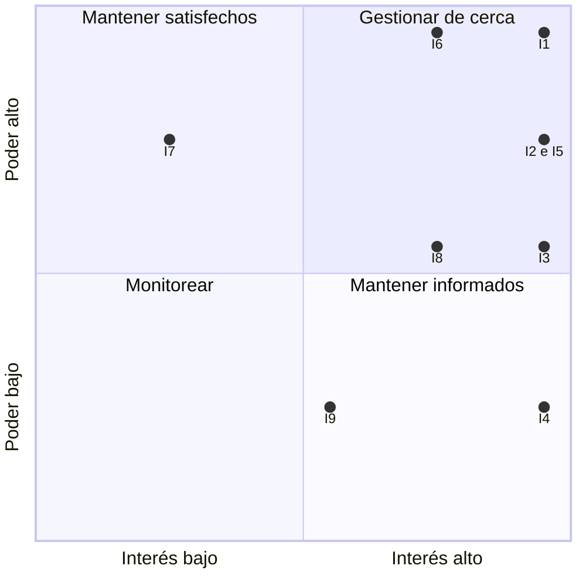
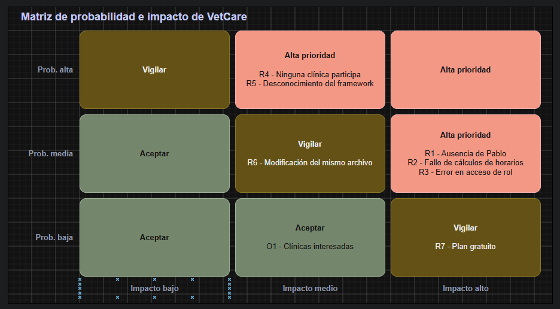

# VetCare

## Sistema de gestión de atención veterinaria

Universidad Técnica Nacional, Sede San Carlos

Curso: Administración de Proyectos Informáticos, III-26, SC-02

Profesor: Deiver Cubero Molina

Estudiantes: Jose Pablo Soto Quesada, Maikel Chaves Salas y Edgar Eliam Araya Alvarado

Fecha: septiembre de 2026

## Problema

Las clínicas veterinarias necesitan administrar información de diferentes clientes y sus mascotas, pero en algunos casos estos datos pueden encontrarse registrados en documentos físicos, hojas de cálculo o diferentes medios de comunicación. Esto puede dificultar el acceso y control de la información. Además, un mismo cliente puede tener varias mascotas, por lo que es necesario mantener organizada la información de cada una de ellas de manera independiente. También puede ser complicado para los médicos veterinarios consultar rápidamente el historial de una mascota, sus consultas anteriores, vacunas, tratamientos y próximas citas. La falta de un sistema centralizado puede generar pérdida de información, dificultades para organizar las citas y mayor tiempo para consultar los datos de los pacientes.

Este planteamiento se basa en lo que el equipo conoce del trabajo en clínicas veterinarias. No proviene de un estudio ni de una clínica en particular.

## Proyecto propuesto

Desarrollar un sistema web para la gestión de una clínica veterinaria, dirigido tanto a los clientes como a los médicos veterinarios. El sistema permitirá a los clientes registrarse y administrar su información, así como registrar una o varias mascotas asociadas a su cuenta. También podrán consultar la información de sus mascotas y gestionar sus citas. Por otra parte, los médicos veterinarios podrán consultar sus citas y acceder al expediente de cada mascota para registrar y consultar información relacionada con las consultas, diagnósticos, tratamientos, vacunas y observaciones. El sistema permitirá centralizar la información y mantener una relación organizada entre los clientes y sus mascotas, de manera que cada mascota tenga su propio historial de atención veterinaria.

## Valor esperado

Con el sistema, la información de clientes y mascotas queda en un solo lugar. Cada cliente puede registrar y administrar varias mascotas, y cada mascota tiene su propio expediente con consultas, tratamientos y vacunas. Los médicos veterinarios consultan el historial de sus pacientes desde el sistema y las citas se registran y consultan en línea. Los clientes pueden ver la información y el historial de atención de sus mascotas. Se busca reducir la dependencia de documentos físicos y registros dispersos, y llevar un mejor control de la atención de cada paciente.

## Objetivo general

Desarrollar un sistema web para la gestión de una clínica veterinaria que permita administrar la información de clientes, mascotas, médicos veterinarios, citas e historiales médicos, y dar seguimiento a la atención de cada mascota.

## Objetivos específicos

1. Analizar los procesos relacionados con la administración de clientes, mascotas, citas e información médica dentro de una clínica veterinaria.
2. Diseñar una base de datos que permita relacionar a los clientes con una o varias mascotas y almacenar de manera organizada la información de cada paciente.
3. Desarrollar un módulo para el registro y administración de clientes, permitiendo mantener actualizada su información personal y de contacto.
4. Implementar un módulo que permita a los clientes registrar y administrar varias mascotas asociadas a su cuenta.
5. Desarrollar un módulo de gestión de citas que permita registrar, consultar y administrar las citas de las mascotas.
6. Implementar un expediente médico digital para cada mascota, permitiendo registrar consultas, diagnósticos, tratamientos, vacunas y observaciones.
7. Desarrollar funcionalidades para que los médicos veterinarios puedan consultar el historial médico de sus pacientes y registrar nueva información durante las consultas.
8. Permitir que los clientes puedan consultar la información y el historial de atención de sus mascotas.
9. Implementar diferentes niveles de acceso para clientes y médicos veterinarios, de acuerdo con las funciones que corresponden a cada tipo de usuario.
10. Realizar pruebas del sistema para verificar el correcto funcionamiento de sus principales módulos y que la información se gestione de manera adecuada.

## Visión a futuro: modelo de negocio

A largo plazo, la plataforma podría ofrecerse como un servicio en la nube por suscripción (SaaS) para clínicas veterinarias, con estos planes:

| Plan | Precio mensual | Enfoque |
| --- | --- | --- |
| Essential | ₡29.900 | Consultorios y clínicas pequeñas con un veterinario. |
| Professional | ₡59.900 | Clínicas en crecimiento, hasta 3 veterinarios. |
| Clinic | ₡99.900 | Clínicas con varias sucursales, hasta 8 veterinarios. |
| Enterprise | Personalizado | Organizaciones con varias compañías y regiones. |

Los precios son una estimación del equipo y no se basan en un estudio de mercado. Esta visión queda solo como referencia. El proyecto del curso es una versión inicial con fines académicos, limitada a las funcionalidades descritas en los requerimientos.

## Gestión de interesados

El análisis se hace para VetCare, el sistema presentado en la Lección 1, y usa el registro de interesados y la matriz poder-interés de la Guía del PMBOK, 6.ª edición (PMI, 2017). Se incluyen los actores que pueden influir en el proyecto o verse afectados por sus resultados. Los roles operativos son propuestos y deben confirmarse al seleccionar la clínica. Las actitudes son estimaciones iniciales y no salen de entrevistas.

| ID / Interesado | Necesidad principal | Poder | Interés | Actitud estimada |
| --- | --- | --- | --- | --- |
| I1. Propietario o dirección de la clínica | Centralizar información, mejorar el servicio y autorizar recursos y puesta en uso. | 5 | 5 | Favorable |
| I2. Médicos veterinarios | Consultar y registrar expedientes, diagnósticos, vacunas y tratamientos con rapidez. | 4 | 5 | Favorable |
| I3. Recepción / administración | Organizar citas y datos de clientes y mascotas; evitar duplicaciones. | 3 | 5 | Neutral |
| I4. Clientes / propietarios de mascotas | Registrar varias mascotas, gestionar citas y consultar información autorizada. | 2 | 5 | Favorable |
| I5. Equipo desarrollador: Jose Pablo Soto, Maikel Chaves y Eliam Araya | Disponer de requisitos claros, acceso a usuarios y tiempo para implementar y probar. | 4 | 5 | Favorable |
| I6. Profesor: Deiver Cubero Molina | Evaluar la coherencia del proyecto, las evidencias y el cumplimiento académico. | 5 | 4 | Favorable |
| I7. Proveedor de alojamiento y base de datos | Contar con requisitos técnicos definidos y condiciones de uso y pago claras. | 4 | 2 | Neutral |
| I8. Responsable de soporte tecnológico de la clínica | Mantener disponibilidad, accesos, respaldos y resolver incidentes. | 3 | 4 | Neutral |
| I9. Personal auxiliar veterinario | Consultar los datos necesarios para apoyar la atención según su autorización. | 2 | 3 | Neutral |

Poder es la capacidad de influir en decisiones, recursos, aceptación o continuidad. Interés es el grado de atención y afectación por el resultado. La escala va de 1 a 5: 1 = muy bajo, 2 = bajo, 3 = medio, 4 = alto y 5 = muy alto.

---

## Requerimientos del proyecto

Los requerimientos corresponden a una versión inicial del sistema con fines académicos, ajustada al tiempo disponible en el curso.

### Requerimientos funcionales

#### Usuarios y acceso

| ID | Requerimiento |
| --- | --- |
| RF-01 | El sistema debe permitir que los propietarios de mascotas se registren con sus datos personales y de contacto. |
| RF-02 | El sistema debe permitir iniciar y cerrar sesión. |
| RF-03 | El sistema debe mostrar a cada usuario solo las funciones de su rol: propietario, médico veterinario o administrador. |
| RF-04 | El administrador debe poder registrar a los médicos veterinarios. |

#### Mascotas

| ID | Requerimiento |
| --- | --- |
| RF-05 | El propietario debe poder registrar una o varias mascotas con su nombre, especie, raza, sexo, fecha de nacimiento y peso. |
| RF-06 | El propietario debe poder consultar y editar la información de sus mascotas. |

#### Citas

| ID | Requerimiento |
| --- | --- |
| RF-07 | El propietario debe poder agendar una cita para una de sus mascotas, eligiendo un veterinario y una fecha y hora disponibles. |
| RF-08 | El propietario debe poder cancelar una cita programada. |
| RF-09 | El médico veterinario debe poder consultar sus citas programadas. |
| RF-10 | El médico veterinario debe poder cambiar el estado de una cita a atendida. |

#### Expediente clínico

| ID | Requerimiento |
| --- | --- |
| RF-11 | El médico veterinario debe poder registrar una consulta en el expediente de la mascota, con motivo, diagnóstico, tratamiento y observaciones. |
| RF-12 | El médico veterinario debe poder registrar las vacunas aplicadas y la fecha de la próxima dosis. |
| RF-13 | El médico veterinario debe poder consultar el historial completo de una mascota. |
| RF-14 | El propietario debe poder consultar el historial de atención y las vacunas de sus mascotas. |

### Requerimientos no funcionales

| ID | Categoría | Requerimiento |
| --- | --- | --- |
| RNF-01 | Usabilidad | El sistema debe ser una aplicación web responsive, utilizable desde computadoras y teléfonos. |
| RNF-02 | Usabilidad | La interfaz debe estar en español y ser sencilla de usar. |
| RNF-03 | Seguridad | Las contraseñas deben almacenarse cifradas. |
| RNF-04 | Seguridad | Cada usuario solo debe acceder a la información permitida por su rol; un propietario solo puede ver sus propias mascotas. |
| RNF-05 | Integridad | El sistema debe validar los datos obligatorios antes de guardarlos. |
| RNF-06 | Mantenibilidad | El código debe gestionarse en un repositorio de GitHub con control de versiones. |
| RNF-07 | Privacidad | Durante el desarrollo y las pruebas se utilizarán únicamente datos ficticios. |

## Registro: estrategias de involucramiento

| ID | Estrategia y acción propuesta |
| --- | --- |
| I1 | Gestionar de cerca. Reunión quincenal para priorizar necesidades, aprobar alcance y revisar riesgos; solicitar aceptación de cada entrega. |
| I2 | Gestionar de cerca. Entrevistas iniciales y demostraciones cada dos semanas; validar campos del expediente y flujos clínicos con datos ficticios. |
| I3 | Gestionar de cerca. Observar el proceso de citas, probar prototipos y capacitar antes del piloto; recoger dificultades de uso. |
| I4 | Mantener informados. Invitar a un grupo representativo a probar registro, varias mascotas y citas en cada entrega relevante; ofrecer instrucciones sencillas. |
| I5 | Gestionar de cerca. Planificación semanal, tablero de tareas y revisión quincenal de avances, obstáculos y calidad. |
| I6 | Gestionar de cerca. Presentar avances en las revisiones del curso, registrar retroalimentación y comprobar la rúbrica antes de las entregas. |
| I7 | Mantener satisfecho. Confirmar límites, costos, disponibilidad y recuperación antes del despliegue; contactar ante cambios técnicos o incidentes. |
| I8 | Gestionar de cerca. Acordar accesos, respaldos y recuperación; revisar preparación del entorno antes del piloto y entregar guía de soporte. |
| I9 | Mantener informados. Consultar en hitos sobre necesidades de apoyo y explicar cambios de flujo; aumentar su participación si se confirma un rol directo en el sistema. |

## Justificación de valoraciones discutibles

I2, poder 4. Los médicos no necesariamente autorizan el presupuesto, pero su validación del expediente y su adopción pueden condicionar la aceptación del sistema. No se asigna 5 porque la aprobación global corresponde a la dirección.

I3, poder 3. Recepción influye en los procesos diarios y en la calidad de los datos, aunque no decide la inversión. Su interés es 5 por el uso frecuente de las citas. Si este rol no existe, sus responsabilidades se asignarán al actor que las ejecute.

I6, poder 5 e interés 4. El profesor determina la evaluación y la aceptación académica, y su poder se limita a ese contexto. Su interés es alto, aunque no usará el sistema en la operación de la clínica.

I7, poder 4 e interés 2. Una interrupción o una limitación técnica del proveedor puede impedir el despliegue. Para el proveedor, en cambio, el proyecto es un servicio más. Esta dependencia se revisará según el alojamiento que se elija.

## Mapa poder-interés

El poder va en el eje vertical y el interés en el horizontal. Para decidir la estrategia, las puntuaciones 1 y 2 se toman como bajas y las puntuaciones 3, 4 y 5 como medias o altas. El valor 3 se incluye en la gestión activa por su influencia operativa, aunque eso no lo iguala al poder de la dirección.

### Coordenadas del mapa

Cada fila es una posición exacta del mapa. El eje horizontal corresponde al interés y el vertical al poder.

| Interesado | Interés (X) | Poder (Y) |
| --- | --- | --- |
| I1 | 5 | 5 |
| I2 | 5 | 4 |
| I3 | 5 | 3 |
| I4 | 5 | 2 |
| I5 | 5 | 4 |
| I6 | 4 | 5 |
| I7 | 2 | 4 |
| I8 | 4 | 3 |
| I9 | 3 | 2 |

El diagrama ubica las puntuaciones 3 a 5 en la mitad alta y 1 a 2 en la mitad baja. La tabla anterior conserva los valores exactos de 1 a 5.

| Cuadrante | Interesados |
| --- | --- |
| Gestionar de cerca | I1, I2, I3, I5, I6 e I8 |
| Mantener satisfechos | I7 |
| Mantener informados | I4 e I9 |
| Monitorear | Sin interesados con poder e interés bajos en esta valoración inicial. |

I2 e I5 comparten la coordenada (interés 5, poder 4). I9 se mantendrá informado en los hitos relevantes porque su participación todavía es indirecta. Si llega a necesitar acceso directo al sistema, se revisarán su interés y su estrategia.

## Tres interesados críticos

Se seleccionan la dirección, los médicos veterinarios y el equipo desarrollador porque intervienen de forma directa en la autorización, la utilidad clínica y la ejecución de VetCare. El profesor también se gestiona de cerca por su papel en la aceptación académica.

### 1. Dirección de la clínica (I1)

Autoriza recursos, define prioridades y decide la puesta en uso. Con ella se hace una reunión inicial para acordar el alcance y los criterios de éxito, y una revisión quincenal con aprobación al cierre de cada entrega. El responsable es el equipo desarrollador, con Jose Pablo Soto como enlace. Como evidencia quedan la minuta de decisiones, la lista priorizada y la aceptación documentada. Se espera llegar a un alcance viable y a decisiones a tiempo sobre cambios y sobre el piloto.

### 2. Médicos veterinarios (I2)

Determinan si el expediente refleja la atención real y si el sistema les sirve durante las consultas. Se propone una entrevista y una observación inicial, y después revisiones de prototipos y pruebas cada dos semanas con casos ficticios de consultas, vacunas y tratamientos. Participan el equipo desarrollador y un médico representante elegido por la clínica. La evidencia son los comentarios registrados, las incidencias y la lista de criterios clínicos aprobados. El objetivo es validar que puedan consultar el historial y registrar una atención completa con los permisos correctos.

### 3. Equipo desarrollador (I5)

Convierte los requisitos en software, gestiona las restricciones y comprueba el funcionamiento. Trabaja con planificación semanal, reparto de tareas entre Jose Pablo Soto, Maikel Chaves y Eliam Araya, revisión de código y demostración quincenal de funcionalidades. Los tres integrantes son responsables, cada uno de los módulos que se le asignen. La evidencia es el tablero actualizado, las versiones del sistema y los resultados de pruebas. Se espera tener entregas funcionales, obstáculos visibles y correcciones antes de cada evaluación.

Las frecuencias indicadas son propuestas y se ajustarán al calendario del curso y a la disponibilidad de la clínica. El registro y el mapa se revisan al final de cada iteración o cuando cambian los actores, las responsabilidades o las condiciones del proyecto.

## Enfoque de gestión del proyecto

Se elige un enfoque híbrido. Los objetivos y módulos de VetCare están definidos desde la Lección 1, pero las necesidades de uso deben validarse con clientes y personal veterinario. Por eso se planifican los compromisos generales y el producto se desarrolla en iteraciones.

### Elementos predictivos

Al inicio se definen el alcance base, los objetivos, los entregables, las responsabilidades y un cronograma ajustado a las fechas del curso. También se acuerdan el modelo inicial de datos, los niveles de acceso, los criterios de aceptación y los riesgos. Con estos elementos un equipo de tres estudiantes puede controlar el trabajo y comprobar el cumplimiento académico.

### Elementos adaptativos

Los flujos de citas, la consulta del historial, la presentación de vacunas y el registro de varias mascotas pueden cambiar después de las pruebas con usuarios. Se trabaja con una lista priorizada de requisitos e iteraciones de dos semanas. Cada ciclo incluye diseño, implementación, pruebas y demostración, para incorporar la retroalimentación antes de continuar.

### Aplicación en VetCare

Primero se validan los requisitos y las relaciones entre clientes, mascotas, médicos y citas. Después se implementan, en este orden: (1) cuentas, permisos y registro de clientes y mascotas; (2) gestión de citas; (3) expediente, consultas, diagnósticos, tratamientos y vacunas; y (4) consulta autorizada para clientes y pruebas integrales. El orden y la cantidad de iteraciones se ajustan al calendario real.

### Control de cambios y calidad

Los ajustes de interfaz o de flujo que no alteran los compromisos se priorizan para la siguiente iteración. Si un cambio afecta el alcance, el tiempo o los recursos, el equipo documenta su impacto y lo revisa con la dirección y, cuando corresponda, con el profesor. Cada entrega debe pasar pruebas funcionales y de permisos antes de considerarse terminada.

### Justificación frente a otros enfoques

Un enfoque solo predictivo haría difícil incorporar los cambios que aparezcan al probar el sistema con usuarios. Uno solo adaptativo daría menos estructura para los compromisos académicos y el alcance ya definido. El híbrido mantiene una planificación verificable y deja espacio para ajustar el producto durante el desarrollo.

El documento original no identifica una clínica concreta, un presupuesto, un proveedor ni un calendario detallado. Estas decisiones y la disponibilidad de usuarios deben confirmarse antes de cerrar la planificación. Lo descrito en esta sección son propuestas y no acuerdos ya tomados.

## Justificación y alcance

Las clínicas veterinarias suelen tener la información de clientes y mascotas dispersa en documentos físicos, hojas de cálculo y otros medios. Esto dificulta consultar historiales, organizar citas y dar seguimiento a vacunas y tratamientos. VetCare se propone como un sistema web que centraliza esa información y le da a cada mascota su propio expediente. Para la versión del curso, el alcance queda así:

| Incluye | No incluye |
| --- | --- |
| Registro e inicio de sesión de usuarios | Facturación, cobros y suscripciones |
| Acceso según rol: propietario, veterinario y administrador | Inventario de medicamentos y productos |
| Registro de varias mascotas por propietario | Laboratorio, imágenes clínicas y hospitalización |
| Agendar, cancelar y consultar citas | Recordatorios automáticos y notificaciones |
| Expediente clínico con consultas y vacunas | Reportes y dashboards administrativos |
| Consulta del historial por parte del propietario | Varias clínicas o sucursales |
| | Aplicación móvil nativa e integraciones externas |

---

## Definición del Scrum Team

Los roles siguen la Guía de Scrum (Schwaber y Sutherland, 2020). Como el equipo es de tres personas, los tres actúan como Developers. Dos integrantes asumen además los roles de Product Owner y Scrum Master, y el tercero se enfoca en el desarrollo, la calidad y la documentación. Se evita que una misma persona sea Product Owner y Scrum Master a la vez, para no mezclar la priorización del producto con la protección de la capacidad del equipo.

| Integrante | Rol Scrum | Responsabilidades |
| --- | --- | --- |
| Jose Pablo Soto Quesada | Product Owner + Developer | Mantener y priorizar el Product Backlog, definir criterios de aceptación y ser el enlace con la clínica y el profesor. |
| Maikel Chaves Salas | Scrum Master + Developer | Facilitar el proceso, remover impedimentos y mantener el tablero actualizado. |
| Edgar Eliam Araya Alvarado | Developer | Desarrollar las funcionalidades del Sprint, liderar las pruebas funcionales y de permisos, y mantener actualizada la documentación del proyecto. |

### Roles adicionales para el futuro

| Rol | Cuándo se necesita | Asignación propuesta |
| --- | --- | --- |
| Responsable de base de datos (DBA) | Diseño del modelo de datos y respaldos | Jose Pablo |
| Responsable de pruebas (QA) | Pruebas funcionales y de permisos | Eliam |
| Responsable de interfaz (UX/UI) | Prototipos y pruebas de usabilidad | Jose Pablo |
| Responsable de despliegue (DevOps) | Alojamiento y puesta en línea | Maikel |
| Responsable de documentación | Manual de usuario y actualización de este documento | Eliam, con apoyo de los demás |

---

## Análisis de entorno

### Factores ambientales de la empresa (EEF)

La Guía del PMBOK (PMI, 2017) llama factores ambientales de la empresa a las condiciones que el equipo no controla y que afectan al proyecto. Para VetCare se identifican los siguientes.

| Factor | Efecto en VetCare |
| --- | --- |
| Infraestructura tecnológica (hosting, base de datos, herramientas) | Define dónde se despliega el sistema y sus límites de uso |
| Cultura organizacional de la clínica | Afecta la adopción del sistema frente a los registros físicos |
| Normativa legal y de privacidad de datos | Obliga a controlar accesos y proteger la información |
| Distribución del equipo (presencial o remoto) | Condiciona la coordinación entre los tres integrantes |
| Disponibilidad de usuarios para pruebas | Afecta la calidad de la validación |
| Calendario académico | Limita el tiempo y el alcance posible |

### Lean Canvas

La tabla usa la plantilla Lean Canvas de Ash Maurya (2012).

| Bloque | Contenido |
| --- | --- |
| Problema | Información dispersa en papel y hojas de cálculo; dificultad para consultar historiales, organizar citas y seguir vacunas y tratamientos. |
| Segmentos de clientes | Clínicas veterinarias; usuarios: médicos, recepción y propietarios de mascotas. |
| Propuesta de valor | Un sistema web donde cada mascota tiene su expediente y cada cliente administra varias mascotas y sus citas. |
| Solución | Módulos de clientes, mascotas, citas y expediente médico con acceso por tipo de usuario. |
| Canales | Aplicación web desde navegador. |
| Fuentes de ingreso | No aplica en el curso; se definiría con la clínica si se implementa. |
| Estructura de costos | Alojamiento, base de datos y tiempo de desarrollo; montos por confirmar. |
| Métricas clave | Citas gestionadas, expedientes creados y tiempo para consultar un historial. |
| Ventaja diferenciadora | Relación de un cliente con varias mascotas y expediente individual validado con personal veterinario. |

---

## Sección 05: backlog inicial, Sprint Backlog y mecanismo de seguimiento

### Product Backlog inicial

El Product Backlog reúne las historias de usuario de VetCare. Cada historia sale de uno o más requerimientos funcionales (columna RF). Lo gestiona y prioriza el Product Owner, Jose Pablo Soto, y se ajusta después de cada Sprint Review según la retroalimentación recibida.

La prioridad tiene dos niveles. P1 es alta y se usa para lo indispensable en el funcionamiento básico. P2 es media y se usa para lo importante que puede esperar a versiones posteriores. La estimación se hace en puntos de historia (1, 2, 3, 5 y 8), que miden el esfuerzo relativo, y se vota con planning poker, la técnica que describió James Grenning en 2002.

| ID | Módulo | Historia de usuario | RF | Prioridad | Puntos |
| --- | --- | --- | :---: | :---: | :---: |
| HU-01 | Usuarios | Como propietario, quiero registrarme con mis datos personales y de contacto, para acceder al sistema. | RF-01 | P1 | 3 |
| HU-02 | Usuarios | Como usuario, quiero iniciar y cerrar sesión, para acceder únicamente a las funciones de mi rol (propietario, médico veterinario o administrador). | RF-02, RF-03 | P1 | 3 |
| HU-03 | Mascotas | Como propietario, quiero registrar una o varias mascotas con su nombre, especie, raza, sexo, fecha de nacimiento y peso, para que cada una tenga su propia información. | RF-05 | P1 | 5 |
| HU-04 | Mascotas | Como propietario, quiero ver la lista de mis mascotas y editar su información, para mantener sus datos actualizados. | RF-06 | P1 | 3 |
| HU-05 | Usuarios | Como administrador, quiero registrar a los médicos veterinarios, para que puedan ingresar al sistema y atender citas. | RF-04 | P1 | 2 |
| HU-06 | Citas | Como propietario, quiero agendar una cita para una de mis mascotas eligiendo un veterinario y una fecha y hora disponibles, para recibir atención sin tener que llamar. | RF-07 | P1 | 8 |
| HU-07 | Citas | Como propietario, quiero cancelar una cita programada, para liberarla si no puedo asistir. | RF-08 | P2 | 2 |
| HU-08 | Citas | Como médico veterinario, quiero consultar mis citas programadas, para organizar mi jornada. | RF-09 | P1 | 3 |
| HU-09 | Citas | Como médico veterinario, quiero marcar una cita como atendida, para llevar el control de las citas realizadas. | RF-10 | P2 | 2 |
| HU-10 | Expediente | Como médico veterinario, quiero registrar una consulta con su motivo, diagnóstico, tratamiento y observaciones en el expediente de la mascota, para documentar la atención. | RF-11 | P1 | 5 |
| HU-11 | Expediente | Como médico veterinario, quiero registrar las vacunas aplicadas y la fecha de la próxima dosis, para dar seguimiento al plan de vacunación. | RF-12 | P2 | 3 |
| HU-12 | Expediente | Como médico veterinario, quiero consultar el historial completo de una mascota, para conocer sus atenciones anteriores antes de atenderla. | RF-13 | P1 | 3 |
| HU-13 | Expediente | Como propietario, quiero consultar el historial de atención y las vacunas de mis mascotas, para conocer su estado de salud. | RF-14 | P2 | 3 |
| | | | | Total | 45 |

### Plan de Sprints

El Product Backlog se reparte en tres Sprints de dos semanas, según las prioridades y la dependencia entre módulos.

| Sprint | Fechas | Enfoque | Historias | Puntos |
| --- | --- | --- | --- | :---: |
| Sprint 1 | 22/10/2026 al 04/11/2026 | Usuarios, roles y mascotas | HU-01, HU-02, HU-03, HU-04, HU-05 | 16 |
| Sprint 2 | 05/11/2026 al 18/11/2026 | Citas | HU-06, HU-07, HU-08, HU-09 | 15 |
| Sprint 3 | 19/11/2026 al 02/12/2026 | Expediente clínico | HU-10, HU-11, HU-12, HU-13 | 14 |

La velocidad inicial es de 15 puntos por Sprint, con un rango de 12 a 18. Es un supuesto del equipo, porque todavía no hay Sprints terminados, y se reemplaza con los puntos que cumplan la Definición de Terminado al cerrar cada Sprint. Si la velocidad real queda por debajo de 15 puntos, se usa un Sprint 4, del 03/12/2026 al 16/12/2026. El costo estimado es de 47 horas por Sprint entre los tres integrantes; no hay una tarifa definida.

### Sprint Backlog del Sprint 1

| Elemento | Detalle |
| --- | --- |
| Duración | 2 semanas (22/10/2026 al 04/11/2026) |
| Sprint Goal | Que un propietario pueda crear su cuenta, iniciar sesión y registrar y administrar sus mascotas, con acceso diferenciado entre propietarios, médicos veterinarios y administrador. |
| Historias seleccionadas | HU-01, HU-02, HU-03, HU-04 y HU-05 |
| Total de puntos | 16 |

Estas historias van primero porque son la base del sistema. Sin usuarios, roles, propietarios y mascotas registrados no se pueden agendar citas ni llevar un expediente. También permiten validar desde el inicio la relación de un propietario con varias mascotas, que es la parte central del modelo de datos.

#### Tareas del Sprint 1

| ID | Historia | Tarea | Responsable | Horas estimadas |
| --- | --- | --- | --- | :---: |
| T-01 | General | Diseñar el modelo de datos inicial (usuarios, roles, propietarios y mascotas). | Jose Pablo Soto | 4 |
| T-02 | General | Configurar el repositorio, la estructura del proyecto y la base de datos. | Maikel Chaves | 3 |
| T-03 | HU-01 | Diseñar e implementar la interfaz de registro de propietarios. | Jose Pablo Soto | 3 |
| T-04 | HU-01 | Implementar el registro de propietarios con validación de datos obligatorios. | Maikel Chaves | 4 |
| T-05 | HU-01 | Probar el registro de propietarios. | Eliam Araya | 2 |
| T-06 | HU-02 | Implementar el inicio y cierre de sesión. | Maikel Chaves | 4 |
| T-07 | HU-02 | Implementar el control de acceso según el rol del usuario. | Eliam Araya | 3 |
| T-08 | HU-02 | Probar el inicio de sesión y los permisos por rol. | Jose Pablo Soto | 2 |
| T-09 | HU-03 | Diseñar e implementar el formulario de registro de mascotas. | Jose Pablo Soto | 3 |
| T-10 | HU-03 | Implementar el registro de mascotas asociadas al propietario. | Eliam Araya | 4 |
| T-11 | HU-03 | Probar el registro de una y de varias mascotas por propietario. | Maikel Chaves | 2 |
| T-12 | HU-04 | Implementar la lista de mascotas del propietario y la edición de sus datos. | Eliam Araya | 4 |
| T-13 | HU-04 | Probar la lista y la edición de mascotas. | Jose Pablo Soto | 2 |
| T-14 | HU-05 | Implementar el registro de médicos veterinarios por parte del administrador. | Maikel Chaves | 3 |
| T-15 | HU-05 | Probar el registro de médicos y su acceso al sistema. | Eliam Araya | 2 |
| T-16 | General | Actualizar la documentación del proyecto con los resultados del Sprint. | Eliam Araya | 2 |

La carga queda así: Jose Pablo Soto, 14 horas; Maikel Chaves, 16 horas; Eliam Araya, 17 horas. En total son 47 horas. Ninguna funcionalidad la prueba solo quien la desarrolló.

### Mecanismo de seguimiento

El seguimiento del Sprint corresponde al grupo de procesos de monitoreo y control de la Guía del PMBOK (PMI, 2017). Sirve para comparar el avance real con lo planificado y tomar decisiones a tiempo.

#### 1. Tablero de tareas

El tablero está en Jira Software (plan gratuito), en el espacio Scrum VetCare, con clave VET.

Enlace: https://josepablonet.atlassian.net/jira/software/c/projects/VET/boards/2

| Columna | Límite WIP | Significado | Justificación del límite |
| --- | :---: | --- | --- |
| Por hacer | Sin límite | Tareas del Sprint que aún no se han iniciado. | Ahí está todo el Sprint Backlog al empezar. |
| En progreso | 3 | Tareas en las que un integrante está trabajando. Cada integrante tiene una tarea activa a la vez. | Somos tres y cada uno trabaja una tarea a la vez. |
| En pruebas | 2 | Código integrado en la rama principal, pendiente de verificación por otro integrante. | Si hay dos tareas esperando, alguien termina lo suyo y prueba antes de empezar otra cosa. |
| Terminado | Sin límite | Tareas que cumplen la Definición de Terminado. Solo las mueve quien prueba, no quien desarrolló. | Es el final del flujo. |

Los límites se configuraron en Jira con la restricción por número de incidencias, que también cuenta las subtareas.

Cada tarjeta tiene una sola tarea y un solo responsable, con el formato "HU-01 · T-03 Interfaz de registro". Cada integrante mueve sus tareas apenas cambia su estado, para que el equipo vea el avance real.

En Jira, las historias HU-01 a HU-05 se cargaron como elementos de tipo Historia, con sus puntos, su prioridad y su descripción con la misma estructura de cinco partes del detalle de historias de usuario (título, estructura, criterios de aceptación, estimación y prioridad, y notas adicionales o anexos). Las tareas T-03 a T-15 son subtareas de su historia, y T-01, T-02 y T-16 son tareas generales. Cada tarea tiene a su responsable en el campo Persona asignada y sus horas en el campo Estimación original. El Sprint 1 va del 22/10/2026 al 04/11/2026 y tiene como objetivo el Sprint Goal de este documento.

Regla para mover una tarjeta a Terminado: solo la mueve quien la probó, nunca quien la desarrolló, y antes revisa que cumpla los cinco puntos de la Definición de Terminado (apartado 5). Es un acuerdo del equipo y no está configurado como restricción en Jira.

#### 2. Daily Scrum

Se hace los lunes, miércoles y viernes, en persona o por mensaje en el grupo del equipo, con un máximo de 15 minutos. Cada integrante responde:

- ¿Qué avancé desde la última Daily?
- ¿Qué voy a hacer hasta la próxima?
- ¿Tengo algún impedimento?

#### 3. Gráfico de avance (burndown)

El Scrum Master registra las horas de trabajo pendientes al final de cada Daily y las compara con el avance ideal. Si el avance real queda por encima del ideal en dos registros seguidos, el equipo revisa qué está frenando el trabajo y, si hace falta, conversa con el Product Owner para ajustar el alcance del Sprint.

| Registro | Día del Sprint | Horas pendientes ideales | Horas pendientes reales |
| --- | :---: | :---: | :---: |
| Inicio | 0 | 47 | 47 |
| Daily 1 | 2 | 38 | |
| Daily 2 | 4 | 28 | |
| Daily 3 | 6 | 19 | |
| Daily 4 | 8 | 9 | |
| Cierre | 10 | 0 | |

#### 4. Registro de impedimentos

El Scrum Master registra los impedimentos detectados y les da seguimiento hasta resolverlos.

| Fecha | Impedimento | Responsable | Acción | Estado |
| --- | --- | --- | --- | --- |
| | | | | |

#### 5. Definición de terminado

Una historia se considera terminada cuando:

1. cumple todos sus criterios de aceptación;
2. el código está integrado en la rama principal del repositorio;
3. fue probada con datos ficticios por un integrante distinto de quien la desarrolló, incluyendo las pruebas de permisos cuando aplique;
4. no tiene errores conocidos sin resolver;
5. está documentada en este documento o en el repositorio.

Una historia está terminada o no lo está. Lo que no cumple la Definición de Terminado no se presenta como terminado en la Sprint Review ni cuenta en la velocidad.

#### 6. Cierre del Sprint

En la Sprint Review se presenta el incremento al profesor y a los representantes de la clínica (I1, I2 e I3), y la retroalimentación se usa para ajustar el Product Backlog. Después, en la Sprint Retrospective, el equipo revisa qué funcionó, qué no y qué cambiar para el siguiente Sprint. Al cierre se registran los puntos de historia completados, que dan la velocidad del equipo, y el porcentaje de tareas terminadas.

### Detalle de historias de usuario

La plantilla sigue la regla de las tres C (card, conversation, confirmation) que Ron Jeffries describió en 2001. Los criterios de aceptación usan el formato Dado que, cuando, entonces, propuesto por Dan North en 2006 dentro del desarrollo guiado por comportamiento (BDD). La revisión de calidad aplica el criterio INVEST de Bill Wake (2003). Las reglas de negocio de cada historia son propuestas del equipo y no provienen de una clínica real; el Product Owner puede ajustarlas antes de cada Sprint Planning.

Cada historia sigue la misma estructura de cinco partes: 1) título; 2) estructura, con el formato Como, quiero, para; 3) criterios de aceptación; 4) estimación y prioridad (metadata de gestión), y 5) notas adicionales o anexos, donde se indican los requerimientos funcionales (RF) y no funcionales (RNF) relacionados, las dependencias, las notas técnicas y los anexos pendientes. La prioridad P1 corresponde a Alta y la P2 a Media.

La dificultad de cada criterio de aceptación la asignó cada integrante en escala 1, 2, 3 y 5, donde JP es Jose Pablo Soto, MC es Maikel Chaves y EA es Eliam Araya. Jose Pablo tiene más experiencia en desarrollo web y bases de datos, por eso sus valores suelen ser más bajos. La dificultad por criterio es distinta de los puntos de historia: la primera muestra qué parte le cuesta más a cada integrante y los puntos miden el tamaño de toda la historia.

Los votos de planning poker que acompañan cada estimación son los de la primera ronda. Cuando no coincidieron, el equipo conversó las diferencias y acordó el valor de la estimación. Jose Pablo suele votar más bajo por su experiencia; Maikel y Eliam votan igual o más alto.

#### HU-01: Registro de propietarios

1. **Título** "Registro de propietarios"

2. **Estructura**

   Como propietario de mascotas, quiero registrarme con mi nombre, teléfono, correo electrónico y una contraseña, para acceder al sistema y administrar la información de mis mascotas.

3. **Criterios de Aceptación**

   - Dado que el visitante completa todos los datos obligatorios, cuando presiona "Registrarse", entonces el sistema crea la cuenta con el rol de propietario y muestra un mensaje de confirmación. (JP 1, MC 2, EA 2)
   - Dado que el visitante deja vacío algún dato obligatorio, cuando intenta registrarse, entonces el sistema no crea la cuenta y señala los campos faltantes. (JP 1, MC 1, EA 2)
   - Dado que el correo ya está registrado, cuando el visitante intenta registrarse, entonces el sistema indica que el correo está en uso. (JP 1, MC 2, EA 2)
   - Dado que la contraseña tiene menos de 8 caracteres, cuando el visitante intenta registrarse, entonces el sistema muestra un mensaje de error. (JP 1, MC 1, EA 1)
   - Dado que la cuenta fue creada, cuando se guarda en la base de datos, entonces la contraseña queda almacenada cifrada. (JP 3, MC 5, EA 5)

4. **Estimación y Prioridad (Metadata de Gestión)**

   - **Prioridad:** Alta (P1)
   - **Estimación propuesta:** 3 puntos de historia, acordados por planning poker (votos de la primera ronda: JP 3, MC 3, EA 3).
   - **Dificultad por criterio:** El quinto criterio fue el de mayor dificultad para los tres.
   - **Sprint:** Sprint 1, del 22/10/2026 al 04/11/2026.

5. **Notas Adicionales o Anexos**

   - **Requerimientos relacionados:** RF-01, RNF-03 y RNF-05.
   - **Dependencias:** No depende de otras historias.
   - **Notas Técnicas:** El rol de propietario se asigna de forma automática y ningún visitante puede registrarse como veterinario o administrador. El mínimo de 8 caracteres para la contraseña es una decisión del equipo.
   - **Anexos:** El wireframe del formulario está pendiente.

#### HU-02: Inicio y cierre de sesión con acceso por rol

1. **Título** "Inicio y cierre de sesión con acceso por rol"

2. **Estructura**

   Como usuario del sistema, quiero iniciar y cerrar sesión, para acceder solo a las funciones de mi rol (propietario, médico veterinario o administrador).

3. **Criterios de Aceptación**

   - Dado que el usuario está registrado, cuando ingresa su correo y contraseña correctos, entonces el sistema inicia la sesión y lo lleva a la pantalla principal de su rol. (JP 1, MC 2, EA 2)
   - Dado que el usuario ingresa un correo o una contraseña incorrectos, cuando intenta iniciar sesión, entonces el sistema muestra un mensaje genérico de credenciales inválidas, sin indicar cuál dato falló. (JP 1, MC 1, EA 1)
   - Dado que el usuario tiene la sesión iniciada, cuando presiona "Cerrar sesión", entonces el sistema finaliza la sesión y lo devuelve a la pantalla de inicio de sesión. (JP 1, MC 1, EA 1)
   - Dado que un propietario tiene la sesión iniciada, cuando intenta entrar a una función de veterinario o de administrador, entonces el sistema le niega el acceso. (JP 2, MC 3, EA 3)

4. **Estimación y Prioridad (Metadata de Gestión)**

   - **Prioridad:** Alta (P1)
   - **Estimación propuesta:** 3 puntos de historia, acordados por planning poker (votos de la primera ronda: JP 3, MC 3, EA 3).
   - **Dificultad por criterio:** El cuarto criterio fue el de mayor dificultad, porque el control de acceso se valida en el servidor.
   - **Sprint:** Sprint 1, del 22/10/2026 al 04/11/2026.

5. **Notas Adicionales o Anexos**

   - **Requerimientos relacionados:** RF-02, RF-03 y RNF-04.
   - **Dependencias:** Depende de la HU-01.
   - **Notas Técnicas:** El control de acceso se valida en el servidor, además de ocultar las opciones en la interfaz.
   - **Anexos:** El wireframe de la pantalla de inicio de sesión está pendiente.

#### HU-03: Registro de mascotas del propietario

1. **Título** "Registro de mascotas del propietario"

2. **Estructura**

   Como propietario de mascotas, quiero registrar una o varias mascotas asociadas a mi cuenta con su nombre, especie, raza, sexo, fecha de nacimiento y peso, para que cada una tenga su propia información.

3. **Criterios de Aceptación**

   - Dado que el propietario inició sesión, cuando completa los datos obligatorios y presiona "Guardar", entonces el sistema registra la mascota, la asocia a su cuenta y muestra un mensaje de confirmación. (JP 2, MC 3, EA 3)
   - Dado que el propietario deja vacío el nombre, la especie o el sexo, cuando intenta guardar, entonces el sistema no registra la mascota y señala los campos faltantes. (JP 1, MC 1, EA 1)
   - Dado que el propietario ingresa una fecha de nacimiento posterior a la fecha actual o un peso menor o igual a cero, cuando intenta guardar, entonces el sistema muestra un mensaje de error. (JP 1, MC 2, EA 2)
   - Dado que el propietario ya tiene una mascota registrada, cuando registra otra, entonces ambas aparecen en su lista con información independiente. (JP 1, MC 2, EA 2)
   - Dado que un usuario no inició sesión, cuando intenta entrar al registro de mascotas, entonces el sistema lo envía a la página de inicio de sesión. (JP 1, MC 1, EA 2)

4. **Estimación y Prioridad (Metadata de Gestión)**

   - **Prioridad:** Alta (P1)
   - **Estimación propuesta:** 5 puntos de historia, acordados por planning poker (votos de la primera ronda: JP 3, MC 5, EA 5).
   - **Dificultad por criterio:** El primer criterio fue el de mayor dificultad, porque requiere la relación entre propietario y mascota en la base de datos.
   - **Sprint:** Sprint 1, del 22/10/2026 al 04/11/2026.

5. **Notas Adicionales o Anexos**

   - **Requerimientos relacionados:** RF-05 y RNF-05.
   - **Dependencias:** Depende de la HU-02, porque la mascota se asocia al propietario autenticado.
   - **Notas Técnicas:** Un propietario puede tener muchas mascotas y cada mascota pertenece a un solo propietario. La raza y la fecha de nacimiento son opcionales.
   - **Anexos:** El wireframe del formulario está pendiente.

#### HU-04: Consulta y edición de mascotas

1. **Título** "Consulta y edición de mascotas"

2. **Estructura**

   Como propietario de mascotas, quiero ver la lista de mis mascotas y editar su información, para mantener sus datos actualizados.

3. **Criterios de Aceptación**

   - Dado que el propietario tiene mascotas registradas, cuando entra a "Mis mascotas", entonces el sistema muestra el nombre, la especie y la raza de cada una. (JP 1, MC 1, EA 1)
   - Dado que el propietario no tiene mascotas, cuando entra a "Mis mascotas", entonces el sistema muestra un mensaje y la opción de registrar una. (JP 1, MC 1, EA 1)
   - Dado que el propietario edita los datos de una mascota con información válida, cuando presiona "Guardar", entonces el sistema actualiza los datos y muestra un mensaje de confirmación. (JP 1, MC 2, EA 2)
   - Dado que el propietario deja un campo obligatorio vacío o ingresa un dato inválido, cuando intenta guardar, entonces el sistema aplica las mismas validaciones de la HU-03. (JP 1, MC 1, EA 1)
   - Dado que un propietario intenta ver o editar una mascota ajena, cuando accede a ella, entonces el sistema le niega el acceso. (JP 2, MC 3, EA 3)

4. **Estimación y Prioridad (Metadata de Gestión)**

   - **Prioridad:** Alta (P1)
   - **Estimación propuesta:** 3 puntos de historia, acordados por planning poker (votos de la primera ronda: JP 2, MC 3, EA 3).
   - **Dificultad por criterio:** El quinto criterio fue el de mayor dificultad, porque cada consulta debe verificar que la mascota pertenezca al propietario.
   - **Sprint:** Sprint 1, del 22/10/2026 al 04/11/2026.

5. **Notas Adicionales o Anexos**

   - **Requerimientos relacionados:** RF-06, RNF-04 y RNF-05.
   - **Dependencias:** Depende de la HU-03.
   - **Notas Técnicas:** El formulario de edición puede reutilizar el de registro.
   - **Anexos:** El wireframe de la lista está pendiente.

#### HU-05: Registro de médicos veterinarios

1. **Título** "Registro de médicos veterinarios"

2. **Estructura**

   Como administrador de la clínica, quiero registrar a los médicos veterinarios con su nombre, correo electrónico y una contraseña inicial, para que puedan ingresar al sistema y atender citas.

3. **Criterios de Aceptación**

   - Dado que el administrador inició sesión, cuando completa los datos del veterinario y presiona "Guardar", entonces el sistema crea la cuenta con el rol de médico veterinario. (JP 1, MC 2, EA 2)
   - Dado que el correo ya está registrado, cuando el administrador intenta guardar, entonces el sistema indica que el correo está en uso. (JP 1, MC 1, EA 1)
   - Dado que el veterinario fue registrado, cuando inicia sesión, entonces el sistema le muestra las funciones de su rol. (JP 1, MC 2, EA 2)
   - Dado que un usuario que no es administrador intenta entrar al registro de veterinarios, cuando accede a esa opción, entonces el sistema le niega el acceso. (JP 1, MC 2, EA 2)

4. **Estimación y Prioridad (Metadata de Gestión)**

   - **Prioridad:** Alta (P1)
   - **Estimación propuesta:** 2 puntos de historia, acordados por planning poker (votos de la primera ronda: JP 1, MC 2, EA 2).
   - **Dificultad por criterio:** Los criterios tienen una dificultad parecida, porque reutilizan el registro de la HU-01 y el control de acceso de la HU-02.
   - **Sprint:** Sprint 1, del 22/10/2026 al 04/11/2026.

5. **Notas Adicionales o Anexos**

   - **Requerimientos relacionados:** RF-03, RF-04 y RNF-03.
   - **Dependencias:** Depende de la HU-02.
   - **Notas Técnicas:** La cuenta del administrador se crea con datos iniciales al instalar el sistema y no existe un registro público de administradores.
   - **Anexos:** El wireframe del panel está pendiente.

#### HU-06: Agendar una cita para una mascota

1. **Título** "Agendar una cita para una mascota"

2. **Estructura**

   Como propietario de mascotas, quiero agendar una cita para una de mis mascotas eligiendo un veterinario y una fecha y hora disponibles, para recibir atención sin llamar a la clínica.

3. **Criterios de Aceptación**

   - Dado que el propietario tiene al menos una mascota registrada, cuando selecciona la mascota, el veterinario, la fecha y una hora disponible y confirma, entonces el sistema registra la cita con estado "Programada" y muestra un resumen. (JP 2, MC 3, EA 3)
   - Dado que el propietario eligió un veterinario y una fecha, cuando el sistema muestra los horarios, entonces solo aparecen las horas libres de ese veterinario. (JP 3, MC 5, EA 5)
   - Dado que dos propietarios intentan reservar el mismo veterinario a la misma hora, cuando el segundo confirma, entonces el sistema le indica que el horario ya no está disponible. (JP 3, MC 5, EA 5)
   - Dado que el propietario selecciona una fecha anterior a la actual, cuando intenta continuar, entonces el sistema no lo permite. (JP 1, MC 1, EA 1)
   - Dado que el propietario no tiene mascotas registradas, cuando entra a agendar una cita, entonces el sistema le indica que primero debe registrar una. (JP 1, MC 1, EA 1)

4. **Estimación y Prioridad (Metadata de Gestión)**

   - **Prioridad:** Alta (P1)
   - **Estimación propuesta:** 8 puntos de historia, acordados por planning poker (votos de la primera ronda: JP 5, MC 8, EA 8).
   - **Dificultad por criterio:** El segundo y el tercer criterio fueron los de mayor dificultad, porque requieren calcular los horarios libres y evitar que dos citas ocupen el mismo espacio.
   - **Sprint:** Sprint 2, del 05/11/2026 al 18/11/2026.

5. **Notas Adicionales o Anexos**

   - **Requerimientos relacionados:** RF-07 y RNF-05.
   - **Dependencias:** Depende de la HU-03 y de la HU-05.
   - **Notas Técnicas:** Antes del Sprint 2 el Product Owner debe definir el horario de atención y la duración de cada cita; el equipo propone 30 minutos como valor inicial, sin una fuente que lo respalde.
   - **Anexos:** El wireframe de la pantalla de agendamiento está pendiente.

#### HU-07: Cancelar una cita

1. **Título** "Cancelar una cita"

2. **Estructura**

   Como propietario de mascotas, quiero cancelar una cita programada, para liberar el espacio si no puedo asistir.

3. **Criterios de Aceptación**

   - Dado que el propietario tiene una cita "Programada" en una fecha futura, cuando presiona "Cancelar" y confirma, entonces el sistema cambia el estado a "Cancelada" y el horario queda libre. (JP 1, MC 2, EA 2)
   - Dado que el sistema pide confirmar la cancelación, cuando el propietario desiste, entonces la cita no cambia. (JP 1, MC 1, EA 1)
   - Dado que la cita está "Atendida" o "Cancelada", cuando el propietario la consulta, entonces la opción de cancelar no aparece. (JP 1, MC 1, EA 2)
   - Dado que un propietario intenta cancelar una cita ajena, cuando realiza la acción, entonces el sistema le niega el acceso. (JP 1, MC 2, EA 2)

4. **Estimación y Prioridad (Metadata de Gestión)**

   - **Prioridad:** Media (P2)
   - **Estimación propuesta:** 2 puntos de historia, acordados por planning poker (votos de la primera ronda: JP 1, MC 2, EA 2).
   - **Dificultad por criterio:** Los criterios tienen una dificultad baja, porque reutilizan el control de acceso y los estados de la HU-06.
   - **Sprint:** Sprint 2, del 05/11/2026 al 18/11/2026.

5. **Notas Adicionales o Anexos**

   - **Requerimientos relacionados:** RF-08 y RNF-04.
   - **Dependencias:** Depende de la HU-06.
   - **Notas Técnicas:** La cita cancelada se conserva con su estado para mantener el historial.
   - **Anexos:** El wireframe está pendiente.

#### HU-08: Consulta de citas del veterinario

1. **Título** "Consulta de citas del veterinario"

2. **Estructura**

   Como médico veterinario, quiero consultar mis citas programadas, para organizar mi jornada.

3. **Criterios de Aceptación**

   - Dado que el veterinario inició sesión, cuando entra a "Mis citas", entonces el sistema muestra sus citas ordenadas por fecha y hora, con el nombre y la especie de la mascota y el nombre del propietario. (JP 2, MC 2, EA 3)
   - Dado que el veterinario selecciona una fecha, cuando filtra la agenda, entonces el sistema muestra solo las citas de ese día. (JP 1, MC 2, EA 2)
   - Dado que el veterinario no tiene citas en la fecha elegida, cuando consulta la agenda, entonces el sistema muestra un mensaje. (JP 1, MC 1, EA 1)
   - Dado que existen citas de otros veterinarios, cuando el veterinario consulta su agenda, entonces solo ve las suyas. (JP 1, MC 2, EA 2)

4. **Estimación y Prioridad (Metadata de Gestión)**

   - **Prioridad:** Alta (P1)
   - **Estimación propuesta:** 3 puntos de historia, acordados por planning poker (votos de la primera ronda: JP 2, MC 3, EA 5).
   - **Dificultad por criterio:** El primer criterio fue el de mayor dificultad, porque la consulta une datos de citas, mascotas y propietarios.
   - **Sprint:** Sprint 2, del 05/11/2026 al 18/11/2026.

5. **Notas Adicionales o Anexos**

   - **Requerimientos relacionados:** RF-09 y RNF-04.
   - **Dependencias:** Depende de la HU-06.
   - **Notas Técnicas:** Por defecto se muestran las citas del día actual.
   - **Anexos:** El wireframe de la agenda está pendiente.

#### HU-09: Marcar una cita como atendida

1. **Título** "Marcar una cita como atendida"

2. **Estructura**

   Como médico veterinario, quiero marcar una cita como atendida, para llevar el control de las citas realizadas.

3. **Criterios de Aceptación**

   - Dado que el veterinario tiene una cita "Programada" para el día actual, cuando presiona "Marcar como atendida", entonces el estado cambia a "Atendida". (JP 1, MC 2, EA 2)
   - Dado que la cita está "Cancelada", cuando el veterinario la consulta, entonces la opción no aparece. (JP 1, MC 1, EA 1)
   - Dado que la cita es de una fecha futura, cuando el veterinario intenta marcarla, entonces el sistema no lo permite. (JP 1, MC 1, EA 2)
   - Dado que la cita pertenece a otro veterinario, cuando intenta modificarla, entonces el sistema le niega el acceso. (JP 1, MC 2, EA 2)

4. **Estimación y Prioridad (Metadata de Gestión)**

   - **Prioridad:** Media (P2)
   - **Estimación propuesta:** 2 puntos de historia, acordados por planning poker (votos de la primera ronda: JP 1, MC 2, EA 3).
   - **Dificultad por criterio:** Los criterios tienen una dificultad baja, porque se trata de un cambio de estado con validaciones simples.
   - **Sprint:** Sprint 2, del 05/11/2026 al 18/11/2026.

5. **Notas Adicionales o Anexos**

   - **Requerimientos relacionados:** RF-10 y RNF-04.
   - **Dependencias:** Depende de la HU-08.
   - **Notas Técnicas:** Al marcar la cita, el sistema puede ofrecer un acceso directo al registro de la consulta de la HU-10.
   - **Anexos:** El wireframe está pendiente.

#### HU-10: Registro de consultas en el expediente

1. **Título** "Registro de consultas en el expediente"

2. **Estructura**

   Como médico veterinario, quiero registrar una consulta con su motivo, diagnóstico, tratamiento y observaciones en el expediente de la mascota, para documentar la atención.

3. **Criterios de Aceptación**

   - Dado que el veterinario seleccionó una mascota, cuando completa el motivo, el diagnóstico y el tratamiento y presiona "Guardar", entonces el sistema registra la consulta con la fecha actual y su nombre. (JP 2, MC 3, EA 3)
   - Dado que el veterinario deja vacío el motivo, el diagnóstico o el tratamiento, cuando intenta guardar, entonces el sistema señala los campos faltantes. (JP 1, MC 1, EA 1)
   - Dado que la consulta fue registrada, cuando se abre el expediente de la mascota, entonces la consulta aparece en el historial. (JP 1, MC 2, EA 2)
   - Dado que un propietario intenta registrar una consulta, cuando accede a esa función, entonces el sistema le niega el acceso. (JP 1, MC 2, EA 2)

4. **Estimación y Prioridad (Metadata de Gestión)**

   - **Prioridad:** Alta (P1)
   - **Estimación propuesta:** 5 puntos de historia, acordados por planning poker (votos de la primera ronda: JP 3, MC 5, EA 5).
   - **Dificultad por criterio:** El primer criterio fue el de mayor dificultad, porque crea la estructura del expediente que usan la HU-12 y la HU-13.
   - **Sprint:** Sprint 3, del 19/11/2026 al 02/12/2026.

5. **Notas Adicionales o Anexos**

   - **Requerimientos relacionados:** RF-11, RNF-04 y RNF-05.
   - **Dependencias:** Depende de la HU-03 y de la HU-05.
   - **Notas Técnicas:** Las observaciones son opcionales. Una consulta registrada no se elimina.
   - **Anexos:** El wireframe del formulario está pendiente.

#### HU-11: Registro de vacunas

1. **Título** "Registro de vacunas"

2. **Estructura**

   Como médico veterinario, quiero registrar las vacunas aplicadas a una mascota y la fecha de la próxima dosis, para dar seguimiento a su vacunación.

3. **Criterios de Aceptación**

   - Dado que el veterinario seleccionó una mascota, cuando ingresa el nombre de la vacuna y la fecha de aplicación y presiona "Guardar", entonces el sistema registra la vacuna en el expediente. (JP 1, MC 2, EA 2)
   - Dado que la fecha de próxima dosis es anterior o igual a la de aplicación, cuando el veterinario intenta guardar, entonces el sistema muestra un mensaje de error. (JP 1, MC 2, EA 2)
   - Dado que la vacuna no requiere otra dosis, cuando el veterinario deja vacío ese campo, entonces el sistema guarda el registro sin próxima dosis. (JP 1, MC 1, EA 1)
   - Dado que la vacuna fue registrada, cuando se abre el expediente, entonces aparece con su fecha de aplicación y su próxima dosis. (JP 1, MC 1, EA 2)

4. **Estimación y Prioridad (Metadata de Gestión)**

   - **Prioridad:** Media (P2)
   - **Estimación propuesta:** 3 puntos de historia, acordados por planning poker (votos de la primera ronda: JP 2, MC 3, EA 3).
   - **Dificultad por criterio:** El primer y el segundo criterio fueron los de mayor dificultad para Maikel y Eliam, por el manejo de fechas.
   - **Sprint:** Sprint 3, del 19/11/2026 al 02/12/2026.

5. **Notas Adicionales o Anexos**

   - **Requerimientos relacionados:** RF-12 y RNF-05.
   - **Dependencias:** Depende de la HU-03 y de la HU-05.
   - **Notas Técnicas:** El nombre de la vacuna se escribe como texto libre; un catálogo de vacunas queda fuera del alcance del curso.
   - **Anexos:** El wireframe está pendiente.

#### HU-12: Consulta del historial clínico por el veterinario

1. **Título** "Consulta del historial clínico por el veterinario"

2. **Estructura**

   Como médico veterinario, quiero consultar el historial completo de una mascota, para conocer sus atenciones anteriores antes de atenderla.

3. **Criterios de Aceptación**

   - Dado que el veterinario busca una mascota, cuando abre su expediente, entonces el sistema muestra los datos de la mascota y del propietario, las consultas y las vacunas. (JP 2, MC 3, EA 3)
   - Dado que la mascota tiene varias consultas, cuando el veterinario abre el historial, entonces aparecen de la más reciente a la más antigua. (JP 1, MC 1, EA 1)
   - Dado que la mascota no tiene consultas, cuando el veterinario abre el expediente, entonces el sistema muestra un mensaje. (JP 1, MC 1, EA 1)
   - Dado que el veterinario está atendiendo una cita, cuando la selecciona en su agenda, entonces puede abrir el expediente de la mascota. (JP 1, MC 2, EA 2)

4. **Estimación y Prioridad (Metadata de Gestión)**

   - **Prioridad:** Alta (P1)
   - **Estimación propuesta:** 3 puntos de historia, acordados por planning poker (votos de la primera ronda: JP 2, MC 3, EA 3).
   - **Dificultad por criterio:** El primer criterio fue el de mayor dificultad, porque reúne datos de cuatro tablas en una sola vista.
   - **Sprint:** Sprint 3, del 19/11/2026 al 02/12/2026.

5. **Notas Adicionales o Anexos**

   - **Requerimientos relacionados:** RF-13 y RNF-04.
   - **Dependencias:** Depende de la HU-10 y de la HU-11.
   - **Notas Técnicas:** Como el sistema atiende una sola clínica, cualquier veterinario puede consultar el expediente de cualquier mascota.
   - **Anexos:** El wireframe del expediente está pendiente.

#### HU-13: Consulta del historial por el propietario

1. **Título** "Consulta del historial por el propietario"

2. **Estructura**

   Como propietario de mascotas, quiero consultar el historial de atención y las vacunas de mis mascotas, para conocer su estado de salud.

3. **Criterios de Aceptación**

   - Dado que el propietario inició sesión, cuando abre el historial de una de sus mascotas, entonces el sistema muestra las consultas y vacunas de la más reciente a la más antigua. (JP 1, MC 2, EA 2)
   - Dado que una vacuna tiene próxima dosis, cuando el propietario consulta el historial, entonces ve esa fecha. (JP 1, MC 1, EA 1)
   - Dado que el propietario consulta el historial, cuando visualiza la información, entonces solo puede leerla. (JP 1, MC 2, EA 2)
   - Dado que el propietario intenta consultar una mascota ajena, cuando accede a ella, entonces el sistema le niega el acceso. (JP 1, MC 2, EA 2)

4. **Estimación y Prioridad (Metadata de Gestión)**

   - **Prioridad:** Media (P2)
   - **Estimación propuesta:** 3 puntos de historia, acordados por planning poker (votos de la primera ronda: JP 2, MC 3, EA 3).
   - **Dificultad por criterio:** Los criterios tienen una dificultad baja, porque reutilizan la vista de la HU-12 y el control de acceso de la HU-04.
   - **Sprint:** Sprint 3, del 19/11/2026 al 02/12/2026.

5. **Notas Adicionales o Anexos**

   - **Requerimientos relacionados:** RF-14 y RNF-04.
   - **Dependencias:** Depende de la HU-10 y de la HU-11.
   - **Notas Técnicas:** Puede reutilizar la vista de la HU-12 sin las opciones de edición.
   - **Anexos:** El wireframe está pendiente.

#### Verificación INVEST

La tabla registra las dependencias y el tamaño de cada historia, que son los dos criterios de INVEST (Wake, 2003) más fáciles de incumplir. Todas las historias tienen criterios de aceptación comprobables con datos ficticios y sus reglas pueden negociarse con el Product Owner.

| Historia | Depende de | Puntos | Sprint |
| --- | --- | :---: | :---: |
| HU-01 | Ninguna | 3 | 1 |
| HU-02 | HU-01 | 3 | 1 |
| HU-03 | HU-02 | 5 | 1 |
| HU-04 | HU-03 | 3 | 1 |
| HU-05 | HU-02 | 2 | 1 |
| HU-06 | HU-03, HU-05 | 8 | 2 |
| HU-07 | HU-06 | 2 | 2 |
| HU-08 | HU-06 | 3 | 2 |
| HU-09 | HU-08 | 2 | 2 |
| HU-10 | HU-03, HU-05 | 5 | 3 |
| HU-11 | HU-03, HU-05 | 3 | 3 |
| HU-12 | HU-10, HU-11 | 3 | 3 |
| HU-13 | HU-10, HU-11 | 3 | 3 |

Ninguna historia depende de trabajo asignado a un Sprint posterior. La HU-06 es la más grande, con 8 puntos.

---

## Sección 07: comunicaciones

La comunicación sigue las categorías del mapa poder-interés. La dirección de la clínica (I1), los médicos (I2), recepción (I3), el equipo (I5), el profesor (I6) y soporte tecnológico (I8) se gestionan de cerca. Los propietarios de mascotas (I4) y el personal auxiliar (I9) se mantienen informados. El proveedor de alojamiento y base de datos (I7) se mantiene satisfecho.

| Canal | Participantes | Frecuencia | Uso |
| --- | --- | --- | --- |
| Sprint Review | I1, I2, I3 y el profesor | Cada dos semanas, al cierre del Sprint | Presentar el incremento y recoger retroalimentación |
| Daily Scrum | Equipo | Lunes, miércoles y viernes, máximo 15 minutos | Avance, trabajo siguiente e impedimentos |
| Chat del equipo | Equipo | Respuesta dentro de 24 horas en días hábiles | Avisos y coordinación |
| Mensaje directo | Equipo | Respuesta el mismo día | Bloqueos urgentes |

El alcance, las prioridades y las fechas se deciden con el Product Owner en la Sprint Planning o en las reuniones de seguimiento. Las asignaciones se acuerdan en la Daily Scrum. El chat sirve para avisar y no para decidir.

Un impedimento técnico se plantea en la Daily Scrum. Si no se resuelve en 24 horas, el Scrum Master lo lleva al Product Owner. Un conflicto entre integrantes lo conversan primero las dos personas involucradas. Si no se resuelve en 48 horas, el Scrum Master lo lleva a la Daily, y si continúa se informa al profesor. Los plazos de 24 y 48 horas son acuerdos del equipo.

---

## Sección 08: matriz de riesgos y plan de mitigación

Los riesgos se identificaron en una lluvia de ideas del equipo. Se califican con la matriz de probabilidad e impacto de la Guía del PMBOK (PMI, 2017), con una escala de 1 a 3 para cada eje. La prioridad es el producto de ambos valores: de 6 a 9 es alta, 3 y 4 se vigilan, y 1 y 2 se aceptan. Las calificaciones son una estimación del equipo. Los riesgos se revisan en cada Sprint Planning y en cada Retrospective.

### Matriz de riesgos

| ID | Nombre | Descripción | Categoría | Tipo | Probabilidad | Impacto | Prioridad | Dueño |
| --- | --- | --- | --- | --- | :---: | :---: | :---: | --- |
| R1 | Ausencia de Pablo | Si Jose Pablo, que es el que más sabe y es el Product Owner, se ausenta, Maikel y Eliam avanzan más lento en las partes difíciles. | Equipo | Amenaza | 2 | 3 | 6 | Maikel |
| R2 | Fallo de cálculos de horarios | Si el cálculo de horarios libres o el bloqueo de reservas duplicadas de la HU-06 falla, dos citas pueden ocupar el mismo espacio. | Técnico | Amenaza | 2 | 3 | 6 | Jose Pablo |
| R3 | Error en acceso de rol | Si el control de acceso por rol tiene un error, un propietario puede ver mascotas o citas ajenas. | Técnico | Amenaza | 2 | 3 | 6 | Eliam |
| R4 | Ninguna clínica participa | Si ninguna clínica acepta participar, o una acepta y se retira antes de terminar el curso, los flujos de citas y expediente no se validan con usuarios reales y pueden no ajustarse al trabajo de una clínica. | Tercero | Amenaza | 3 | 2 | 6 | Jose Pablo |
| R5 | Desconocimiento del framework | Si los integrantes no conocen lo suficiente el framework elegido, las tareas toman más horas que las estimadas y quedan historias sin terminar al cierre del Sprint. | Equipo | Amenaza | 3 | 2 | 6 | Maikel |
| R6 | Modificación del mismo archivo | Si dos integrantes modifican los mismos archivos y los integran sin revisar, se generan conflictos en Git o se pierde código de la rama principal. | Técnico | Amenaza | 2 | 2 | 4 | Eliam |
| R7 | Plan gratuito | Si el plan gratuito de alojamiento o de base de datos cambia sus condiciones o suspende el servicio, el sistema queda fuera de línea en la Sprint Review. | Tercero | Amenaza | 1 | 3 | 3 | Maikel |
| O1 | Clínicas interesadas | Si una clínica que revisa el sistema se interesa en usarlo después del curso, el proyecto puede seguir como piloto. | Negocio | Oportunidad | 1 | 2 | 2 | Jose Pablo |

### Mapa de calor

Cinco riesgos quedan en la zona de alta prioridad. R6 y R7 se vigilan. O1 es la única oportunidad y queda en la zona de aceptar.

### Plan de mitigación

La estrategia de respuesta sigue las opciones de la Guía del PMBOK (PMI, 2017): evitar, transferir, mitigar o aceptar para las amenazas, y explotar, compartir, mejorar o aceptar para las oportunidades.

| ID | Estrategia | Acciones concretas | Ítem en el backlog |
| --- | --- | --- | --- |
| R1 | Mitigar | Jose Pablo documenta en el repositorio el modelo de datos y la estructura del proyecto. En la HU-06 trabaja en pareja con Maikel o Eliam. | M-01 |
| R2 | Mitigar | La base de datos impide dos citas del mismo veterinario en la misma fecha y hora. Se prueban reservas simultáneas con datos ficticios. | M-02, M-03 |
| R3 | Mitigar | Se arma una lista de pruebas de permisos por rol, que incluye cambiar el identificador de una mascota en la dirección para intentar ver una ajena. Se aplica a cada historia antes de pasarla a Terminado. | M-04 |
| R4 | Mitigar | Jose Pablo contacta una clínica o un veterinario para que revise el sistema al cierre del Sprint 2 y del Sprint 3. | M-05 |
| R5 | Mitigar | Jose Pablo da una sesión sobre el framework a Maikel y Eliam antes de empezar la HU-06. | M-06 |
| R6 | Mitigar | Los cambios entran a la rama principal por pull request, revisado por otro integrante. | M-07 |
| R7 | Mitigar | Se guarda en el repositorio el script que crea la base de datos y se hace un respaldo semanal de los datos ficticios. | M-08 |
| O1 | Aceptar | Si una clínica muestra interés, se conversa con ella al cierre del curso. No requiere acciones en el backlog. | Ninguno |

| ID | Disparador | Plan de contingencia | Fecha de revisión | Riesgo residual |
| --- | --- | --- | --- | --- |
| R1 | Jose Pablo avisa una ausencia de más de dos días o falta a dos Daily seguidas. | Maikel reparte tareas de menor dificultad y las decisiones de alcance se consultan a Jose Pablo por mensaje. | 19/11/2026 | P 1, I 2, prioridad 2 |
| R2 | Una prueba muestra dos citas con el mismo veterinario y la misma hora, o una hora ocupada aparece como libre. | La HU-06 no se da por terminada y se corrige al inicio del Sprint 3. | 18/11/2026 | P 1, I 3, prioridad 3 |
| R3 | Una prueba logra abrir una mascota o una cita de otro propietario. | La historia vuelve a En progreso y no se presenta en la Sprint Review. | Cierre de cada Sprint | P 1, I 3, prioridad 3 |
| R4 | Al 18/11/2026 no hay una clínica confirmada, o la clínica deja de responder durante una semana. | Jose Pablo valida los flujos como representante de la clínica y se deja constancia en este documento. | 18/11/2026 | P 2, I 2, prioridad 4 |
| R5 | El burndown queda por encima del ideal en dos registros seguidos. | Se conversa con el Product Owner para pasar una historia P2 (HU-07 o HU-09) al Sprint siguiente. | 18/11/2026 | P 2, I 1, prioridad 2 |
| R6 | Un conflicto de integración borra código o alguien sube cambios directo a la rama principal. | Se recupera la versión anterior desde el historial de Git. | 18/11/2026 | P 1, I 2, prioridad 2 |
| R7 | El proveedor anuncia cambios en el plan gratuito, o el sistema no responde 24 horas antes de una Sprint Review. | La Sprint Review se hace con el sistema corriendo en la computadora de un integrante. | Antes de cada Sprint Review | P 1, I 1, prioridad 1 |
| O1 | Una clínica pregunta si puede seguir usando el sistema. | No aplica. | 02/12/2026 | No aplica |

Los umbrales de los disparadores (dos días, dos Daily, una semana, 24 horas) son acuerdos del equipo y no vienen de una fuente externa.

### Adquisiciones críticas

| Adquisición | Proveedor | Tipo de contrato | Plan de salida |
| --- | --- | --- | --- |
| Alojamiento y base de datos | Por definir, en plan gratuito | Términos de uso del plan gratuito, sin costo | Con el script de la base de datos y los respaldos del repositorio, el sistema se puede montar en otro proveedor o en una computadora local. |
| Repositorio de código | GitHub, plan gratuito | Términos de uso del plan gratuito, sin costo | Cada integrante tiene una copia completa del repositorio en su computadora. |
| Tablero de trabajo | Jira Software de Atlassian, plan gratuito | Términos de uso del plan gratuito, sin costo | Las historias y tareas se exportan a un archivo CSV y se pasan a otro tablero, como GitHub Projects. |

### Tareas de mitigación para el Sprint 2

Estas tareas se agregan al Sprint Backlog del Sprint 2, del 05/11/2026 al 18/11/2026.

| ID | Riesgo | Tarea | Responsable | Horas estimadas |
| --- | --- | --- | --- | :---: |
| M-01 | R1 | Documentar el modelo de datos y la estructura del proyecto en el repositorio. | Jose Pablo Soto | 2 |
| M-02 | R2 | Agregar en la base de datos la restricción que impide dos citas del mismo veterinario a la misma hora. | Jose Pablo Soto | 1 |
| M-03 | R2 | Probar reservas simultáneas con datos ficticios. | Eliam Araya | 2 |
| M-04 | R3 | Preparar la lista de pruebas de permisos por rol. | Eliam Araya | 2 |
| M-05 | R4 | Contactar una clínica o un veterinario para revisar el sistema. | Jose Pablo Soto | 1 |
| M-06 | R5 | Dar una sesión sobre el framework a Maikel y Eliam. | Jose Pablo Soto | 2 |
| M-07 | R6 | Configurar la rama principal para que solo reciba cambios por pull request revisado. | Maikel Chaves | 1 |
| M-08 | R7 | Guardar el script de la base de datos y programar un respaldo semanal. | Maikel Chaves | 2 |

En total son 13 horas: 6 de Jose Pablo, 4 de Eliam y 3 de Maikel.

## Historial de actualizaciones

| Versión | Fecha | Descripción de la actualización |
| --- | --- | --- |
| 1.0 | 29/09/2026 | Creación del documento inicial: problema, proyecto propuesto, valor esperado, objetivo general y objetivos específicos. |
| 1.1 | 29/09/2026 | Incorporación del registro de interesados con necesidades, poder, interés, actitud y estrategias; justificación de valoraciones; mapa poder-interés; selección de tres interesados críticos y su involucramiento; definición y justificación del enfoque híbrido. |
| 1.2 | 04/10/2026 | Incorporación del Acta de Inicio, la definición del Scrum Team y el Análisis de Entorno (EEF y Lean Canvas). |
| 1.3 | 13/10/2026 | Incorporación de Edgar Eliam Araya Alvarado al equipo: actualización de estudiantes, interesado I5, Scrum Team, roles adicionales, enfoque de gestión y factores ambientales para un equipo de tres integrantes. |
| 1.4 | 14/10/2026 | Incorporación de la Sección 05: Product Backlog inicial, Sprint Backlog del Sprint 1 con tareas y responsables, y mecanismo de seguimiento (tablero, Daily Scrum, burndown, impedimentos y Definición de Terminado). |
| 1.5 | 14/10/2026 | Ajuste del alcance a una versión académica: visión a futuro con los planes de suscripción, requerimientos funcionales y no funcionales, actualización de los límites del proyecto y adaptación del Product Backlog, con plan de Sprints y relación de cada historia con sus requerimientos. |
| 1.6 | 20/10/2026 | Incorporación del detalle de las 13 historias de usuario con la plantilla del curso: historia, requerimientos relacionados, criterios de aceptación en formato Dado que, cuando, entonces, prioridad, estimación, dependencias y verificación INVEST. |
| 1.7 | 04/11/2026 | Revisión de redacción de todo el documento: títulos, formato y fuentes de los datos. Se agregan las fechas del Sprint 1, la velocidad inicial, los límites WIP del tablero, los votos de planning poker de HU-03 a HU-13 y la Sección 07 de comunicaciones. |
| 1.8 | 04/11/2026 | Cambio del tablero de GitHub Projects a Jira: enlace al tablero del espacio VetCare, justificación de los límites WIP, carga de las historias y tareas del Sprint 1 y regla para mover una tarjeta a Terminado. |
| 1.9 | 05/11/2026 | Reestructuración del detalle de las 13 historias de usuario con el formato de cinco partes (título, estructura, criterios de aceptación, estimación y prioridad, y notas adicionales o anexos), aplicado también a las historias HU-01 a HU-05 cargadas en Jira. |
| 1.10 | 08/11/2026 | Incorporación de la Sección 08: matriz de riesgos con ocho riesgos, mapa de calor, plan de mitigación, adquisiciones críticas y tareas de mitigación para el Sprint 2. |
