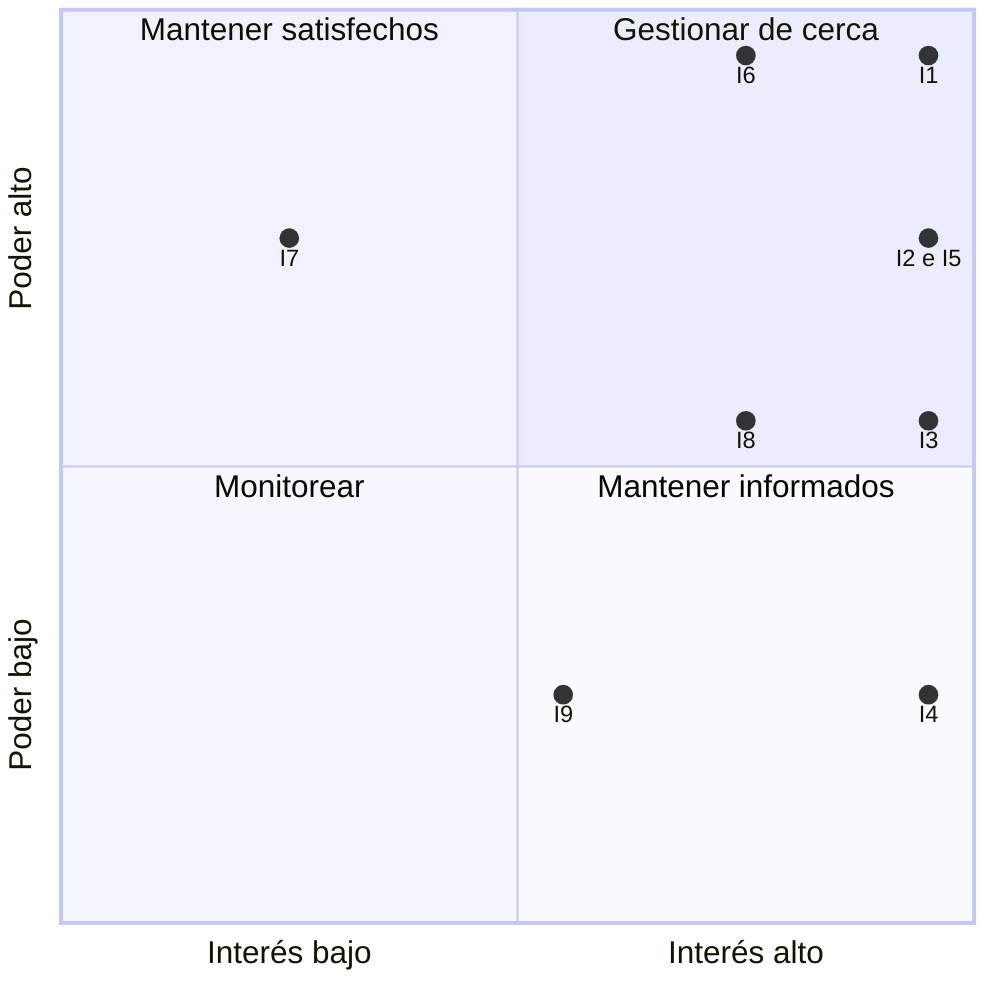

# VetCare

## Sistema de Gestión de Atención Veterinaria

**Universidad Técnica Nacional — Sede San Carlos**

**Curso:** Administración de Proyectos Informáticos, III-26, SC-02

**Profesor:** Deiver Cubero Molina

**Estudiantes:** Jose Pablo Soto Quesada, Maikel Chaves Salas y Edgar Eliam Araya Alvarado

**Fecha:** Septiembre 2026

## Problema

Las clínicas veterinarias necesitan administrar información de diferentes clientes y sus mascotas, pero en algunos casos estos datos pueden encontrarse registrados en documentos físicos, hojas de cálculo o diferentes medios de comunicación. Esto puede dificultar el acceso y control de la información. Además, un mismo cliente puede tener varias mascotas, por lo que es necesario mantener organizada la información de cada una de ellas de manera independiente. También puede ser complicado para los médicos veterinarios consultar rápidamente el historial de una mascota, sus consultas anteriores, vacunas, tratamientos y próximas citas. La falta de un sistema centralizado puede generar pérdida de información, dificultades para organizar las citas y mayor tiempo para consultar los datos de los pacientes.

## Proyecto propuesto

Desarrollar un sistema web para la gestión de una clínica veterinaria, dirigido tanto a los clientes como a los médicos veterinarios. El sistema permitirá a los clientes registrarse y administrar su información, así como registrar una o varias mascotas asociadas a su cuenta. También podrán consultar la información de sus mascotas y gestionar sus citas. Por otra parte, los médicos veterinarios podrán consultar sus citas y acceder al expediente de cada mascota para registrar y consultar información relacionada con las consultas, diagnósticos, tratamientos, vacunas y observaciones. El sistema permitirá centralizar la información y mantener una relación organizada entre los clientes y sus mascotas, de manera que cada mascota tenga su propio historial de atención veterinaria.

## Valor esperado

Se espera que el sistema permita mejorar la organización y administración de la información de la clínica veterinaria, facilitando tanto el trabajo de los médicos como la gestión de los clientes.

El proyecto busca:

- Centralizar la información de clientes y mascotas. Permitir que un cliente pueda registrar y administrar varias mascotas. Mantener un expediente independiente para cada mascota. Facilitar a los médicos veterinarios el acceso al historial de sus pacientes. Mejorar la gestión y organización de las citas. Facilitar el seguimiento de vacunas y tratamientos. Reducir la dependencia de documentos físicos y registros dispersos.
- Permitir que los clientes puedan consultar información relacionada con sus mascotas.
- Mejorar el control y seguimiento de la atención brindada a cada paciente.

## Objetivo general

Desarrollar un sistema web para la gestión de una clínica veterinaria que permita administrar la información de clientes, mascotas, médicos veterinarios, citas e historiales médicos, facilitando el seguimiento y control de la atención de cada mascota.

## Objetivos específicos

1. Analizar los procesos relacionados con la administración de clientes, mascotas, citas e información médica dentro de una clínica veterinaria.
2. Diseñar una base de datos que permita relacionar a los clientes con una o varias mascotas y almacenar de manera organizada la información de cada paciente.
3. Desarrollar un módulo para el registro y administración de clientes, permitiendo mantener actualizada su información personal y de contacto.
4. Implementar un módulo que permita a los clientes registrar y administrar varias mascotas asociadas a su cuenta.
5. Desarrollar un módulo de gestión de citas que permita registrar, consultar y administrar las citas de las mascotas.
6. Implementar un expediente médico digital para cada mascota, permitiendo registrar consultas, diagnósticos, tratamientos, vacunas y observaciones.
7. Desarrollar funcionalidades para que los médicos veterinarios puedan consultar el historial médico de sus pacientes y registrar nueva información durante las consultas.
8. Permitir que los clientes puedan consultar la información y el historial de atención de sus mascotas.
9. Implementar diferentes niveles de acceso para clientes y médicos veterinarios, de acuerdo con las funciones que corresponden a cada tipo de usuario.
10. Realizar pruebas del sistema para verificar el correcto funcionamiento de sus principales módulos y garantizar que la información sea gestionada de manera adecuada.

## Visión a futuro: modelo de negocio

Como visión a largo plazo, la plataforma podría ofrecerse como un servicio en la nube por suscripción (SaaS) para clínicas veterinarias, con los siguientes planes:

| Plan | Precio mensual | Enfoque |
| --- | --- | --- |
| **Essential** | ₡29.900 | Consultorios y clínicas pequeñas con un veterinario. |
| **Professional** | ₡59.900 | Clínicas en crecimiento, hasta 3 veterinarios. |
| **Clinic** | ₡99.900 | Clínicas con varias sucursales, hasta 8 veterinarios. |
| **Enterprise** | Personalizado | Organizaciones con múltiples compañías y regiones. |

Esta visión se menciona únicamente como referencia. El proyecto desarrollado en el curso corresponde a una versión inicial con fines académicos, enfocada en las funcionalidades base descritas en los requerimientos.

## Gestión de interesados

El análisis se realiza para VetCare, el sistema web de gestión de atención veterinaria presentado en la Lección 1. Se consideran los actores que pueden influir en el proyecto o verse afectados por sus resultados. Los roles operativos son propuestos y deberán confirmarse al seleccionar la clínica; las actitudes son estimaciones iniciales, no resultados de entrevistas.

| ID / Interesado | Necesidad principal | Poder | Interés | Actitud estimada |
| --- | --- | --- | --- | --- |
| I1. Propietario o dirección de la clínica | Centralizar información, mejorar el servicio y autorizar recursos y puesta en uso. | 5 | 5 | Favorable |
| I2. Médicos veterinarios | Consultar y registrar expedientes, diagnósticos, vacunas y tratamientos con rapidez. | 4 | 5 | Favorable |
| I3. Recepción / administración | Organizar citas y datos de clientes y mascotas; evitar duplicaciones. | 3 | 5 | Neutral |
| I4. Clientes / propietarios de mascotas | Registrar varias mascotas, gestionar citas y consultar información autorizada. | 2 | 5 | Favorable |
| I5. Equipo desarrollador: Jose Pablo Soto, Maikel Chaves y Eliam Araya | Disponer de requisitos claros, acceso a usuarios y tiempo para implementar y probar. | 4 | 5 | Favorable |
| I6. Profesor: Deiver Cubero Molina | Evaluar la coherencia del proyecto, las evidencias y el cumplimiento académico. | 5 | 4 | Favorable |
| I7. Proveedor de alojamiento y base de datos | Contar con requisitos técnicos definidos y condiciones de uso y pago claras. | 4 | 2 | Neutral |
| I8. Responsable de soporte tecnológico de la clínica | Mantener disponibilidad, accesos, respaldos y resolver incidentes. | 3 | 4 | Neutral |
| I9. Personal auxiliar veterinario | Consultar los datos necesarios para apoyar la atención según su autorización. | 2 | 3 | Neutral |

Poder: capacidad de influir en decisiones, recursos, aceptación o continuidad. Interés: grado de atención y afectación por el resultado. Escala: 1 = muy bajo; 2 = bajo; 3 = medio; 4 = alto; 5 = muy alto.

---

---

## Requerimientos del proyecto

Los requerimientos corresponden a una versión inicial del sistema con fines académicos, ajustada al tiempo disponible en el curso.

### Requerimientos funcionales

#### Usuarios y acceso

| ID | Requerimiento |
| --- | --- |
| RF-01 | El sistema debe permitir que los propietarios de mascotas se registren con sus datos personales y de contacto. |
| RF-02 | El sistema debe permitir iniciar y cerrar sesión. |
| RF-03 | El sistema debe mostrar a cada usuario solo las funciones de su rol: propietario, médico veterinario o administrador. |
| RF-04 | El administrador debe poder registrar a los médicos veterinarios. |

#### Mascotas

| ID | Requerimiento |
| --- | --- |
| RF-05 | El propietario debe poder registrar una o varias mascotas con su nombre, especie, raza, sexo, fecha de nacimiento y peso. |
| RF-06 | El propietario debe poder consultar y editar la información de sus mascotas. |

#### Citas

| ID | Requerimiento |
| --- | --- |
| RF-07 | El propietario debe poder agendar una cita para una de sus mascotas, eligiendo un veterinario y una fecha y hora disponibles. |
| RF-08 | El propietario debe poder cancelar una cita programada. |
| RF-09 | El médico veterinario debe poder consultar sus citas programadas. |
| RF-10 | El médico veterinario debe poder cambiar el estado de una cita a atendida. |

#### Expediente clínico

| ID | Requerimiento |
| --- | --- |
| RF-11 | El médico veterinario debe poder registrar una consulta en el expediente de la mascota, con motivo, diagnóstico, tratamiento y observaciones. |
| RF-12 | El médico veterinario debe poder registrar las vacunas aplicadas y la fecha de la próxima dosis. |
| RF-13 | El médico veterinario debe poder consultar el historial completo de una mascota. |
| RF-14 | El propietario debe poder consultar el historial de atención y las vacunas de sus mascotas. |

### Requerimientos no funcionales

| ID | Categoría | Requerimiento |
| --- | --- | --- |
| RNF-01 | Usabilidad | El sistema debe ser una aplicación web responsive, utilizable desde computadoras y teléfonos. |
| RNF-02 | Usabilidad | La interfaz debe estar en español y ser sencilla de usar. |
| RNF-03 | Seguridad | Las contraseñas deben almacenarse cifradas. |
| RNF-04 | Seguridad | Cada usuario solo debe acceder a la información permitida por su rol; un propietario solo puede ver sus propias mascotas. |
| RNF-05 | Integridad | El sistema debe validar los datos obligatorios antes de guardarlos. |
| RNF-06 | Mantenibilidad | El código debe gestionarse en un repositorio de GitHub con control de versiones. |
| RNF-07 | Privacidad | Durante el desarrollo y las pruebas se utilizarán únicamente datos ficticios. |

## Registro: estrategias de involucramiento

| ID | Estrategia y acción propuesta |
| --- | --- |
| I1 | Gestionar de cerca. Reunión quincenal para priorizar necesidades, aprobar alcance y revisar riesgos; solicitar aceptación de cada entrega. |
| I2 | Gestionar de cerca. Entrevistas iniciales y demostraciones cada dos semanas; validar campos del expediente y flujos clínicos con datos ficticios. |
| I3 | Gestionar de cerca. Observar el proceso de citas, probar prototipos y capacitar antes del piloto; recoger dificultades de uso. |
| I4 | Mantener informados. Invitar a un grupo representativo a probar registro, varias mascotas y citas en cada entrega relevante; ofrecer instrucciones sencillas. |
| I5 | Gestionar de cerca. Planificación semanal, tablero de tareas y revisión quincenal de avances, obstáculos y calidad. |
| I6 | Gestionar de cerca. Presentar avances en las revisiones del curso, registrar retroalimentación y comprobar la rúbrica antes de las entregas. |
| I7 | Mantener satisfecho. Confirmar límites, costos, disponibilidad y recuperación antes del despliegue; contactar ante cambios técnicos o incidentes. |
| I8 | Gestionar de cerca. Acordar accesos, respaldos y recuperación; revisar preparación del entorno antes del piloto y entregar guía de soporte. |
| I9 | Mantener informados. Consultar en hitos sobre necesidades de apoyo y explicar cambios de flujo; aumentar su participación si se confirma un rol directo en el sistema. |

## Justificación de valoraciones discutibles

**I2 - Poder 4:** los médicos no necesariamente autorizan el presupuesto, pero su validación del expediente y su adopción pueden condicionar la aceptación del sistema. No se asigna 5 porque la aprobación global corresponde a la dirección.

**I3 - Poder 3:** recepción influye en los procesos diarios y en la calidad de los datos, aunque no decide la inversión. Su interés es 5 por el uso frecuente de las citas. Si este rol no existe, sus responsabilidades se asignarán al actor que las ejecute.

**I6 - Poder 5 e interés 4:** el profesor determina la evaluación y aceptación académica; su poder se limita a ese contexto. Su interés es alto, aunque no utilizará el sistema en la operación de la clínica.

**I7 - Poder 4 e interés 2:** una interrupción o una limitación técnica puede impedir el despliegue; sin embargo, el proyecto es solo un servicio más para el proveedor. Esta dependencia deberá revisarse según el alojamiento elegido.

## Mapa Poder-Interés

Se utiliza poder en el eje vertical e interés en el horizontal. Para decidir la estrategia, las puntuaciones 1 y 2 se consideran bajas y las puntuaciones 3, 4 y 5 se consideran medias o altas. El valor 3 se incluye en la gestión activa por su influencia operativa; no implica que su poder sea igual al de la dirección.

### Coordenadas del mapa

Cada fila representa una posición exacta del mapa. El eje horizontal corresponde al interés y el vertical al poder.

| Interesado | Interés (X) | Poder (Y) |
| --- | --- | --- |
| I1 | 5 | 5 |
| I2 | 5 | 4 |
| I3 | 5 | 3 |
| I4 | 5 | 2 |
| I5 | 5 | 4 |
| I6 | 4 | 5 |
| I7 | 2 | 4 |
| I8 | 4 | 3 |
| I9 | 3 | 2 |

*El diagrama ubica las puntuaciones 3 a 5 en la mitad alta y 1 a 2 en la mitad baja. La tabla anterior conserva los valores exactos de 1 a 5.*

| Cuadrante | Interesados |
| --- | --- |
| Gestionar de cerca | I1, I2, I3, I5, I6 e I8 |
| Mantener satisfechos | I7 |
| Mantener informados | I4 e I9 |
| Monitorear | Sin interesados con poder e interés bajos en esta valoración inicial. |

I2 e I5 comparten la coordenada (interés 5, poder 4). I9 se mantendrá informado en los hitos relevantes por su participación todavía indirecta; si requiere acceso directo al sistema, se revisará su interés y estrategia.

## Tres interesados críticos

Se seleccionan la dirección, los médicos veterinarios y el equipo desarrollador por su influencia directa en la autorización, utilidad clínica y ejecución de VetCare. El profesor también se gestionará de cerca por su papel en la aceptación académica.

### 1. Dirección de la clínica (I1)

**Por qué es crítica:** autoriza recursos, define prioridades y decide la puesta en uso.

**Cómo involucrarla:** reunión inicial para acordar alcance y criterios de éxito; revisión quincenal con el equipo y aprobación al cierre de cada entrega.

**Responsable:** equipo desarrollador, con un integrante como enlace.

**Evidencia:** minuta de decisiones, lista priorizada y aceptación documentada.

**Resultado esperado:** alcance viable y decisiones oportunas sobre cambios y piloto.

### 2. Médicos veterinarios (I2)

**Por qué son críticos:** determinan si el expediente refleja la atención real y si el sistema resulta útil durante las consultas.

**Cómo involucrarlos:** entrevista y observación inicial; revisión de prototipos y pruebas cada dos semanas con casos ficticios de consultas, vacunas y tratamientos.

**Responsable:** equipo desarrollador y un médico representante elegido por la clínica.

**Evidencia:** comentarios registrados, incidencias y lista de criterios clínicos aprobados.

**Resultado esperado:** validar que puedan consultar el historial y registrar una atención completa con los permisos correctos.

### 3. Equipo desarrollador (I5)

**Por qué es crítico:** transforma los requisitos en software, gestiona las restricciones y comprueba el funcionamiento.

**Cómo involucrarlo:** planificación semanal, distribución de tareas entre Jose Pablo Soto, Maikel Chaves y Eliam Araya, revisión de código y demostración quincenal de funcionalidades.

**Responsable:** los tres integrantes, con responsabilidades acordadas por módulo.

**Evidencia:** tablero actualizado, versiones del sistema y resultados de pruebas.

**Resultado esperado:** entregas funcionales, obstáculos visibles y correcciones antes de cada evaluación.

Las frecuencias indicadas son propuestas. Se ajustarán al calendario del curso y a la disponibilidad de la clínica. El registro y el mapa se revisarán al finalizar cada iteración o cuando cambien actores, responsabilidades o condiciones del proyecto.

## Enfoque de gestión del proyecto

**Decisión: enfoque híbrido.** VetCare combina objetivos y módulos definidos desde la Lección 1 con necesidades de uso que deberán validarse con clientes y personal veterinario. Por ello, se propone planificar los compromisos generales y desarrollar el producto mediante iteraciones.

### Elementos predictivos

Se definirán al inicio el alcance base, los objetivos, los entregables, las responsabilidades y un cronograma ajustado a las fechas que establezca el curso. También se acordarán el modelo inicial de datos, los niveles de acceso, los criterios de aceptación y los riesgos. Estos elementos permiten controlar el trabajo de un equipo de tres estudiantes y comprobar el cumplimiento académico.

### Elementos adaptativos

Los flujos de citas, la consulta del historial, la presentación de vacunas y el registro de varias mascotas pueden cambiar tras las pruebas con usuarios. Se trabajará con una lista priorizada de requisitos e iteraciones propuestas de dos semanas. Cada ciclo incluirá diseño, implementación, pruebas y demostración para incorporar retroalimentación antes de continuar.

### Aplicación en VetCare

Primero se validarán requisitos y relaciones entre clientes, mascotas, médicos y citas. Después se propone implementar: (1) cuentas, permisos y registro de clientes y mascotas; (2) gestión de citas; (3) expediente, consultas, diagnósticos, tratamientos y vacunas; y (4) consulta autorizada para clientes y pruebas integrales. El orden y la cantidad de iteraciones se ajustarán al calendario real.

### Control de cambios y calidad

Los ajustes de interfaz o de flujo que no alteren los compromisos se priorizarán para la siguiente iteración. Si un cambio afecta alcance, tiempo o recursos, el equipo documentará su impacto y lo revisará con la dirección y, cuando corresponda, con el profesor. Cada entrega deberá superar pruebas funcionales y de permisos antes de considerarse terminada.

### Justificación frente a otros enfoques

Un enfoque exclusivamente predictivo dificultaría incorporar cambios descubiertos al probar el sistema con usuarios. Uno exclusivamente adaptativo ofrecería menos estructura para los compromisos académicos y el alcance ya definido. El enfoque híbrido permite mantener una planificación verificable y aprender durante el desarrollo, reduciendo el riesgo de entregar funciones que no respondan a la operación real.

**Condición del análisis:** el documento original no identifica una clínica concreta, presupuesto, proveedor ni calendario detallado. Estas decisiones y la disponibilidad de usuarios deben confirmarse antes de cerrar la planificación; las propuestas anteriores no constituyen acuerdos ya realizados.

### Justificación del proyecto

Las clínicas veterinarias suelen tener la información de clientes y mascotas dispersa en documentos físicos, hojas y otros medios. Esto dificulta consultar historiales, organizar citas y dar seguimiento a vacunas y tratamientos. VetCare se propone como un sistema web que centraliza esa información y le da a cada mascota su propio expediente.

| Incluye | No incluye |
| --- | --- |
| Registro e inicio de sesión de usuarios | Facturación, cobros y suscripciones |
| Acceso según rol: propietario, veterinario y administrador | Inventario de medicamentos y productos |
| Registro de varias mascotas por propietario | Laboratorio, imágenes clínicas y hospitalización |
| Agendar, cancelar y consultar citas | Recordatorios automáticos y notificaciones |
| Expediente clínico con consultas y vacunas | Reportes y dashboards administrativos |
| Consulta del historial por parte del propietario | Varias clínicas o sucursales |
| | Aplicación móvil nativa e integraciones externas |

---

## Definición del Scrum Team

Como somos un equipo de tres personas, los tres actuamos como Developers. Además, dos integrantes asumen los roles de Product Owner y Scrum Master, y el tercero se enfoca en el desarrollo y en las áreas de calidad y documentación. Se evita que una misma persona sea Product Owner y Scrum Master a la vez, para no mezclar la priorización del producto con la protección de la capacidad del equipo.

| Integrante | Rol Scrum | Responsabilidades |
| --- | --- | --- |
| Jose Pablo Soto Quesada | **Product Owner + Developer** | Mantener y priorizar el Product Backlog, definir criterios de aceptación y ser el enlace con la clínica y el profesor. |
| Maikel Chaves Salas | **Scrum Master + Developer** | Facilitar el proceso, remover impedimentos y mantener el tablero actualizado. |
| Edgar Eliam Araya Alvarado | **Developer** | Desarrollar las funcionalidades del Sprint, liderar las pruebas funcionales y de permisos, y mantener actualizada la documentación del proyecto. |

### Roles adicionales para el futuro

| Rol | Cuándo se necesita | Asignación propuesta |
| --- | --- | --- |
| Responsable de base de datos (DBA) | Diseño del modelo de datos y respaldos | Jose Pablo |
| Responsable de pruebas (QA) | Pruebas funcionales y de permisos | Eliam |
| Responsable de interfaz (UX/UI) | Prototipos y pruebas de usabilidad | Jose Pablo |
| Responsable de despliegue (DevOps) | Alojamiento y puesta en línea | Maikel |
| Responsable de documentación | Manual de usuario y actualización de este documento | Eliam, con apoyo de los demás |

---

## Análisis de Entorno

### Factores Ambientales de la Empresa (EEFs)

| Factor | Efecto en VetCare |
| --- | --- |
| Infraestructura tecnológica (hosting, base de datos, herramientas) | Define dónde se despliega el sistema y sus límites de uso |
| Cultura organizacional de la clínica | Afecta la adopción del sistema frente a los registros físicos |
| Normativa legal y de privacidad de datos | Obliga a controlar accesos y proteger la información |
| Distribución del equipo (presencial o remoto) | Condiciona la coordinación entre los tres integrantes |
| Disponibilidad de usuarios para pruebas | Afecta la calidad de la validación |
| Calendario académico | Limita el tiempo y el alcance posible |

### Lean Canvas

| Bloque | Contenido |
| --- | --- |
| **Problema** | Información dispersa en papel y hojas de cálculo; dificultad para consultar historiales, organizar citas y seguir vacunas y tratamientos. |
| **Segmentos de clientes** | Clínicas veterinarias; usuarios: médicos, recepción y propietarios de mascotas. |
| **Propuesta de valor** | Un sistema web donde cada mascota tiene su expediente y cada cliente administra varias mascotas y sus citas. |
| **Solución** | Módulos de clientes, mascotas, citas y expediente médico con acceso por tipo de usuario. |
| **Canales** | Aplicación web desde navegador. |
| **Fuentes de ingreso** | No aplica en el curso; se definiría con la clínica si se implementa. |
| **Estructura de costos** | Alojamiento, base de datos y tiempo de desarrollo; montos por confirmar. |
| **Métricas clave** | Citas gestionadas, expedientes creados y tiempo para consultar un historial. |
| **Ventaja diferenciadora** | Relación cliente–varias mascotas y expediente individual validado con personal veterinario. |

---

---

## Sección 05: Backlog inicial, Sprint Backlog y mecanismo de seguimiento

### Product Backlog inicial

El Product Backlog reúne las historias de usuario de VetCare. Cada historia se deriva de uno o más requerimientos funcionales (columna **RF**). Es gestionado y priorizado por el Product Owner (Jose Pablo Soto) y se ajustará después de cada Sprint Review según la retroalimentación recibida.

**Escala de prioridad:** P1 = alta (indispensable para el funcionamiento básico), P2 = media (importante, pero el sistema puede operar sin ella en las primeras versiones).
**Estimación:** puntos de historia (1, 2, 3, 5, 8), que representan el esfuerzo relativo.

| ID | Módulo | Historia de usuario | RF | Prioridad | Puntos |
| --- | --- | --- | :---: | :---: | :---: |
| HU-01 | Usuarios | Como propietario, quiero registrarme con mis datos personales y de contacto, para acceder al sistema. | RF-01 | P1 | 3 |
| HU-02 | Usuarios | Como usuario, quiero iniciar y cerrar sesión, para acceder únicamente a las funciones de mi rol (propietario, médico veterinario o administrador). | RF-02, RF-03 | P1 | 3 |
| HU-03 | Mascotas | Como propietario, quiero registrar una o varias mascotas con su nombre, especie, raza, sexo, fecha de nacimiento y peso, para que cada una tenga su propia información. | RF-05 | P1 | 5 |
| HU-04 | Mascotas | Como propietario, quiero ver la lista de mis mascotas y editar su información, para mantener sus datos actualizados. | RF-06 | P1 | 3 |
| HU-05 | Usuarios | Como administrador, quiero registrar a los médicos veterinarios, para que puedan ingresar al sistema y atender citas. | RF-04 | P1 | 2 |
| HU-06 | Citas | Como propietario, quiero agendar una cita para una de mis mascotas eligiendo un veterinario y una fecha y hora disponibles, para recibir atención sin tener que llamar. | RF-07 | P1 | 8 |
| HU-07 | Citas | Como propietario, quiero cancelar una cita programada, para liberarla si no puedo asistir. | RF-08 | P2 | 2 |
| HU-08 | Citas | Como médico veterinario, quiero consultar mis citas programadas, para organizar mi jornada. | RF-09 | P1 | 3 |
| HU-09 | Citas | Como médico veterinario, quiero marcar una cita como atendida, para llevar el control de las citas realizadas. | RF-10 | P2 | 2 |
| HU-10 | Expediente | Como médico veterinario, quiero registrar una consulta con su motivo, diagnóstico, tratamiento y observaciones en el expediente de la mascota, para documentar la atención. | RF-11 | P1 | 5 |
| HU-11 | Expediente | Como médico veterinario, quiero registrar las vacunas aplicadas y la fecha de la próxima dosis, para dar seguimiento al plan de vacunación. | RF-12 | P2 | 3 |
| HU-12 | Expediente | Como médico veterinario, quiero consultar el historial completo de una mascota, para conocer sus atenciones anteriores antes de atenderla. | RF-13 | P1 | 3 |
| HU-13 | Expediente | Como propietario, quiero consultar el historial de atención y las vacunas de mis mascotas, para conocer su estado de salud. | RF-14 | P2 | 3 |
| | | | | **Total** | **45** |

### Plan de Sprints

Con base en las prioridades y en la dependencia entre módulos, el Product Backlog se distribuye en tres Sprints de dos semanas. Este plan es una referencia y se ajustará según la velocidad real del equipo.

| Sprint | Enfoque | Historias | Puntos |
| --- | --- | --- | :---: |
| Sprint 1 | Usuarios, roles y mascotas | HU-01, HU-02, HU-03, HU-04, HU-05 | 16 |
| Sprint 2 | Citas | HU-06, HU-07, HU-08, HU-09 | 15 |
| Sprint 3 | Expediente clínico | HU-10, HU-11, HU-12, HU-13 | 14 |

### Sprint Backlog — Sprint 1

| Elemento | Detalle |
| --- | --- |
| **Duración** | 2 semanas (DD/MM/2026 al DD/MM/2026) |
| **Sprint Goal** | Que un propietario pueda crear su cuenta, iniciar sesión y registrar y administrar sus mascotas, con acceso diferenciado entre propietarios, médicos veterinarios y administrador. |
| **Historias seleccionadas** | HU-01, HU-02, HU-03, HU-04 y HU-05 |
| **Total de puntos** | 16 |

**¿Por qué estas historias primero?** Son la base de todo el sistema: sin usuarios, roles, propietarios y mascotas registrados no es posible agendar citas ni llevar un expediente. Además, permiten validar desde el inicio el modelo de datos más importante del proyecto, la relación de un propietario con varias mascotas.

#### Tareas del Sprint 1

| ID | Historia | Tarea | Responsable | Horas estimadas |
| --- | --- | --- | --- | :---: |
| T-01 | General | Diseñar el modelo de datos inicial (usuarios, roles, propietarios y mascotas). | Jose Pablo Soto | 4 |
| T-02 | General | Configurar el repositorio, la estructura del proyecto y la base de datos. | Maikel Chaves | 3 |
| T-03 | HU-01 | Diseñar e implementar la interfaz de registro de propietarios. | Jose Pablo Soto | 3 |
| T-04 | HU-01 | Implementar el registro de propietarios con validación de datos obligatorios. | Maikel Chaves | 4 |
| T-05 | HU-01 | Probar el registro de propietarios. | Eliam Araya | 2 |
| T-06 | HU-02 | Implementar el inicio y cierre de sesión. | Maikel Chaves | 4 |
| T-07 | HU-02 | Implementar el control de acceso según el rol del usuario. | Eliam Araya | 3 |
| T-08 | HU-02 | Probar el inicio de sesión y los permisos por rol. | Jose Pablo Soto | 2 |
| T-09 | HU-03 | Diseñar e implementar el formulario de registro de mascotas. | Jose Pablo Soto | 3 |
| T-10 | HU-03 | Implementar el registro de mascotas asociadas al propietario. | Eliam Araya | 4 |
| T-11 | HU-03 | Probar el registro de una y de varias mascotas por propietario. | Maikel Chaves | 2 |
| T-12 | HU-04 | Implementar la lista de mascotas del propietario y la edición de sus datos. | Eliam Araya | 4 |
| T-13 | HU-04 | Probar la lista y la edición de mascotas. | Jose Pablo Soto | 2 |
| T-14 | HU-05 | Implementar el registro de médicos veterinarios por parte del administrador. | Maikel Chaves | 3 |
| T-15 | HU-05 | Probar el registro de médicos y su acceso al sistema. | Eliam Araya | 2 |
| T-16 | General | Actualizar la documentación del proyecto con los resultados del Sprint. | Eliam Araya | 2 |

**Carga por integrante:** Jose Pablo Soto, 14 horas; Maikel Chaves, 16 horas; Eliam Araya, 17 horas.

Como práctica de calidad, ninguna funcionalidad es probada únicamente por quien la desarrolló.

### Mecanismo de seguimiento

El seguimiento del Sprint corresponde al grupo de procesos de **Monitoreo y Control**: permite comparar el avance real con lo planificado y tomar decisiones a tiempo.

#### 1. Tablero de tareas

Se utilizará un tablero en GitHub Projects con las siguientes columnas:

| Columna | Significado |
| --- | --- |
| **Por hacer** | Tareas del Sprint que aún no se han iniciado. |
| **En progreso** | Tareas en las que un integrante está trabajando. |
| **En pruebas** | Tareas terminadas que están siendo probadas por otro integrante. |
| **Terminado** | Tareas que cumplen la Definición de Terminado. |

Cada integrante mueve sus tareas en el tablero apenas cambia su estado, de modo que todo el equipo vea el avance real (transparencia). Para evitar dejar muchas tareas a medias, cada integrante tendrá como máximo dos tareas en progreso al mismo tiempo.

#### 2. Daily Scrum

Se realizará tres veces por semana (lunes, miércoles y viernes), de forma presencial o por mensaje en el grupo del equipo, con una duración máxima de 15 minutos. Cada integrante responde:

- ¿Qué avancé desde la última Daily?
- ¿Qué voy a hacer hasta la próxima?
- ¿Tengo algún impedimento?

#### 3. Gráfico de avance (Burndown)

El Scrum Master registrará las horas de trabajo pendientes al final de cada Daily y las comparará con el avance ideal. Si el avance real queda por encima del ideal durante dos registros seguidos, el equipo revisará qué está frenando el trabajo y, de ser necesario, conversará con el Product Owner para ajustar el alcance del Sprint.

| Registro | Día del Sprint | Horas pendientes ideales | Horas pendientes reales |
| --- | :---: | :---: | :---: |
| Inicio | 0 | 47 | 47 |
| Daily 1 | 2 | 38 | |
| Daily 2 | 4 | 28 | |
| Daily 3 | 6 | 19 | |
| Daily 4 | 8 | 9 | |
| Cierre | 10 | 0 | |

#### 4. Registro de impedimentos

El Scrum Master registra los impedimentos detectados y da seguimiento hasta resolverlos.

| Fecha | Impedimento | Responsable | Acción | Estado |
| --- | --- | --- | --- | --- |
| | | | | |

#### 5. Definición de Terminado (Definition of Done)

Una historia se considera terminada cuando:

- cumple todos sus criterios de aceptación;
- el código está integrado en la rama principal del repositorio;
- fue probada con datos ficticios por un integrante distinto de quien la desarrolló, incluyendo las pruebas de permisos cuando aplique;
- no tiene errores conocidos sin resolver;
- está documentada en este documento o en el repositorio.

#### 6. Cierre del Sprint

- **Sprint Review:** al final del Sprint se presenta el incremento al profesor. La retroalimentación se usa para ajustar el Product Backlog.
- **Sprint Retrospective:** después de la Review, el equipo identifica qué funcionó, qué no y qué mejorar en el siguiente Sprint.
- **Métricas registradas:** puntos de historia completados (velocidad del equipo) y porcentaje de tareas terminadas, que servirán para planificar de forma más realista los siguientes Sprints.

### Detalle de historias de usuario

La plantilla sigue la regla de las tres C (card, conversation, confirmation) que Ron Jeffries describió en 2001. Los criterios de aceptación usan el formato Dado que, cuando, entonces, propuesto por Dan North en 2006 dentro del desarrollo guiado por comportamiento (BDD). La revisión de calidad aplica el criterio INVEST de Bill Wake (2003). Las reglas de negocio de cada historia son propuestas del equipo y no provienen de una clínica real; el Product Owner puede ajustarlas antes de cada Sprint Planning.

Cada historia indica los requerimientos funcionales (RF) y no funcionales (RNF) con los que se relaciona.

La dificultad de cada criterio de aceptación la asignó cada integrante en escala 1, 2, 3 y 5, donde JP es Jose Pablo Soto, MC es Maikel Chaves y EA es Eliam Araya. Jose Pablo tiene más experiencia en desarrollo web y bases de datos, por eso sus valores suelen ser más bajos. La dificultad por criterio es distinta de los puntos de historia: la primera muestra qué parte le cuesta más a cada integrante y los puntos miden el tamaño de toda la historia.

#### HU-01: Registro de propietarios

Requerimientos relacionados: RF-01, RNF-03 y RNF-05.

> Como propietario de mascotas, quiero registrarme con mi nombre, teléfono, correo electrónico y una contraseña, para acceder al sistema y administrar la información de mis mascotas.

Criterios de aceptación:

1. Dado que el visitante completa todos los datos obligatorios, cuando presiona "Registrarse", entonces el sistema crea la cuenta con el rol de propietario y muestra un mensaje de confirmación. (JP 1, MC 2, EA 2)
2. Dado que el visitante deja vacío algún dato obligatorio, cuando intenta registrarse, entonces el sistema no crea la cuenta y señala los campos faltantes. (JP 1, MC 1, EA 2)
3. Dado que el correo ya está registrado, cuando el visitante intenta registrarse, entonces el sistema indica que el correo está en uso. (JP 1, MC 2, EA 2)
4. Dado que la contraseña tiene menos de 8 caracteres, cuando el visitante intenta registrarse, entonces el sistema muestra un mensaje de error. (JP 1, MC 1, EA 1)
5. Dado que la cuenta fue creada, cuando se guarda en la base de datos, entonces la contraseña queda almacenada cifrada. (JP 3, MC 5, EA 5)

El criterio 5 fue el de mayor dificultad para los tres.

Prioridad P1. Estimación de 3 puntos por planning poker (JP 3, MC 3, EA 3). Sprint 1, del 22/10/2026 al 04/11/2026.

No depende de otras historias. El rol de propietario se asigna de forma automática y ningún visitante puede registrarse como veterinario o administrador. El mínimo de 8 caracteres para la contraseña es una decisión del equipo. El wireframe del formulario está pendiente.

#### HU-02: Inicio y cierre de sesión con acceso por rol

Requerimientos relacionados: RF-02, RF-03 y RNF-04.

> Como usuario del sistema, quiero iniciar y cerrar sesión, para acceder solo a las funciones de mi rol (propietario, médico veterinario o administrador).

Criterios de aceptación:

1. Dado que el usuario está registrado, cuando ingresa su correo y contraseña correctos, entonces el sistema inicia la sesión y lo lleva a la pantalla principal de su rol. (JP 1, MC 2, EA 2)
2. Dado que el usuario ingresa un correo o una contraseña incorrectos, cuando intenta iniciar sesión, entonces el sistema muestra un mensaje genérico de credenciales inválidas, sin indicar cuál dato falló. (JP 1, MC 1, EA 1)
3. Dado que el usuario tiene la sesión iniciada, cuando presiona "Cerrar sesión", entonces el sistema finaliza la sesión y lo devuelve a la pantalla de inicio de sesión. (JP 1, MC 1, EA 1)
4. Dado que un propietario tiene la sesión iniciada, cuando intenta entrar a una función de veterinario o de administrador, entonces el sistema le niega el acceso. (JP 2, MC 3, EA 3)

El criterio 4 fue el de mayor dificultad, porque el control de acceso se valida en el servidor.

Prioridad P1. Estimación de 3 puntos por planning poker (JP 3, MC 3, EA 3). Sprint 1, del 22/10/2026 al 04/11/2026.

Depende de la HU-01. El control de acceso se valida en el servidor y no solo ocultando opciones en la interfaz. El wireframe de la pantalla de inicio de sesión está pendiente.

#### HU-03: Registro de mascotas del propietario

Requerimientos relacionados: RF-05 y RNF-05.

> Como propietario de mascotas, quiero registrar una o varias mascotas asociadas a mi cuenta con su nombre, especie, raza, sexo, fecha de nacimiento y peso, para que cada una tenga su propia información.

Criterios de aceptación:

1. Dado que el propietario inició sesión, cuando completa los datos obligatorios y presiona "Guardar", entonces el sistema registra la mascota, la asocia a su cuenta y muestra un mensaje de confirmación. (JP 2, MC 3, EA 3)
2. Dado que el propietario deja vacío el nombre, la especie o el sexo, cuando intenta guardar, entonces el sistema no registra la mascota y señala los campos faltantes. (JP 1, MC 1, EA 1)
3. Dado que el propietario ingresa una fecha de nacimiento posterior a la fecha actual o un peso menor o igual a cero, cuando intenta guardar, entonces el sistema muestra un mensaje de error. (JP 1, MC 2, EA 2)
4. Dado que el propietario ya tiene una mascota registrada, cuando registra otra, entonces ambas aparecen en su lista con información independiente. (JP 1, MC 2, EA 2)
5. Dado que un usuario no inició sesión, cuando intenta entrar al registro de mascotas, entonces el sistema lo envía a la página de inicio de sesión. (JP 1, MC 1, EA 2)

El criterio 1 fue el de mayor dificultad, porque requiere la relación entre propietario y mascota en la base de datos.

Prioridad P1. Estimación de 5 puntos por planning poker (JP _, MC _, EA _). Sprint 1, del 22/10/2026 al 04/11/2026.

Depende de la HU-02, porque la mascota se asocia al propietario autenticado. Un propietario puede tener muchas mascotas y cada mascota pertenece a un solo propietario. La raza y la fecha de nacimiento son opcionales. El wireframe del formulario está pendiente.

#### HU-04: Consulta y edición de mascotas

Requerimientos relacionados: RF-06, RNF-04 y RNF-05.

> Como propietario de mascotas, quiero ver la lista de mis mascotas y editar su información, para mantener sus datos actualizados.

Criterios de aceptación:

1. Dado que el propietario tiene mascotas registradas, cuando entra a "Mis mascotas", entonces el sistema muestra el nombre, la especie y la raza de cada una. (JP 1, MC 1, EA 1)
2. Dado que el propietario no tiene mascotas, cuando entra a "Mis mascotas", entonces el sistema muestra un mensaje y la opción de registrar una. (JP 1, MC 1, EA 1)
3. Dado que el propietario edita los datos de una mascota con información válida, cuando presiona "Guardar", entonces el sistema actualiza los datos y muestra un mensaje de confirmación. (JP 1, MC 2, EA 2)
4. Dado que el propietario deja un campo obligatorio vacío o ingresa un dato inválido, cuando intenta guardar, entonces el sistema aplica las mismas validaciones de la HU-03. (JP 1, MC 1, EA 1)
5. Dado que un propietario intenta ver o editar una mascota ajena, cuando accede a ella, entonces el sistema le niega el acceso. (JP 2, MC 3, EA 3)

El criterio 5 fue el de mayor dificultad, porque cada consulta debe verificar que la mascota pertenezca al propietario.

Prioridad P1. Estimación de 3 puntos por planning poker (JP _, MC _, EA _). Sprint 1, del 22/10/2026 al 04/11/2026.

Depende de la HU-03. El formulario de edición puede reutilizar el de registro. El wireframe de la lista está pendiente.

#### HU-05: Registro de médicos veterinarios

Requerimientos relacionados: RF-03, RF-04 y RNF-03.

> Como administrador de la clínica, quiero registrar a los médicos veterinarios con su nombre, correo electrónico y una contraseña inicial, para que puedan ingresar al sistema y atender citas.

Criterios de aceptación:

1. Dado que el administrador inició sesión, cuando completa los datos del veterinario y presiona "Guardar", entonces el sistema crea la cuenta con el rol de médico veterinario. (JP 1, MC 2, EA 2)
2. Dado que el correo ya está registrado, cuando el administrador intenta guardar, entonces el sistema indica que el correo está en uso. (JP 1, MC 1, EA 1)
3. Dado que el veterinario fue registrado, cuando inicia sesión, entonces el sistema le muestra las funciones de su rol. (JP 1, MC 2, EA 2)
4. Dado que un usuario que no es administrador intenta entrar al registro de veterinarios, cuando accede a esa opción, entonces el sistema le niega el acceso. (JP 1, MC 2, EA 2)

Los criterios tienen una dificultad parecida, porque reutilizan el registro de la HU-01 y el control de acceso de la HU-02.

Prioridad P1. Estimación de 2 puntos por planning poker (JP _, MC _, EA _). Sprint 1, del 22/10/2026 al 04/11/2026.

Depende de la HU-02. La cuenta del administrador se crea con datos iniciales al instalar el sistema y no existe un registro público de administradores. El wireframe del panel está pendiente.

#### HU-06: Agendar una cita para una mascota

Requerimientos relacionados: RF-07 y RNF-05.

> Como propietario de mascotas, quiero agendar una cita para una de mis mascotas eligiendo un veterinario y una fecha y hora disponibles, para recibir atención sin llamar a la clínica.

Criterios de aceptación:

1. Dado que el propietario tiene al menos una mascota registrada, cuando selecciona la mascota, el veterinario, la fecha y una hora disponible y confirma, entonces el sistema registra la cita con estado "Programada" y muestra un resumen. (JP 2, MC 3, EA 3)
2. Dado que el propietario eligió un veterinario y una fecha, cuando el sistema muestra los horarios, entonces solo aparecen las horas libres de ese veterinario. (JP 3, MC 5, EA 5)
3. Dado que dos propietarios intentan reservar el mismo veterinario a la misma hora, cuando el segundo confirma, entonces el sistema le indica que el horario ya no está disponible. (JP 3, MC 5, EA 5)
4. Dado que el propietario selecciona una fecha anterior a la actual, cuando intenta continuar, entonces el sistema no lo permite. (JP 1, MC 1, EA 1)
5. Dado que el propietario no tiene mascotas registradas, cuando entra a agendar una cita, entonces el sistema le indica que primero debe registrar una. (JP 1, MC 1, EA 1)

Los criterios 2 y 3 fueron los de mayor dificultad, porque requieren calcular los horarios libres y evitar que dos citas ocupen el mismo espacio.

Prioridad P1. Estimación de 8 puntos por planning poker (JP _, MC _, EA _). Sprint 2, del 05/11/2026 al 18/11/2026.

Depende de la HU-03 y de la HU-05. Antes del Sprint 2 el Product Owner debe definir el horario de atención y la duración de cada cita; el equipo propone 30 minutos como valor inicial, sin una fuente que lo respalde. El wireframe de la pantalla de agendamiento está pendiente.

#### HU-07: Cancelar una cita

Requerimientos relacionados: RF-08 y RNF-04.

> Como propietario de mascotas, quiero cancelar una cita programada, para liberar el espacio si no puedo asistir.

Criterios de aceptación:

1. Dado que el propietario tiene una cita "Programada" en una fecha futura, cuando presiona "Cancelar" y confirma, entonces el sistema cambia el estado a "Cancelada" y el horario queda libre. (JP 1, MC 2, EA 2)
2. Dado que el sistema pide confirmar la cancelación, cuando el propietario desiste, entonces la cita no cambia. (JP 1, MC 1, EA 1)
3. Dado que la cita está "Atendida" o "Cancelada", cuando el propietario la consulta, entonces la opción de cancelar no aparece. (JP 1, MC 1, EA 2)
4. Dado que un propietario intenta cancelar una cita ajena, cuando realiza la acción, entonces el sistema le niega el acceso. (JP 1, MC 2, EA 2)

Los criterios tienen una dificultad baja, porque reutilizan el control de acceso y los estados de la HU-06.

Prioridad P2. Estimación de 2 puntos por planning poker (JP _, MC _, EA _). Sprint 2, del 05/11/2026 al 18/11/2026.

Depende de la HU-06. La cita cancelada se conserva con su estado para mantener el historial. El wireframe está pendiente.

#### HU-08: Consulta de citas del veterinario

Requerimientos relacionados: RF-09 y RNF-04.

> Como médico veterinario, quiero consultar mis citas programadas, para organizar mi jornada.

Criterios de aceptación:

1. Dado que el veterinario inició sesión, cuando entra a "Mis citas", entonces el sistema muestra sus citas ordenadas por fecha y hora, con el nombre y la especie de la mascota y el nombre del propietario. (JP 2, MC 2, EA 3)
2. Dado que el veterinario selecciona una fecha, cuando filtra la agenda, entonces el sistema muestra solo las citas de ese día. (JP 1, MC 2, EA 2)
3. Dado que el veterinario no tiene citas en la fecha elegida, cuando consulta la agenda, entonces el sistema muestra un mensaje. (JP 1, MC 1, EA 1)
4. Dado que existen citas de otros veterinarios, cuando el veterinario consulta su agenda, entonces solo ve las suyas. (JP 1, MC 2, EA 2)

El criterio 1 fue el de mayor dificultad, porque la consulta une datos de citas, mascotas y propietarios.

Prioridad P1. Estimación de 3 puntos por planning poker (JP _, MC _, EA _). Sprint 2, del 05/11/2026 al 18/11/2026.

Depende de la HU-06. Por defecto se muestran las citas del día actual. El wireframe de la agenda está pendiente.

#### HU-09: Marcar una cita como atendida

Requerimientos relacionados: RF-10 y RNF-04.

> Como médico veterinario, quiero marcar una cita como atendida, para llevar el control de las citas realizadas.

Criterios de aceptación:

1. Dado que el veterinario tiene una cita "Programada" para el día actual, cuando presiona "Marcar como atendida", entonces el estado cambia a "Atendida". (JP 1, MC 2, EA 2)
2. Dado que la cita está "Cancelada", cuando el veterinario la consulta, entonces la opción no aparece. (JP 1, MC 1, EA 1)
3. Dado que la cita es de una fecha futura, cuando el veterinario intenta marcarla, entonces el sistema no lo permite. (JP 1, MC 1, EA 2)
4. Dado que la cita pertenece a otro veterinario, cuando intenta modificarla, entonces el sistema le niega el acceso. (JP 1, MC 2, EA 2)

Los criterios tienen una dificultad baja, porque se trata de un cambio de estado con validaciones simples.

Prioridad P2. Estimación de 2 puntos por planning poker (JP _, MC _, EA _). Sprint 2, del 05/11/2026 al 18/11/2026.

Depende de la HU-08. Al marcar la cita, el sistema puede ofrecer un acceso directo al registro de la consulta de la HU-10. El wireframe está pendiente.

#### HU-10: Registro de consultas en el expediente

Requerimientos relacionados: RF-11, RNF-04 y RNF-05.

> Como médico veterinario, quiero registrar una consulta con su motivo, diagnóstico, tratamiento y observaciones en el expediente de la mascota, para documentar la atención.

Criterios de aceptación:

1. Dado que el veterinario seleccionó una mascota, cuando completa el motivo, el diagnóstico y el tratamiento y presiona "Guardar", entonces el sistema registra la consulta con la fecha actual y su nombre. (JP 2, MC 3, EA 3)
2. Dado que el veterinario deja vacío el motivo, el diagnóstico o el tratamiento, cuando intenta guardar, entonces el sistema señala los campos faltantes. (JP 1, MC 1, EA 1)
3. Dado que la consulta fue registrada, cuando se abre el expediente de la mascota, entonces la consulta aparece en el historial. (JP 1, MC 2, EA 2)
4. Dado que un propietario intenta registrar una consulta, cuando accede a esa función, entonces el sistema le niega el acceso. (JP 1, MC 2, EA 2)

El criterio 1 fue el de mayor dificultad, porque crea la estructura del expediente que usan la HU-12 y la HU-13.

Prioridad P1. Estimación de 5 puntos por planning poker (JP _, MC _, EA _). Sprint 3, del 19/11/2026 al 02/12/2026.

Depende de la HU-03 y de la HU-05. Las observaciones son opcionales. Una consulta registrada no se elimina. El wireframe del formulario está pendiente.

#### HU-11: Registro de vacunas

Requerimientos relacionados: RF-12 y RNF-05.

> Como médico veterinario, quiero registrar las vacunas aplicadas a una mascota y la fecha de la próxima dosis, para dar seguimiento a su vacunación.

Criterios de aceptación:

1. Dado que el veterinario seleccionó una mascota, cuando ingresa el nombre de la vacuna y la fecha de aplicación y presiona "Guardar", entonces el sistema registra la vacuna en el expediente. (JP 1, MC 2, EA 2)
2. Dado que la fecha de próxima dosis es anterior o igual a la de aplicación, cuando el veterinario intenta guardar, entonces el sistema muestra un mensaje de error. (JP 1, MC 2, EA 2)
3. Dado que la vacuna no requiere otra dosis, cuando el veterinario deja vacío ese campo, entonces el sistema guarda el registro sin próxima dosis. (JP 1, MC 1, EA 1)
4. Dado que la vacuna fue registrada, cuando se abre el expediente, entonces aparece con su fecha de aplicación y su próxima dosis. (JP 1, MC 1, EA 2)

Los criterios 1 y 2 fueron los de mayor dificultad para Maikel y Eliam, por el manejo de fechas.

Prioridad P2. Estimación de 3 puntos por planning poker (JP _, MC _, EA _). Sprint 3, del 19/11/2026 al 02/12/2026.

Depende de la HU-03 y de la HU-05. El nombre de la vacuna se escribe como texto libre; un catálogo de vacunas queda fuera del alcance del curso. El wireframe está pendiente.

#### HU-12: Consulta del historial clínico por el veterinario

Requerimientos relacionados: RF-13 y RNF-04.

> Como médico veterinario, quiero consultar el historial completo de una mascota, para conocer sus atenciones anteriores antes de atenderla.

Criterios de aceptación:

1. Dado que el veterinario busca una mascota, cuando abre su expediente, entonces el sistema muestra los datos de la mascota y del propietario, las consultas y las vacunas. (JP 2, MC 3, EA 3)
2. Dado que la mascota tiene varias consultas, cuando el veterinario abre el historial, entonces aparecen de la más reciente a la más antigua. (JP 1, MC 1, EA 1)
3. Dado que la mascota no tiene consultas, cuando el veterinario abre el expediente, entonces el sistema muestra un mensaje. (JP 1, MC 1, EA 1)
4. Dado que el veterinario está atendiendo una cita, cuando la selecciona en su agenda, entonces puede abrir el expediente de la mascota. (JP 1, MC 2, EA 2)

El criterio 1 fue el de mayor dificultad, porque reúne datos de cuatro tablas en una sola vista.

Prioridad P1. Estimación de 3 puntos por planning poker (JP _, MC _, EA _). Sprint 3, del 19/11/2026 al 02/12/2026.

Depende de la HU-10 y de la HU-11. Como el sistema atiende una sola clínica, cualquier veterinario puede consultar el expediente de cualquier mascota. El wireframe del expediente está pendiente.

#### HU-13: Consulta del historial por el propietario

Requerimientos relacionados: RF-14 y RNF-04.

> Como propietario de mascotas, quiero consultar el historial de atención y las vacunas de mis mascotas, para conocer su estado de salud.

Criterios de aceptación:

1. Dado que el propietario inició sesión, cuando abre el historial de una de sus mascotas, entonces el sistema muestra las consultas y vacunas de la más reciente a la más antigua. (JP 1, MC 2, EA 2)
2. Dado que una vacuna tiene próxima dosis, cuando el propietario consulta el historial, entonces ve esa fecha. (JP 1, MC 1, EA 1)
3. Dado que el propietario consulta el historial, cuando visualiza la información, entonces solo puede leerla. (JP 1, MC 2, EA 2)
4. Dado que el propietario intenta consultar una mascota ajena, cuando accede a ella, entonces el sistema le niega el acceso. (JP 1, MC 2, EA 2)

Los criterios tienen una dificultad baja, porque reutilizan la vista de la HU-12 y el control de acceso de la HU-04.

Prioridad P2. Estimación de 3 puntos por planning poker (JP _, MC _, EA _). Sprint 3, del 19/11/2026 al 02/12/2026.

Depende de la HU-10 y de la HU-11. Puede reutilizar la vista de la HU-12 sin las opciones de edición. El wireframe está pendiente.

#### Verificación INVEST

La tabla registra las dependencias y el tamaño de cada historia, que son los dos criterios de INVEST (Wake, 2003) más fáciles de incumplir. Todas las historias tienen criterios de aceptación comprobables con datos ficticios y sus reglas pueden negociarse con el Product Owner.

| Historia | Depende de | Puntos | Sprint |
| --- | --- | :---: | :---: |
| HU-01 | Ninguna | 3 | 1 |
| HU-02 | HU-01 | 3 | 1 |
| HU-03 | HU-02 | 5 | 1 |
| HU-04 | HU-03 | 3 | 1 |
| HU-05 | HU-02 | 2 | 1 |
| HU-06 | HU-03, HU-05 | 8 | 2 |
| HU-07 | HU-06 | 2 | 2 |
| HU-08 | HU-06 | 3 | 2 |
| HU-09 | HU-08 | 2 | 2 |
| HU-10 | HU-03, HU-05 | 5 | 3 |
| HU-11 | HU-03, HU-05 | 3 | 3 |
| HU-12 | HU-10, HU-11 | 3 | 3 |
| HU-13 | HU-10, HU-11 | 3 | 3 |

Ninguna historia depende de trabajo asignado a un Sprint posterior. La HU-06 es la más grande, con 8 puntos.

## Historial de actualizaciones

| Versión | Fecha | Descripción de la actualización |
| --- | --- | --- |
| 1.0 | 29/09/2026 | Creación del documento inicial: problema, proyecto propuesto, valor esperado, objetivo general y objetivos específicos. |
| 1.1 | 29/09/2026 | Incorporación del registro de interesados con necesidades, poder, interés, actitud y estrategias; justificación de valoraciones; mapa Poder–Interés; selección de tres interesados críticos y su involucramiento; definición y justificación del enfoque híbrido. |
| 1.2 | 04/10/2026 | Incorporación del Acta de Inicio, la definición del Scrum Team y el Análisis de Entorno (EEFs y Lean Canvas). |
| 1.3 | 13/10/2026 | Incorporación de Edgar Eliam Araya Alvarado al equipo: actualización de estudiantes, interesado I5, Scrum Team, roles adicionales, enfoque de gestión y factores ambientales para un equipo de tres integrantes. |
| 1.4 | 14/10/2026 | Incorporación de la Sección 05: Product Backlog inicial, Sprint Backlog del Sprint 1 con tareas y responsables, y mecanismo de seguimiento (tablero, Daily Scrum, burndown, impedimentos y Definición de Terminado). |
| 1.5 | 14/10/2026 | Ajuste del alcance a una versión académica: visión a futuro con los planes de suscripción, requerimientos funcionales y no funcionales, actualización de los límites del proyecto y adaptación del Product Backlog, con plan de Sprints y relación de cada historia con sus requerimientos. |
| 1.6 | 20/10/2026 | Incorporación del detalle de las 13 historias de usuario con la plantilla del curso: historia, requerimientos relacionados, criterios de aceptación en formato Dado que, cuando, entonces, prioridad, estimación, dependencias y verificación INVEST. |

